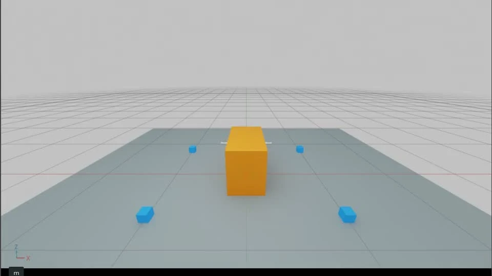
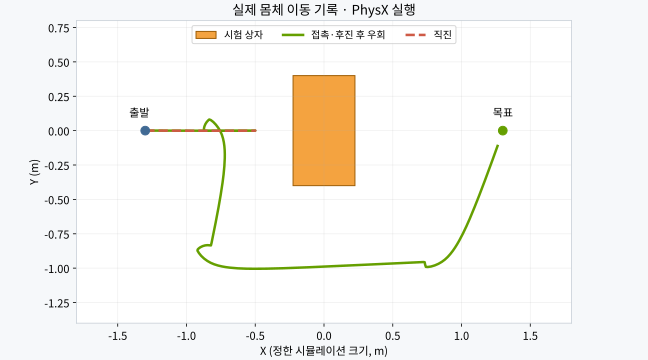
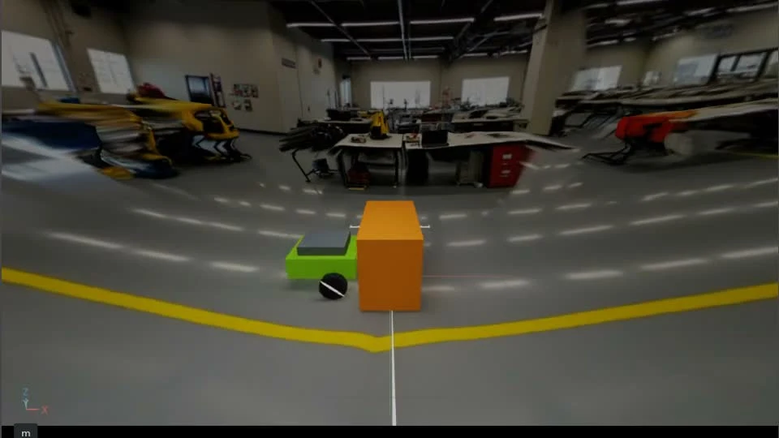

# WorldGen 실험실에서 로봇 움직이기

[English](../../en/labs/worldgen-isaac.md) · [원본 공간 생성 실습](worldgen-scenes.md) · [코드와 장면 파일](../../../labs/worldgen-isaac/)

## 생성한 공간에 로봇을 넣으려면 무엇이 필요할까요?

앞에서 만든 실험실은 RGB와 추정 거리로 표현한 표면입니다. 이번에는 이 표면을 **Isaac Sim 6.2**로 가져와 크기 기준을 정하고, 충돌을 검사한 뒤 이동 로봇을 주행시킵니다. 생성한 메시는 공간의 겉모습을 담당하고, 따로 설정한 충돌체가 접촉을 계산합니다.


### 1. 좌표계와 크기 기준부터 맞춥니다

WorldGen 거리의 최댓값 20은 정규화 값입니다. 실제 20m라는 뜻이 아닙니다. `prepare.py`는 카메라 가까이에서 바닥으로 보이는 점을 골라 평면을 반복해서 맞추고, 0.025 원본 단위보다 많이 벗어난 점을 제외합니다. 구한 위쪽 법선은 WorldGen 좌표에서 약 `[0.00942, -0.99985, -0.01474]`입니다. 이 방향을 Isaac Sim의 +Z 방향에 맞추고, 평면이 Z=0에 오도록 옮깁니다.

그다음 **원본 카메라가 바닥에서 1.5m 높이에 있다고 가정**합니다. 평면까지의 추정 거리가 0.789658 원본 단위이므로, **원본 1단위를 1.899556m로 환산**합니다. 같은 변환을 모든 정점에 적용하고, USD 장면을 `metersPerUnit=1`, Z-up으로 설정합니다. 화면의 1m 막대와 폭 0.55m인 로봇 몸체는 이렇게 정한 시뮬레이션 크기의 기준입니다. 생성된 방의 실제 크기를 알아낸 것은 아닙니다.

```text
원본 점 [x, y, z]
  → 바닥 평면의 기준점을 빼기
  → 추정한 위쪽 방향을 +Z로 회전
  → 1.899556배 확대
  → 미터 기준으로 정한 Isaac Sim 좌표
```

사용한 바닥 점들의 평면 오차는 변환 후 RMS **16.0mm**입니다. 평면에 얼마나 잘 맞는지를 나타내며 실제 형상 정확도는 아닙니다. 변환한 전체 공간은 X 방향으로 약 44m에 걸쳐 있고, 먼 곳의 왜곡은 남아 있습니다. 이번 로봇 예제에서 확인한 범위는 원래 시점 부근에 따로 만든 **5×4m 시험 바닥**입니다.

준비한 배열은 `points: float32[80000,3]`, `indices: int32[158802,3]`, `uv: float32[80000,2]`입니다. `points`는 정한 미터 기준의 위치이고, `indices`의 한 행은 삼각형을 이루는 정점 세 개를 가리킵니다. UV 좌표는 파노라마의 어디에서 색을 가져올지 정합니다.

### 2. 보이는 표면과 부딪히는 표면을 구분합니다

렌더용 메시는 원본 거리 배열을 4픽셀 간격으로 뽑은 **정점 80,000개, 삼각형 158,802개**입니다. 여기에 파노라마 UV 텍스처를 입힙니다. 평면 배경 이미지가 아니라 실제 깊이가 있는 3D 메시이며, 파노라마 이음새에는 작은 틈이 남습니다. 이번 물리 표현에는 Gaussian splat을 직접 사용하지 않습니다.

세 가지 물리 설정을 실제로 비교했습니다.

| 설정 | 낙하하는 큐브를 받치는 것 | 확인할 내용 |
|---|---|---|
| 렌더용 표면만 배치 | 없음 | 바닥이 보여도 충돌체는 따로 필요함 |
| 가져온 메시를 정적 충돌체로 설정 | 굴곡이 있는 추정 표면 | 접촉은 되지만 형상은 여전히 추정값임 |
| 바닥 충돌체를 따로 작성 | 윗면이 Z=0인 평평한 상자 | 같은 조건으로 로봇을 시험할 기준면 |

비교 실험에서는 가져온 메시에 **정적 삼각형 메시 충돌체**를 적용할 수 있습니다. 방 전체를 동적 convex hull 하나로 만들면 내부의 빈 공간을 보존할 수 없습니다. 주행 실험에서는 렌더용 메시의 충돌을 끄고 바닥과 **추가로 만든 주황색 시험 상자**를 사용합니다. 상자는 0.45×0.80×0.60m이며, 생성 이미지에서 자동으로 찾아낸 물체가 아닙니다. 다른 가구의 충돌체는 검증하지 않았습니다. [NVIDIA 충돌체 기초](https://docs.isaacsim.omniverse.nvidia.com/6.2.0/physics/simulation_fundamentals.html)



### 3. 바퀴 명령이 실제 움직임으로 이어집니다

로봇은 USD 강체와 회전 관절로 직접 구성한 간단한 차동구동 AMR입니다. **Jetbot이나 GR00T 정책을 쓴 예제는 아닙니다.** 몸체 질량은 8kg, 구동 바퀴는 각각 0.3kg이며 바퀴 반지름은 0.11m, 두 바퀴 사이 거리는 0.52m입니다. 뒤쪽의 마찰이 작은 받침이 균형을 잡습니다.

```text
현재 몸체 위치·방향 + 다음 경유점
  → 목표 방향과의 차이
  → 전진 속도 v(m/s), 회전 속도 ω(rad/s)
  → 왼쪽·오른쪽 바퀴의 각속도(rad/s)
  → USD 관절 드라이브의 목표 속도(도/s)
  → PhysX가 관절·마찰·충돌 계산
  → 실제 몸체 자세를 읽어 다음 명령 계산
```

직진 명령 `v=0.32m/s`, `ω=0`이면 두 바퀴 모두 약 **2.91rad/s**, 즉 **166.7도/s**를 목표로 회전합니다. 두 바퀴의 속도에 차이를 주면 방향이 바뀝니다. 제어기는 시뮬레이터에서 읽은 자세로 **미리 정한 경유점**을 따라갑니다. 카메라 영상을 보거나, 정책을 학습하거나, 스스로 경로를 찾는 것은 아닙니다. 코드가 몸체를 목표 좌표로 직접 옮기는 대신 시뮬레이터가 바퀴 접촉으로 생기는 움직임을 계산합니다. [NVIDIA 차동구동 설명](https://docs.isaacsim.omniverse.nvidia.com/6.2.0/controllers/tutorial_differential_drive.html)



점선은 직진하다 막힌 실행이고, 초록색은 접촉 후 회복 주행입니다. 선은 실제 몸체 중심의 기록입니다. 중심이 X=-0.50m에 멈추면 0.275m 앞에 있는 몸체 앞면이 상자의 X=-0.225m 면에 닿습니다.

## 장면을 가져와 로봇을 움직여 봅니다

### 1. 머신을 확인하고 준비된 장면을 복사합니다

NVIDIA GPU가 있는 Linux 머신과 Isaac Sim 6.2 컨테이너 실행 환경이 필요합니다. `nvidia-smi`나 Docker GPU 설정이 낯설다면 [NVIDIA Linux 환경 설정](../onboarding/nvidia-linux.md)부터 확인하세요. 아래 명령은 저장소 최상위 폴더에서 입력합니다.

```bash
nvidia-smi
mkdir -p runs/worldgen-isaac
cp -R labs/worldgen-isaac/assets runs/worldgen-isaac/assets
```



[준비된 USD 장면 받기(ZIP)](https://james-joobs.github.io/awesome-nvidia-physical-ai/showcase/worldgen-isaac-scene.zip). Isaac Sim 6.2에서 `combined/scene.usdc`를 열고, 옆에 `assets/` 폴더도 그대로 두세요.

동봉한 장면은 직접 생성한 WorldGen 실험실의 축소 결과입니다. **이 장면을 실행할 때는 FLUX 접근 승인이나 모델 가중치가 필요하지 않습니다.** 직접 생성한 결과에서 다시 만들고 싶다면 별도의 WorldGen Python으로 변환합니다.

```bash
runs/worldgen-runtime/.venv/bin/python labs/worldgen-isaac/prepare.py \
  --source runs/worldgen/robot-lab --output runs/worldgen-isaac/assets \
  --camera-height 1.5 --stride 4
```

`--camera-height`는 크기를 정할 때 쓰는 가정입니다. 기준을 바꾸려면 값을 명확히 정하고 메시를 다시 만드세요. 이미지 확장 실습의 카메라 행렬로 이 방의 실제 크기를 복원하는 것은 아닙니다.

### 2. 주행 전에 바닥부터 확인합니다

[NVIDIA Omniverse 약관](https://docs.omniverse.nvidia.com/isaacsim/latest/common/NVIDIA_Omniverse_License_Agreement.html)에 동의했다면 터미널에서 `ACCEPT_EULA=Y`를 설정합니다. 본인이 약관에 동의했다는 뜻이며 스크립트가 명시적으로 요구합니다. 같은 터미널에서 결과를 저장할 폴더도 지정합니다.

```bash
export ACCEPT_EULA=Y
export WORLDGEN_DATA_ROOT="$PWD/runs/worldgen-isaac"
bash labs/worldgen-isaac/run.sh probes --headless
```

한 변이 10cm인 큐브 네 개의 중심이 Z=0.05m 근처에 멈추면 됩니다. `runs/worldgen-isaac/probes/result.json`에 실제 자세, 장면 단위, 아래쪽으로 쏜 광선의 충돌 결과가 기록됩니다. 나머지 설정도 서로 다른 출력 폴더로 실행해 비교하세요.

```bash
bash labs/worldgen-isaac/run.sh probes --headless --no-floor \
  --output /work/no-floor
bash labs/worldgen-isaac/run.sh probes --headless --no-floor --raw-collider \
  --output /work/raw-mesh
```

`/work`는 컨테이너 안에서 `WORLDGEN_DATA_ROOT`를 가리킵니다. Linux 루트에 직접 만들 폴더가 아닙니다. 충돌체가 없으면 큐브가 보이는 바닥을 통과합니다. 가져온 메시를 정적 충돌체로 쓰면 평평한 바닥 충돌체와 다른 높이에서 기울어져 멈춥니다. 평평한 바닥 충돌체는 이를 비교할 기준이 됩니다.

### 3. 직진과 우회 주행을 비교합니다

```bash
bash labs/worldgen-isaac/run.sh combined
# Separate comparison runs:
bash labs/worldgen-isaac/run.sh blocked
bash labs/worldgen-isaac/run.sh detour
```

대표 영상은 `combined` 실행입니다. 4초 동안 전진 명령을 주고 1.6초 후진한 뒤 경유점 주행으로 바꿉니다. 이 전환 시점은 미리 정했으며 학습한 검출기가 결정하지 않습니다. 실제 멈춤·접촉·회복 동작은 PhysX가 계산합니다. 전체 실행은 약 24.3초의 시뮬레이션 시간 후 목표에 도착했습니다.

각 명령은 실제 Isaac Sim GUI를 열어 실험 하나를 실행하고 결과를 저장한 뒤 종료합니다. `blocked`는 계속 전진 명령을 주지만 충돌 때문에 몸체가 **X=-0.50m 부근**에서 멈춥니다. `detour`는 자세 피드백으로 `[-0.85,0] → [-0.85,-0.95] → [0.85,-0.95] → [1.3,0]`을 따라갑니다. 마지막 목표의 허용 오차는 0.12m입니다. 같은 물리 환경에서 제어 방법을 바꾼 비교이며 AI 정책의 성능 비교는 아닙니다.

`--collision-view`를 붙이면 생성한 렌더용 메시를 숨기고 바닥·상자의 물리 형상을 볼 수 있습니다. 각 결과의 `scene.usdc`에는 **실행 전 장면 구성**이 저장되며 녹화한 궤적은 들어 있지 않습니다. 따로 연 Isaac Sim에서 **File → Open**으로 이 파일을 확인할 수 있습니다. 텍스처를 읽을 수 있도록 형제 폴더인 `assets/`도 함께 두세요. USD만 열고 Play를 누르면 설정된 물체의 물리 시뮬레이션이 실행됩니다. 경유점 제어기는 `run.sh`로 실행해야 작동합니다.

### 4. 실제 GUI 화면을 녹화합니다

X11 데스크톱과 `x11grab`을 지원하는 ffmpeg, `xwininfo`가 필요합니다.

```bash
mkdir -p runs/worldgen-recording
cp -R labs/worldgen-isaac/assets runs/worldgen-recording/assets
python3 labs/worldgen-isaac/record_gui.py \
  --work "$PWD/runs/worldgen-recording" --scenario combined --ffmpeg /path/to/ffmpeg
```

새로 녹화할 때는 새 출력 폴더를 사용하세요. 도우미는 시뮬레이터 준비를 기다린 뒤 실제 창을 녹화하고 제어 루프를 시작합니다. `native-gui.mp4`, 창 정보 `window.txt`, 로그와 물리 궤적을 함께 남깁니다. 공개한 뷰포트 영상은 이 실제 GUI 화면을 잘라 만든 것입니다. 렌더링 속도에 따라 물리 시간보다 실제 재생 시간이 길어질 수 있으므로 두 시간을 구분해서 확인하세요.

6.2 예제는 `SimulationManager.step()`과 `RenderingManager.render()`로 물리 스텝과 화면 그리기를 분리합니다. GPU workstation GUI 구성에는 공식 문서의 프레임별 렌더링 호환 플래그 `--/rtx/hydra/supportMultiTickRate=false`를 적용했습니다. 여러 주기의 카메라·LiDAR 촬영을 검증한 구성은 아닙니다. 처음 셰이더·뷰포트를 준비할 때 1~2분이 걸릴 수 있습니다. 실제 뷰포트 프레임이 저장된 뒤에 녹화를 시작합니다. [NVIDIA multi-tick 설정](https://docs.isaacsim.omniverse.nvidia.com/6.2.0/sensors/isaacsim_sensors_multitick_rendering.html)

공간의 겉모습은 파노라마를 OmniPBR로 표시하고, 구워진 색이 잘 보이도록 발광 표시값을 조정했습니다. 실제 조명이나 반사율을 복원·보정한 재질은 아닙니다. 제어에 기록한 자세 형식은 `[position_xyz, quaternion_xyzw]`이며, 바퀴 속도 명령의 기준점은 몸체 좌표보다 0.10m 앞에 있는 차축 중앙입니다.

## GPU 없이 결과를 검사합니다

```bash
python3 labs/worldgen-isaac/check.py
```

동봉한 크기 설정, 낙하 실험, 충돌 광선, 실제 장애물 접촉, 우회 주행의 도착 위치, 코드와 공개 영상의 해시를 확인합니다. 아래 영상에서 소스와 전체 실행 기록으로 이어갈 수 있습니다. 직접 실행한 새 결과는 다음처럼 검사합니다.

```bash
python3 labs/worldgen-isaac/check.py --run runs/worldgen-isaac/detour
```

장면을 가져왔다고 검증된 디지털 트윈이 완성되는 것은 아닙니다. 이 실습은 **생성한 시각 환경에, 동작을 확인한 국소 물리 구성을 더하는 과정**입니다. 크기는 가정했고, 표면은 추정값이며, 충돌체는 시험 구역에만 설정했습니다. 로봇은 단순한 상태 피드백으로 움직입니다. [WorldGen 생성 실습](worldgen-scenes.md) · [Isaac Sim 원리](../isaac-sim.md) · [영상·입력 출처](../../../site/public/showcase/SPATIAL-CREDITS.md).


[다음 실습: 센서로 장애물을 보고 우회하기](worldgen-navigation.md).
