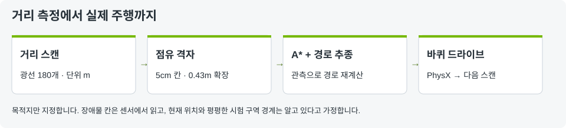
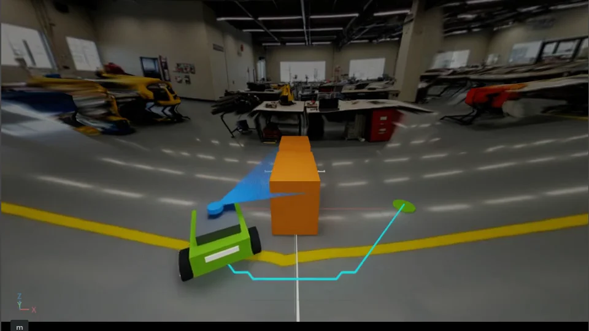
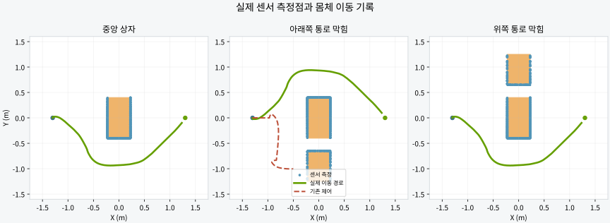

# 센서로 장애물을 보고 우회하기

[English](../../en/labs/worldgen-navigation.md) · [공간 크기·충돌체 실습](worldgen-isaac.md) · [실습 코드](../../../labs/worldgen-navigation/)

## 거리 측정값이 바퀴 명령이 되기까지

앞선 로봇은 우리가 지정한 경유점을 따라갔습니다. 이번에는 **목적지 `[1.3, 0]`만 지정합니다.** Isaac Sim 6.2의 Physics Raycast Sensor로 주변까지의 거리를 읽고, 측정값으로 점유 격자를 만듭니다. 로봇이 들어갈 여유를 확보한 뒤 A*로 경로를 찾아 바퀴를 제어합니다. 실제 움직임과 접촉은 PhysX가 계산합니다.



### 1. 센서에서 어떤 데이터가 나올까요?

센서는 몸체 좌표계에서 0.25m 위, 바닥에서는 약 **0.48m 높이**에 놓았습니다. 수평으로 **360°를 2° 간격으로 나눈 광선 180개**를 쏘며, 최대 측정 거리는 2.5m입니다. 센서는 물리 스텝에 맞춰 측정하고, 제어기는 6스텝마다 한 프레임을 읽습니다. 물리 계산이 초당 60스텝이면 제어에 사용하는 스캔은 **초당 10개**입니다.

Isaac Sim의 `isaacsim.sensors.experimental.physics.RaycastSensor`가 광선별 거리와 충돌 지점을 돌려줍니다. 이상적인 물리 거리 센서이며, 회전형 RTX LiDAR나 카메라를 사용한 예제는 아닙니다. [NVIDIA 센서 설명](https://docs.isaacsim.omniverse.nvidia.com/6.2.0/sensors/isaacsim_sensors_physics_raycast.html)

```text
angles:        float[180]       로봇 수평면에서의 방향, 단위 rad
ranges:        float[180]       광선별 거리, 단위 m
hit_positions: float[180,3]     월드 좌표계에서 측정한 XYZ 지점
pose:          [x, y, yaw]      몸체의 위치와 바라보는 방향
```

로봇이 `[-1.3, 0]` 부근에 있을 때 90번 광선은 정면인 +X 방향을 가리킵니다. 중앙 상자 배치에서 기록한 첫 스캔을 반올림하면 다음과 같습니다.

```json
{
  "ray_index": 90,
  "angle_degrees": 0,
  "range_m": 1.075,
  "hit_position_world": [-0.225, 0.0, 0.48]
}
```

정면 1.075m 앞에 광선과 만나는 표면이 있다는 뜻입니다. 이것만으로 물체의 이름이 ‘상자’라고 알 수는 없습니다. 시험 상자의 앞면이 X=-0.225m에 있어서 이 지점이 측정된 것입니다. 옆 광선들은 앞면의 다른 부분을 읽습니다. 부딪힌 곳이 없으면 최대 거리인 2.5m가 나오며, 이 값은 장애물로 지도에 넣지 않습니다.

[실제로 기록한 광선별 값 보기](../../../labs/worldgen-navigation/evidence/scan-example.json).



### 2. 왜 장애물을 실제보다 크게 표시할까요?

경로 탐색에는 한 칸이 **5cm인 격자**를 씁니다. 측정한 충돌 지점을 장애물 칸으로 표시하고, 그 주변을 **0.43m만큼 넓힙니다**. 바퀴까지 포함한 로봇의 외접 반경 약 0.36m에 추종 오차를 위한 여유를 더한 값입니다. 로봇의 중심이 이 영역 밖으로 지나가야 몸체도 부딪히지 않습니다. 점 하나는 통과할 수 있는 틈이라도 실제 로봇에는 좁을 수 있습니다.

시작할 때 장애물 지도는 비어 있습니다. **평평한 5×4m 시험 바닥의 경계는 알고 있다**고 가정하고, 그 안에서 아직 관측하지 않은 칸은 통행 가능으로 취급합니다. 센서가 읽은 지점을 누적하고 초당 10번 경로를 다시 계산합니다. 정적인 장애물용 예제라 이전 장애물 관측을 지우지는 않습니다. 움직이는 사람이나 상자를 추적하는 기능은 별도입니다.

A*는 주변 칸을 후보로 살펴봅니다. 지금까지 이동할 거리와 목적지까지 남은 거리의 추정치를 함께 비교해 다음 후보를 고릅니다. 이 예제는 주변 8칸을 확인하며, 막힌 모서리를 대각선으로 가로지르는 이동은 제외합니다. 목적지 칸까지 찾으면 앞서 거쳐 온 칸들을 역순으로 연결해 경로를 만듭니다.

```text
S . . # # # . . G
. . . # # # . . .
. . . # # # . . .
. . . . . . . . .
```

이 설명용 격자에서 `S`는 로봇, `G`는 목적지, `#`은 로봇 크기까지 고려해 넓힌 장애물, `.`은 통과 가능한 칸입니다. 막힌 칸을 피해 돌아가야 합니다. 결과는 칸 중심의 XY 좌표를 순서대로 담은 `float[N,2]` 배열입니다. 중앙 상자 실험의 첫 경로는 **53개 지점**이었고, `[[-1.30, 0.00], [-1.25, -0.05], …]`로 시작했습니다. 이 좌표들은 **스캔을 읽은 뒤 계산한 결과**이며, 앞선 제어처럼 실행 전에 입력해 둔 경유점이 아닙니다.

### 3. 계산한 경로가 어떻게 주행으로 이어질까요?

계산한 경로에서 가까운 진행 목표점을 고르고, 로봇이 바라보는 방향과 얼마나 차이가 나는지 구합니다. 그 차이로 전진 속도와 회전 속도를 정해 좌우 바퀴에 전달합니다. 화면의 청록색 선은 **센서 관측으로 그때 계산한 경로**입니다. 파란 선은 실제로 표면에 닿은 광선입니다. 선을 따라 몸체 좌표를 강제로 옮기지는 않습니다.

```text
광선 180개의 거리 + 현재 로봇 위치
  → 장애물 칸 표시 → 로봇 크기만큼 확장 → A* 경로
  → 가까운 진행 목표점 → 전진 속도 v / 회전 속도 ω
  → 좌우 바퀴 속도 → PhysX가 계산한 움직임
  → 다음 센서 프레임 → 경로 재계산
```

최대 전진 속도는 앞선 예제와 같은 0.32m/s입니다. 정면 측정값이 0.46m보다 작으면 전진 명령을 멈추는 보조 조건도 넣었습니다. 센서 데이터가 없거나 오래됐을 때, 통과할 경로를 찾지 못했을 때도 정지합니다. 학습용 정지 조건이며 실제 로봇의 안전 인증 기능을 대신하지 않습니다.

로봇의 현재 위치는 시뮬레이터에서 직접 읽습니다. **SLAM이나 실제 바퀴 오도메트리를 구현한 것은 아닙니다.** WorldGen 공간은 겉모습을 담당하고, 바닥·상자는 따로 설정한 충돌체입니다. 센서 높이보다 낮은 물체, 계단, 생성한 공간의 임의의 가구까지 감지한다고 볼 수는 없습니다.

## 같은 환경에서 두 제어 방식을 실행합니다

### 1. 생성한 실험실 준비하기

[NVIDIA Linux 환경 설정](../onboarding/nvidia-linux.md)과 [WorldGen 공간 가져오기](worldgen-isaac.md)를 먼저 확인하세요. NVIDIA GPU가 있는 호환 Linux 머신의 터미널에서 저장소 루트로 이동한 뒤 입력합니다.

```bash
nvidia-smi
mkdir -p runs/worldgen-navigation
cp -R labs/worldgen-isaac/assets runs/worldgen-navigation/assets
export WORLDGEN_DATA_ROOT="$PWD/runs/worldgen-navigation"
```

준비된 장면을 사용하므로 FLUX 가중치를 받거나 공간을 새로 생성할 필요가 없습니다. [NVIDIA Omniverse 약관](https://docs.omniverse.nvidia.com/isaacsim/latest/common/NVIDIA_Omniverse_License_Agreement.html)에 동의한 뒤, 본인의 동의를 나타내는 환경 변수를 설정합니다.

```bash
export ACCEPT_EULA=Y
bash labs/worldgen-navigation/run.sh sensor --layout center
```

Isaac Sim GUI가 열리고 측정 광선과 계산한 경로가 보입니다. 실행을 마치면 결과를 저장하고 닫힙니다. `runs/worldgen-navigation/sensor/result.json`과 `scans.json`을 확인하세요. `scene.usdc`는 시작 장면이며, 파일을 열고 Play만 눌렀을 때 제어기까지 실행되지는 않습니다. 제어는 Python 실행 스크립트가 담당합니다.

### 2. 기존 경유점 경로를 막아 보기

`lower` 배치는 기존에 지정한 −Y 방향 우회로에 상자를 하나 더 놓습니다. 경유점 목록은 그대로 둡니다. 두 방식은 시작점·목적지·로봇·충돌체·최대 속도가 같습니다. 센서 제어기에 배치 이름이나 상자의 좌표를 전달하지 않습니다.

```bash
bash labs/worldgen-navigation/run.sh scripted --layout lower \
  --output /work/scripted-lower --max-seconds 20
bash labs/worldgen-navigation/run.sh sensor --layout lower \
  --output /work/sensor-lower
bash labs/worldgen-navigation/run.sh sensor --layout upper \
  --output /work/sensor-upper
```

컨테이너의 `/work`는 앞서 지정한 `WORLDGEN_DATA_ROOT`입니다. `upper`는 추가 상자를 반대편에 놓습니다. 관측에 맞춰 계획한다면 우회 방향도 다시 바뀌어야 합니다. 세 가지 통제된 배치의 동작 확인이며, 일반적인 자율주행 성능을 평가한 벤치마크는 아닙니다. 실제 접촉 기록, 몸체 위치, 계산한 경로를 결과 파일에서 비교해 보세요.

### 3. 센서 데이터를 일부러 끊어 보기

```bash
bash labs/worldgen-navigation/run.sh sensor --sensor-off \
  --output /work/sensor-off --max-seconds 3
```

로봇은 움직이지 않아야 합니다. 거리 프레임을 못 받는데도 숨겨진 경로를 따라 주행하지 않는지 확인하는 실험입니다.

### 4. 실제 GUI 녹화하기

X11 데스크톱에서 `xwininfo`와 `x11grab`을 지원하는 ffmpeg를 준비합니다. 녹화할 때는 새 출력 폴더를 사용하세요.

```bash
mkdir -p runs/worldgen-navigation-film
cp -R labs/worldgen-isaac/assets runs/worldgen-navigation-film/assets
python3 labs/worldgen-navigation/record_gui.py \
  --work "$PWD/runs/worldgen-navigation-film" --scenario sensor \
  --layout lower --max-seconds 30 --ffmpeg /path/to/ffmpeg
```

실제 뷰포트 프레임이 준비되면 녹화를 시작하고 로봇을 움직입니다. 원본 창 녹화, 로그, 거리 배열, 주행 기록을 함께 남깁니다. `package.py`로 뷰포트 영상과 비교 영상을 만들 수 있으며, 배속을 바꿨다면 편집 메타데이터에 기록합니다. 시뮬레이션 시간과 실제 녹화 시간도 각각 저장합니다.

## GPU 없이 기록을 검사합니다



중앙·아래·위 배치에서 고정 경로와 센서 제어를 비교하세요. 센서 제어는 열린 쪽으로 우회하고, 측정을 끄면 정지합니다.

[시작 USD 장면 다운로드](https://james-joobs.github.io/awesome-nvidia-physical-ai/showcase/worldgen-navigation-scene.zip). `assets/`와 `sensor/`를 나란히 두고 `sensor/scene.usdc`를 엽니다. 로봇 주행은 Python 제어기로 실행합니다.

```bash
python3 labs/worldgen-navigation/test_navigation.py
python3 labs/worldgen-navigation/check.py
python3 labs/worldgen-navigation/check.py --run runs/worldgen-navigation/sensor-lower
```

앞의 두 명령으로 계획기와 동봉한 예제를 검사하고, 세 번째로 직접 실행한 결과를 확인합니다. [실행 상세](../../../labs/worldgen-navigation/recorded.json) · [영상 출처](../../../site/public/showcase/SPATIAL-CREDITS.md).

**다음 실습: [움직이는 장애물에 대응하고 오래된 관측 지우기](worldgen-dynamic-navigation.md).**
