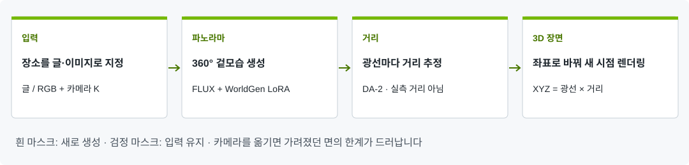
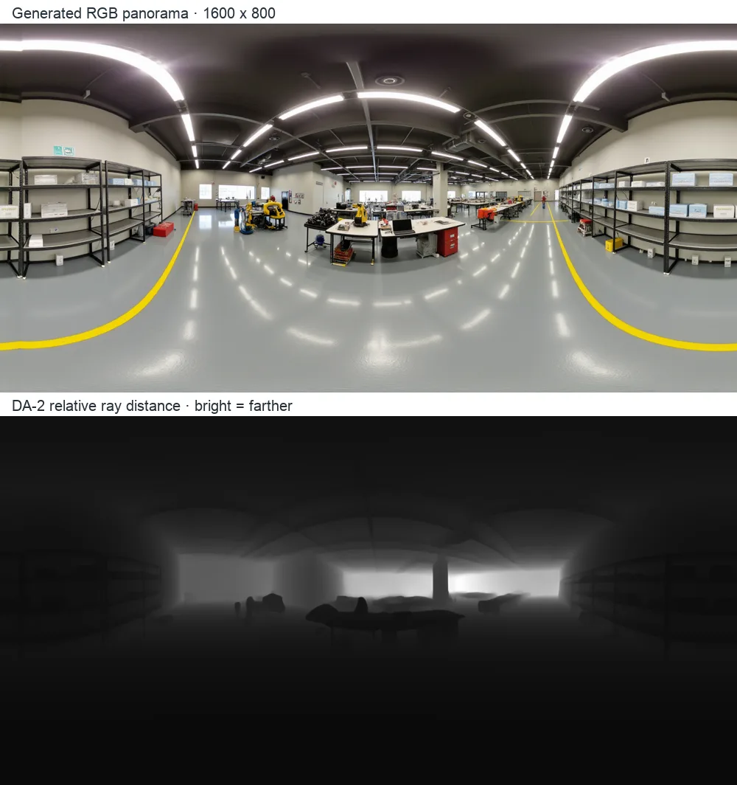
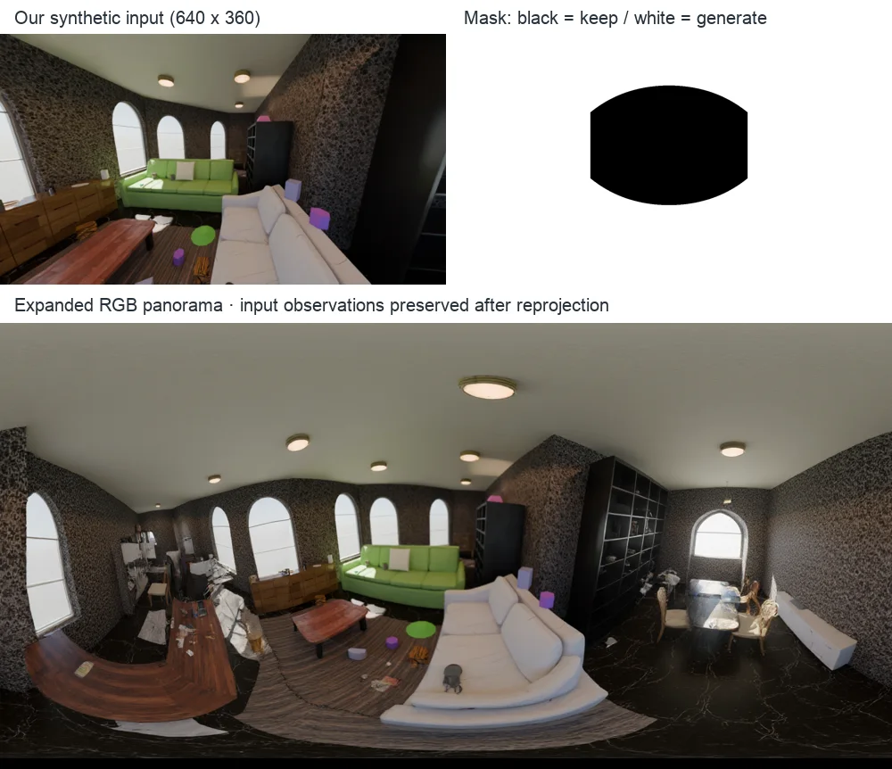

# WorldGen으로 글·이미지에서 3D 공간 만들기

[English](../../en/labs/worldgen-scenes.md) · [코드와 실행 기록](../../../labs/worldgen-scenes/) · [3D 도구 비교](../spatial-worlds.md)

## 글로 묘사한 장소를 어떻게 둘러볼 수 있을까요?

WorldGen은 먼저 **360° 공간의 겉모습을 이미지로 생성**하고, 카메라에서 각 표면까지의 거리를 추정합니다. 이 두 배열을 Gaussian 장면과 색이 있는 메시로 바꾸면, 저장된 3D 데이터 안에서 카메라를 움직여 다른 시점을 그릴 수 있습니다. 이번 실습에서는 글로 로봇 실험실을 만들고, 이미지 한 장에서 주변 거실을 확장합니다. 추가로 생성한 숲길에서는 실외 장면의 차이도 확인할 수 있습니다.



### 1. 겉모습을 만들고, 거리를 추정합니다

텍스트 입력에서는 FLUX.1-dev와 WorldGen의 파노라마 LoRA가 **`[800, 1600, 3]` 형태의 RGB 배열**을 생성합니다. 가로축은 360°, 세로축은 180°를 담습니다. 이 단계의 파노라마는 아직 이미지입니다. 각 표면이 3D 공간의 어디에 있는지는 명시되어 있지 않습니다.

DA-2는 파노라마를 읽고 **거리 배열** `[800, 1600]`을 예측합니다. 각 값은 해당 픽셀의 광선을 따라 카메라에서 표면까지 얼마나 떨어져 있는지를 뜻합니다. Replicator 실습의 카메라 평면 기준 Z 깊이와는 다릅니다. WorldGen은 추정 거리의 최댓값이 **20**이 되도록 맞춥니다. **이 값은 정규화된 추정값이며 실측 미터가 아닙니다.**



거리 미리보기에서 밝은 곳일수록 멀리 예측한 표면입니다. 내보내기 전에 물체의 모양과 경계를 살펴보세요.

### 2. 픽셀마다 Gaussian을 배치합니다

파노라마의 픽셀 위치로부터 단위 방향 벡터 `ray = [x, y, z]`를 구한 뒤, 추정 거리를 곱합니다.

```text
XYZ = 단위 광선 × 추정 거리
RGB 픽셀 → Gaussian의 색
픽셀이 차지하는 각도와 거리 → Gaussian의 크기
광선 주변의 좌표축 → 회전 quaternion [w, x, y, z]
```

카메라 위치는 `[0, 0, 0]`이며 X는 오른쪽, Y는 아래쪽, Z는 앞쪽입니다. 전체 장면은 파노라마 픽셀당 하나씩 **Gaussian 128만 개**로 이루어집니다. 각각 위치·크기·회전·불투명도·색을 가집니다. PLY 파일에는 **크기의 로그값**과 **불투명도의 logit 값**을 저장하므로 읽는 쪽에서 이를 복원해야 합니다. 제공하는 내보내기 코드는 원본의 불투명도 저장 방식을 바로잡고 극점의 0 크기를 제한합니다. 모델을 새로 학습한 것은 아닙니다.

메시는 역투영한 이웃 픽셀을 삼각형으로 연결한 것입니다. 표면을 추정해 만든 껍질에 가깝습니다. 가구마다 따로 모델링했거나 관절이 설정된 장면은 아닙니다.

실제로 생성한 실험실의 픽셀 하나를 보면 아래와 같습니다. 읽기 쉽게 반올림했고 검사 파일에는 원래 정밀도로 남겼습니다. 거의 정면을 향하는 광선이므로 Gaussian은 주로 +Z 방향에 놓입니다. 거리는 WorldGen의 정규화 단위입니다.

```json
{
  "pixel": [
    800,
    400
  ],
  "rgb": [
    179,
    175,
    163
  ],
  "ray": [
    0.001963,
    0.001963,
    0.999996
  ],
  "distance": 7.208282,
  "xyz": [
    0.014154,
    0.014153,
    7.208254
  ]
}
```

### 3. 이미지 입력에서는 무엇을 유지하고 무엇을 만들까요?

이번 입력은 실제 사진이 아니라 **직접 생성한 Infinigen 실내 렌더**입니다. 촬영에 사용한 pinhole 카메라 정보도 함께 저장했습니다.

```json
{
  "resolution": [640, 360],
  "K": [[160, 0, 320], [0, 160, 180], [0, 0, 1]]
}
```

`fx=fy=160`은 시야각에 영향을 주는 초점거리 성분이고, `(cx,cy)=(320,180)`은 주점입니다. 제공하는 보정 코드는 파노라마의 광선을 이 카메라에 투영합니다. **마스크가 검정(`0`)인 곳은 입력 RGB를 유지**하고, **흰색(`255`)인 곳은 새로 생성**하도록 FLUX.1-Fill-dev와 WorldGen 이미지 LoRA에 전달합니다. 생성 후 관측 영역의 픽셀을 다시 합성해 정확히 유지합니다. 여기서 유지되는 대상은 **투영·bilinear 보간을 거친 파노라마 픽셀**입니다. 원본 카메라의 모든 픽셀을 무손실로 보관한다는 뜻은 아닙니다.

이번 실행에서는 파노라마 픽셀의 **16.30%**를 입력 이미지에서 가져오고 나머지 **83.70%**를 생성했습니다. 유지 영역의 저장된 RGB 오차는 0입니다.



이 보정은 원본의 일반 이미지→파노라마 매핑 부분을 대체합니다. FLUX 파노라마 생성, DA-2, WorldGen의 3D 변환은 원본 구현을 사용합니다. 새로 채운 영역은 모델의 창작입니다. RGB를 유지해도 DA-2가 원래 물체의 형상을 정확히 추정한다는 보장은 없습니다.

## 설치부터 새 장면 생성까지 따라 하기

### 1. 별도 Linux 환경을 준비합니다

이 저장소의 최상위 폴더에서 시작합니다. NVIDIA 드라이버가 설치된 GPU 머신과 Git, [uv](https://docs.astral.sh/uv/getting-started/installation/)가 필요합니다. 먼저 터미널에 `nvidia-smi`를 입력해 GPU 이름이 오류 없이 나오는지 확인하세요. 이번 실행 환경은 **RTX 5090 32GB, 시스템 메모리 30GiB**입니다. 환경·모델·결과 파일을 위해 **디스크 약 100GB**를 확보하세요. 아래 FP4 구성은 Linux x86_64와 이 Blackwell 환경에서 실행했습니다. 다른 아키텍처에서는 맞는 Nunchaku 빌드가 필요합니다.

```bash
bash labs/worldgen-scenes/setup.sh runs/worldgen-runtime
runs/worldgen-runtime/.venv/bin/hf auth login
```

첫 줄은 Python 3.11, PyTorch 2.7/cu128, Nunchaku 0.2와 고정된 WorldGen·DA-2 소스를 별도 폴더에 설치합니다. Isaac Sim의 Python에 설치하지 않습니다. 두 번째 줄은 Hugging Face 로그인을 로컬에 저장합니다. 토큰을 스크립트에 적거나 커밋하지 마세요. 모델을 받기 전에 같은 계정으로 **[FLUX.1-dev](https://huggingface.co/black-forest-labs/FLUX.1-dev)와 [FLUX.1-Fill-dev](https://huggingface.co/black-forest-labs/FLUX.1-Fill-dev) 두 모델 모두** 이용 조건·접근 승인을 마쳐야 합니다.

메모리 사용량을 줄이기 위해 Nunchaku FP4와 CPU offload를 사용합니다. RTX 5090에서 실행되지 않는 구형 xFormers 커널 대신 DA-2에 포함된 PyTorch SDPA 경로를 선택했습니다. PyTorch3D는 **네이티브 확장 없이** 설치합니다. 이 실습에서는 순수 PyTorch로 구현된 quaternion 변환만 사용하며, PyTorch3D 네이티브 래스터라이저는 사용할 수 없습니다. 소스와 모델의 고정 버전은 [model-pins.json](../../../labs/worldgen-scenes/model-pins.json)에 있습니다.

### 2. 글로 장소를 생성합니다

아래 블록 전체를 저장소 최상위 폴더의 터미널에 붙여 넣으세요. 줄 끝의 `\`는 다음 줄까지 하나의 명령이라는 뜻입니다. 마지막 JSON 메시지가 나올 때까지 기다립니다.

```bash
runs/worldgen-runtime/.venv/bin/python labs/worldgen-scenes/generate.py \
  --output runs/worldgen/robot-lab --seed 42 \
  --prompt "A spacious realistic robotics laboratory with collaborative robot arms on workbenches, yellow safety markings on a polished concrete floor, metal storage racks, large windows, natural daylight, no people, a coherent modern industrial interior"
```

처음에는 고정 버전의 모델을 내려받습니다. 다음 실행부터는 캐시를 재사용합니다. `panorama.png`가 먼저 생긴 뒤 `distance.npy`, `scene.ply`, `scene-mesh.ply`, `scene-mesh.glb`, `result.json`이 저장됩니다. 이미지가 나왔다고 3D 변환까지 성공한 것은 아닙니다. 마지막 결과 파일도 확인하세요. 이 머신에서 로봇 실험실 생성에 걸린 시간은 **캐시 다운로드 이후 모델 로딩을 포함해 약 44초**였습니다. 한 번의 실행 기록이며 하드웨어 성능 비교 수치는 아닙니다.

### 3. 이미지 주변을 확장합니다

실행에 사용한 입력 이미지와 카메라 정보를 저장소에 넣었습니다. 카메라 파일의 해상도는 이미지와 같아야 합니다. 다른 사진에는 그 카메라에 맞는 내부 파라미터가 필요합니다. 아래 값을 그대로 재사용하지 마세요.

```bash
runs/worldgen-runtime/.venv/bin/python labs/worldgen-scenes/generate.py \
  --output runs/worldgen/livingroom \
  --image labs/worldgen-scenes/evidence/input.png \
  --intrinsics labs/worldgen-scenes/evidence/input-camera.json \
  --prompt "A coherent spacious living room continuing the input image, matching the pale walls, wooden furniture, indoor materials and natural window light, realistic interior, no people"
```

결과를 평가하기 전에 `generation-mask.png`와 `conditioning.png`를 열어보세요. 입력에서 가져온 부분과 모델이 채운 부분을 구분할 수 있습니다. 실외 예제도 해보고 싶다면 이미지 인자를 빼고, [recorded.json](../../../labs/worldgen-scenes/recorded.json)의 숲길 프롬프트와 시드 `17`을 사용하세요.

### 4. 카메라 위치를 옮겨 렌더링합니다

렌더링에는 **호환되는 별도 [fVDB Reality Capture 환경](spatial-reconstruction.md)**을 사용합니다. WorldGen의 Torch 2.7 환경에 추가하지 마세요. 아래 경로는 그 별도 Python을 가리키는 예시입니다. 먼저 이 환경에서 `fvdb_reality_capture`를 import할 수 있어야 하고 ffmpeg도 필요합니다.

```bash
runs/fvdb-runtime/bin/python labs/worldgen-scenes/render.py \
  --scene runs/worldgen/robot-lab/scene.ply \
  --output runs/worldgen/robot-lab/render --ffmpeg ffmpeg
```

20초 MP4와 카메라 행렬 `cameras.json`을 저장합니다. 원래 시점 근처에서 카메라를 회전·이동하며, 실험실·거실·숲을 인터랙티브 미리보기로도 비교할 수 있습니다.

## 데이터 검사와 결과의 한계 확인하기

GPU 없이도 영상을 보고 동봉한 실행 기록을 검사할 수 있습니다.

```bash
python3 labs/worldgen-scenes/check.py
```

공개 영상·모델의 해시, 압축 장면의 헤더, 입력 이미지의 생성 마스크, 카메라의 실제 이동, 광선과 좌표의 수치 예시를 확인합니다. **직접 생성한 새 결과**는 생성 환경의 Python으로 CPU 검사를 실행하세요.

```bash
runs/worldgen-runtime/.venv/bin/python labs/worldgen-scenes/audit.py \
  --folder runs/worldgen/robot-lab
```

실제 거리 배열과 PLY를 열어 양수·유한값인지, 회전이 정규화되어 있는지, `XYZ = 광선 × 거리`가 맞는지 확인하고 `geometry-audit.json`을 저장합니다. 이미지 경로에서는 관측한 파노라마 픽셀을 그대로 유지했는지도 확인합니다. 프롬프트나 패키지 버전을 바꾸면 결과가 달라질 수 있습니다. 파일 이름만 보고 판단하지 말고 데이터 검사도 함께 하세요.

숲에서는 얇은 잎과 가려졌던 면 주변에 빈틈이 더 많이 보입니다. 로봇 시뮬레이션으로 연결할 때 필요한 크기·충돌체 검사는 다음 실습에서 다룹니다.

**출처:** [WorldGen](https://github.com/ZiYang-xie/WorldGen), [DA-2](https://huggingface.co/haodongli/DA-2), [FLUX 모델 사용 조건](https://huggingface.co/black-forest-labs/FLUX.1-dev). WorldGen·DA-2는 Apache-2.0이며 FLUX 가중치에는 별도 비상업적 사용 조건이 있습니다. [영상·입력 출처](../../../site/public/showcase/SPATIAL-CREDITS.md).


**다음 실습: [이 실험실을 Isaac Sim으로 가져와 크기·충돌체를 확인하고 로봇을 움직여 보세요](worldgen-isaac.md).**
