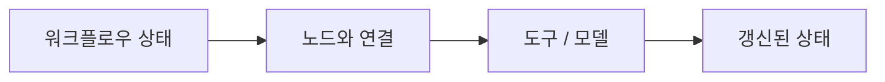

# LangGraph

[← 전체 목록](../../README.ko.md) · [English](../en/langgraph.md) · [공식 소스](https://github.com/langchain-ai/langgraph) · [공식 문서 / 관련 프로젝트](https://docs.langchain.com/oss/python/langgraph/overview)

상태를 가진 에이전트 워크플로우를 구성하는 오케스트레이션 프레임워크입니다.

**공개 및 이용 조건:** 사용 버전의 저장소 라이선스를 확인하세요. 호스팅 서비스, 연동 도구와 모델은 별도 조건이 적용됩니다.

## 구성과 활용 흐름

*이 안내서의 개념도이며, 지원 구현은 공식 자료를 확인하세요.*

그래프 상태와 노드를 정의하고 전환을 연결한 뒤 실행 결과를 확인하거나 지원되는 실행을 재개합니다.

## 활용 사례

비디오 처리 단계나 도구를 선택하고 결과를 검토하는 에이전트를 조율할 수 있습니다.

## 연계 기술

모델과 데이터 처리 호출을 조율할 수 있지만 비전 모델을 자체 제공하는 것은 아닙니다.

## 공식 자료

- [프로젝트 자료](https://github.com/langchain-ai/langgraph)
- [공식 문서 / 관련 프로젝트](https://docs.langchain.com/oss/python/langgraph/overview)
