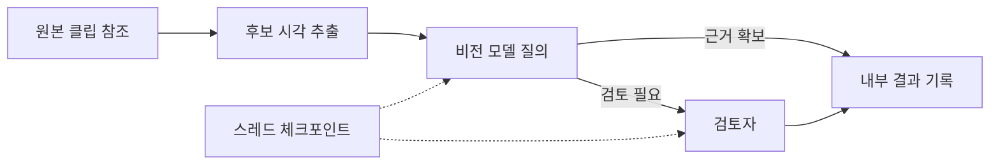

# LangGraph

[← 전체 목록](../../README.ko.md) · [English](../en/langgraph.md)

LangGraph는 앞 단계의 결과로 다음 단계를 고르는 상태 기반 워크플로를 실행합니다. 물리 AI에서는 오프라인 영상·데이터셋 도구를 호출하고 검토를 분기하는 데 사용할 수 있습니다.

## 어떻게 동작하나

그래프에는 상태 스키마, 상태 변경을 반환하는 노드, 연결 또는 경로 함수가 있습니다. 리듀서가 병렬 업데이트를 합칩니다. 체크포인터는 실행 단계의 상태를 스레드 ID별로 기록해 지원되는 실행을 재개할 수 있게 합니다. 도구가 외부 산출물을 쓰는 경우 재실행에 대비해 중복 처리를 막아야 합니다.

*아래 공식 자료에 근거해 재구성한 그림입니다.*

## 실전 워크플로

클립 검토 그래프를 구성합니다. 한 노드가 후보 시각을 찾고, 다른 노드가 모델 요약을 요청하며, 조건 분기가 저신뢰도 클립을 검토로 보냅니다. 상태에 원본 클립 ID와 모델 버전을 기록해 결과 생성 경로를 추적합니다.

## 검증할 항목

내용을 아는 클립으로 분기와 복구를 시험합니다. 작업마다 일관되고 별개의 스레드 ID를 사용하고 실패 노드를 재개할 때 외부 작업이 반복되지 않는지 확인합니다.

## 공개 범위와 라이선스

사용 버전의 저장소 라이선스를 확인하세요. 호스팅 서비스, 연동 도구와 모델은 별도 조건이 적용됩니다.

## 공식 자료

- [공식 기술 자료](https://docs.langchain.com/oss/python/langgraph/persistence)
- [그래프 API](https://docs.langchain.com/oss/python/langgraph/graph-api)
- [관련 공식 자료 · github.com](https://github.com/langchain-ai/langgraph)
- [관련 공식 자료 · docs.langchain.com](https://docs.langchain.com/oss/python/langgraph/overview)
