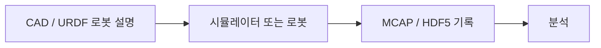

# MCAP / HDF5 / URDF / CAD

[← 전체 목록](../../README.ko.md) · [English](../en/mcap-hdf5-urdf-cad.md) · [공식 소스](https://mcap.dev/) · [공식 문서 / 관련 프로젝트](https://docs.ros.org/en/rolling/Tutorials/Intermediate/URDF/URDF-Main.html)

로봇·공학에서 쓰이는 MCAP 로그, HDF5 구조화 데이터, URDF 로봇 설명, CAD 설계 에셋을 함께 설명합니다.

**공개 및 이용 조건:** 형식·개념과 구현체는 별개입니다. 각 라이브러리, 파일, 에셋, 변환 도구와 데이터셋의 조건을 확인하세요.

## 구성과 활용 흐름

*이 안내서의 개념도이며, 지원 구현은 공식 자료를 확인하세요.*

기하와 로봇 설명을 준비해 호환 소프트웨어를 구성하고 동기화된 데이터를 기록한 뒤 분석용으로 확인하거나 변환합니다. 형식 간 변환은 자동이 아닙니다.

## 활용 사례

센서 스트림 기록, 학습 배열 저장, 시뮬레이터에 로봇 모델을 불러오는 데 활용할 수 있습니다.

## 연계 기술

ROS 2 도구는 MCAP과 URDF를 활용할 수 있으며 HDF5는 구조화 데이터를 저장합니다. CAD 파일은 시뮬레이션 전에 별도 변환이 필요할 수 있습니다.

## 공식 자료

- [프로젝트 자료](https://mcap.dev/)
- [공식 문서 / 관련 프로젝트](https://docs.ros.org/en/rolling/Tutorials/Intermediate/URDF/URDF-Main.html)
- [MCAP](https://mcap.dev/)
- [HDF5](https://www.hdfgroup.org/solutions/hdf5/)
- [URDF](https://docs.ros.org/en/rolling/Tutorials/Intermediate/URDF/URDF-Main.html)
