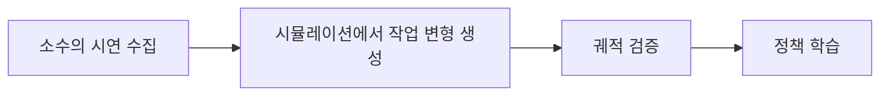

# MimicGen

[← 전체 목록](../../README.ko.md) · [English](../en/mimicgen.md)

이미지: 아래 공식 프로젝트 출처.

## 소개

시연으로 다양한 로봇 행동 데이터 생성.

## 개념적 워크플로

## 활용 흐름과 사례

소수의 시연 수집 → 시뮬레이션에서 작업 변형 생성 → 궤적 검증 → 정책 학습. 개념적인 흐름이며 버전별 사전 요구사항과 지원 구성은 공식 문서를 확인한다.

**활용 사례:** 조작 학습을 위한 물체 위치 변형. 지원 입력과 모델 버전은 공식 출처에서 확인한다.

**연결 기술:** Isaac Lab, AutoData.

## 구성과 실제 활용

MimicGen은 하위 작업 종료 신호로 원본 데이터셋을 분할하고, 원본 구간을 선택해 경유점을 변환·조합하여 새 궤적을 만듭니다. 공식 시작 예제에서는 square 작업 데이터셋을 생성하고 성공·실패 궤적을 분리해 기록합니다. 학습 전에 성공 통계를 검토하세요.

[공식 문서](https://github.com/NVlabs/mimicgen/blob/main/docs/tutorials/getting_started.md)

## 공개 및 이용 조건

소스 공개; NVIDIA Source Code License 조건을 확인해야 하며 오픈소스로 단정하지 않음. 사용 전 해당 버전과 모델·데이터·바이너리·의존성의 조건을 각각 확인한다.

## 공식 출처

[저장소](https://github.com/NVlabs/mimicgen)
