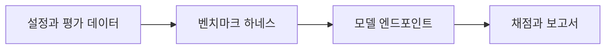

# NeMo Evaluator

[← 전체 목록](../../README.ko.md) · [English](../en/nemo-evaluator.md)

모델 엔드포인트를 대상으로 재현 가능한 모델·에이전트 평가.

## 아키텍처와 데이터 흐름

런처가 모델 엔드포인트, 벤치마크, 채점과 출력 설정을 적용합니다. 평가 하네스가 요청을 실행하고 비교·보고용 결과를 저장합니다. 기본 텍스트·에이전트 벤치마크는 활용 예제이며 물리 AI 데이터에 맞는 평가 하네스를 선택하거나 연결해야 합니다.

아래 공식 자료를 바탕으로 정리한 개념도입니다.

## 물리 AI 활용 예시

예상 사고 유형과 근거 참조가 있는 비식별화 테스트 세트에서 두 검사 보고 모델을 평가합니다. 엔드포인트 모델 ID와 채점 설정을 결과와 함께 저장합니다. 생성 영상 품질은 Cosmos Evaluator로 별도 평가합니다.

## 검증할 항목

벤치마크가 다루는 범위와 채점 신뢰도를 확인합니다. 센서 영상의 정확도는 해당 데이터셋에서 직접 평가합니다.

## 공개 범위와 라이선스

저장소 코드는 Apache-2.0입니다. 모델 가중치, 외부 서비스와 의존성에는 별도 조건이 적용될 수 있습니다.

## 공식 자료

- [저장소](https://github.com/NVIDIA-NeMo/Evaluator)
- [저장소 라이선스](https://github.com/NVIDIA-NeMo/Evaluator/blob/HEAD/LICENSE)

## 관련 가이드

[Cosmos Evaluator](cosmos-evaluator.md) · [NeMo Helix](nemo-helix.md)
