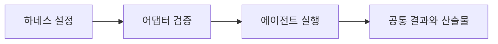

# NeMo Fabric

[← 전체 목록](../../README.ko.md) · [English](../en/nemo-fabric.md)

지원 에이전트 하네스의 어댑터 기반 실행.

## 아키텍처와 데이터 흐름

애플리케이션이 하네스, 모델, 도구와 자원을 정의합니다. Fabric 어댑터가 구성을 검증해 선택한 실행 환경에 매핑합니다. 어댑터가 지원하는 범위에서 결과, 오류와 산출물 참조가 공통 형태로 반환됩니다.

아래 공식 자료를 바탕으로 정리한 개념도입니다.

## 물리 AI 활용 예시

같은 오프라인 로봇 영상 분류 과제를 두 지원 하네스에서 실행합니다. 모델과 도구 규약을 고정하고 근거 참조와 작업 완료 동작을 비교합니다. 내부 호출을 비교할 때는 트레이스 통합을 사용합니다.

## 검증할 항목

필요한 도구 설정과 계측을 어댑터 지원 표에서 확인합니다. 버전을 기록하고 하네스별 제공 동작을 확인합니다.

## 공개 범위와 라이선스

저장소 코드는 Apache-2.0입니다. 모델 가중치, 외부 서비스와 의존성에는 별도 조건이 적용될 수 있습니다.

## 공식 자료

- [저장소](https://github.com/NVIDIA/NeMo-Fabric)
- [Fabric 설치와 어댑터](https://docs.nvidia.com/nemo/fabric/latest/getting-started/install)
- [Agent Toolkit 전환 안내](https://docs.nvidia.com/nemo/agent-toolkit/1.9/resources/migration-guide.html)
- [저장소 라이선스](https://github.com/NVIDIA/NeMo-Fabric/blob/HEAD/LICENSE)

## 관련 가이드

[NeMo Agent Toolkit](nemo-agent-toolkit.md) · [NeMo Helix](nemo-helix.md) · [NeMo Relay](nemo-relay.md)
