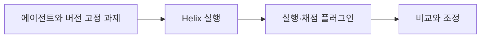

# NeMo Helix

[← 전체 목록](../../README.ko.md) · [English](../en/nemo-helix.md)

에이전트 평가·최적화·보안 테스트를 위한 제어 계층.

## 아키텍처와 데이터 흐름

Helix는 CLI, REST API와 Python SDK를 통해 에이전트 개선 워크플로를 반복 실행할 수 있게 합니다. 플러그인이 에이전트 실행, 격리 환경, 저장소 등 인프라를 연결합니다. 평가에서 작업 결과를 모아 프롬프트나 설정 변경의 근거로 사용합니다.

아래 공식 자료를 바탕으로 정리한 개념도입니다.

## 물리 AI 활용 예시

작업 셀 사고 검토 과제를 고정해 변경한 보고 워크플로와 기준 구성을 비교합니다. 이벤트 ID와 근거 인용의 완전성을 채점합니다. 잘못된 형식의 도구 응답은 정상 사례와 별도로 시험합니다.

## 검증할 항목

하네스, 프롬프트, 채점기와 테스트 데이터를 버전 관리합니다. 릴리스별 지원 플러그인과 에이전트 조합을 확인합니다. 정책·레드팀 결과는 에이전트 애플리케이션의 평가로 기록합니다.

## 공개 범위와 라이선스

저장소 코드는 Apache-2.0입니다. 모델 가중치, 외부 서비스와 의존성에는 별도 조건이 적용될 수 있습니다.

## 공식 자료

- [저장소](https://github.com/NVIDIA-NeMo/nemo-helix)
- [Agent Toolkit 전환 안내](https://docs.nvidia.com/nemo/agent-toolkit/1.9/resources/migration-guide.html)
- [저장소 라이선스](https://github.com/NVIDIA-NeMo/nemo-helix/blob/HEAD/LICENSE)

## 관련 가이드

[NeMo Evaluator](nemo-evaluator.md) · [NeMo Agent Toolkit](nemo-agent-toolkit.md) · [NeMo Fabric](nemo-fabric.md)
