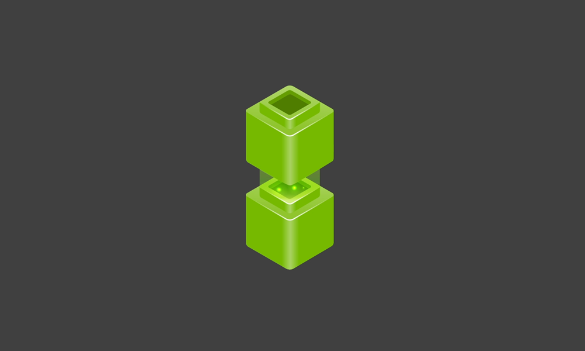

# NVIDIA NeMo Platform

[← 전체 목록](../../README.ko.md) · [English](../en/nemo-platform.md)

   
  <a href="https://developer.nvidia.com/blog/announcing-nemo-fast-development-of-speech-and-language-models/">NVIDIA NeMo 공식 공개 이미지</a>

모델 맞춤 학습·평가·가드레일·추론 인프라.

이전 마이크로서비스 릴리스에서 맞춤 학습, 평가, 저장소와 추론이 어떻게 이어지는지 보여 줍니다. [공식 그림 출처](https://docs.nvidia.com/nemo/microservices/25.4.0/about/index.html)

## 아키텍처와 데이터 흐름

NeMo Platform은 데이터 준비, 모델 적응·평가와 추론 게이트웨이를 통한 서빙 서비스를 제공합니다. 이전 NeMo Microservices 문서에는 Kubernetes의 Customizer, Evaluator, Guardrails와 저장 서비스 구성이 설명되어 있습니다. 실제 릴리스에 맞춰 구성 요소를 확인하고 공개 라이브러리와 서비스 배포물을 구분합니다.

## 물리 AI 활용 예시

산업 보고서 에이전트에서 검토된 예제를 모아 지원 모델을 맞춤 학습합니다. 고정된 사고 평가 세트에서 검증한 후 시험용 엔드포인트에서 이전·신규 경로를 비교합니다. 운영 결과에는 근거와 모델 버전을 함께 기록합니다.

## 검증할 항목

플랫폼의 배포와 접근 조건을 목록의 Apache 라이브러리와 별도로 확인합니다. 배포에서 지원하는 모델과 런타임을 확인합니다.

## 공개 범위와 라이선스

NVIDIA 플랫폼 또는 서비스입니다. 제품, 배포와 모델별 조건을 확인합니다.

## 공식 자료

- [공식 문서](https://docs.nvidia.com/nemo/microservices/latest/about/core-concepts/platform.html)
- [버전별 마이크로서비스 아키텍처](https://docs.nvidia.com/nemo/microservices/25.4.0/about/index.html)

## 관련 가이드

[NeMo Guardrails](nemo-guardrails.md) · [NeMo Evaluator](nemo-evaluator.md) · [NVIDIA NIM](nvidia-nim.md)
