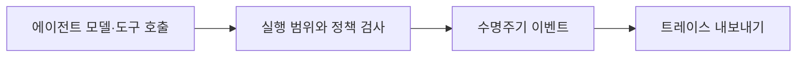

# NeMo Relay

[← 전체 목록](../../README.ko.md) · [English](../en/nemo-relay.md)

에이전트 모델·도구 호출 추적, 미들웨어와 정책 관리.

## 아키텍처와 데이터 흐름

Relay는 지원 하네스나 SDK 호출을 계측합니다. 실행 범위와 수명주기 이벤트를 통해 도구·모델 활동을 한 실행 단위로 기록합니다. 플러그인으로 미들웨어 정책을 적용하고 관측 도구로 트레이스를 내보낼 수 있습니다. Switchyard에는 Relay 라우팅 플러그인이 문서화되어 있습니다.

아래 공식 자료를 바탕으로 정리한 개념도입니다.

## 물리 AI 활용 예시

영상 사고 분석 에이전트를 클립 검색부터 보고서 생성까지 추적합니다. 기준 사례에서 도구 재시도, 근거 조회와 모델 실행 시간을 비교합니다. 민감 데이터를 가린 트레이스를 내보내 재현에 활용합니다.

## 검증할 항목

하네스 통합과 이벤트 범위를 확인합니다. 실행 ID를 보존하고 트레이스에 민감 프레임이나 자격 증명이 포함되지 않도록 합니다. Relay와 라우팅 플러그인 버전 호환성을 확인합니다.

## 공개 범위와 라이선스

저장소 코드는 Apache-2.0입니다. 모델 가중치, 외부 서비스와 의존성에는 별도 조건이 적용될 수 있습니다.

## 공식 자료

- [저장소](https://github.com/NVIDIA/NeMo-Relay)
- [Relay 문서](https://docs.nvidia.com/nemo/relay/latest/getting-started/about)
- [Agent Toolkit 전환 안내](https://docs.nvidia.com/nemo/agent-toolkit/1.9/resources/migration-guide.html)
- [저장소 라이선스](https://github.com/NVIDIA/NeMo-Relay/blob/HEAD/LICENSE)

## 관련 가이드

[NeMo Switchyard](nemo-switchyard.md) · [NeMo Agent Toolkit](nemo-agent-toolkit.md) · [NeMo Fabric](nemo-fabric.md)
