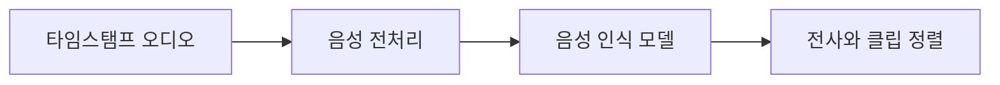

# NeMo Speech

[← 전체 목록](../../README.ko.md) · [English](../en/nemo-speech.md)

음성 인식·합성 등 음성 모델 학습과 추론.

## 아키텍처와 데이터 흐름

기존 NeMo 저장소는 현재 음성에 초점을 둡니다. 오디오 전처리와 음성 모델을 통해 작업에 따라 전사나 합성 음성을 생성합니다. 체크포인트와 설정이 언어, 스트리밍 동작과 오디오 요구 사항을 결정합니다.

아래 공식 자료를 바탕으로 정리한 개념도입니다.

## 물리 AI 활용 예시

1인칭 영상에서 작업자 설명을 전사해 클립 목록의 시각과 맞춥니다. 발화 타임스탬프와 라벨 불확실성을 보존합니다. 음성 인터페이스에서는 명령 인식과 로봇 행동 승인 검증을 분리합니다.

## 검증할 항목

실제 소음과 마이크 조건에서 단어 또는 명령 오류율을 측정합니다. 스트리밍 지연과 언어 지원, 체크포인트 별도 조건을 확인합니다.

## 공개 범위와 라이선스

저장소 코드는 Apache-2.0입니다. 모델 가중치, 외부 서비스와 의존성에는 별도 조건이 적용될 수 있습니다.

## 공식 자료

- [저장소](https://github.com/NVIDIA/NeMo)
- [NeMo 프레임워크 저장소별 역할](https://github.com/NVIDIA-NeMo)
- [저장소 라이선스](https://github.com/NVIDIA/NeMo/blob/HEAD/LICENSE)

## 관련 가이드

[NeMo Curator](nemo-curator.md) · [Isaac Capture](isaac-capture.md)
