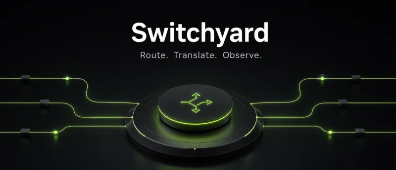

# NeMo Switchyard

[← 프로젝트 홈](../../README.ko.md) · [English](../en/nemo-switchyard.md)

   
  <a href="https://github.com/NVIDIA-NeMo/Switchyard/blob/88fe33e323d48bedc82b4c55920b6764548411fd/assets/logo.png">NeMo Switchyard 공식 로고 배너</a>

NeMo Switchyard는 LLM 에이전트나 앱이 보낸 요청을 조건에 맞는 모델로 보내는 라우팅 라이브러리입니다. 예를 들어 문서 분류와 보고서 작성을 서로 다른 모델에 맡길 수 있습니다.

공식 구성도는 라우팅 라이브러리가 모델을 고르고 앱이나 게이트웨이가 해당 모델을 호출하는 구조를 보여 줍니다. [공식 그림 출처](https://github.com/NVIDIA-NeMo/Switchyard)

## 아키텍처와 데이터 흐름

Switchyard는 애플리케이션의 작업 로직과 모델 선택을 분리합니다. 호스트는 요청, 사용 가능한 모델 목록과 라우팅 전략을 라이브러리에 전달합니다. 작업 기반 라우팅은 모델에 요청 분류를 맡길 수 있고 단계 기반 라우팅은 최근 도구 사용을 참고합니다. 호스트는 라우팅 결과에 따라 모델 API를 호출합니다. 게이트웨이 통합에서는 OpenAI·Anthropic 요청, 응답과 스트림 형식을 변환할 수 있습니다.

### 영상 분석 뒤에 오는 요청은 어디로 갈까요?

설비 영상에서 이벤트를 찾아 보고서를 만든다고 가정해 봅니다. 분석 서비스가 00:12에 이벤트를 감지했다고 알려주면, 앱은 그 관찰을 텍스트 요약 요청으로 바꿀 수 있습니다. Switchyard는 호스트가 전달한 요청과 사용 가능한 모델, 선택 규칙을 바탕으로 호출할 모델을 정하는 데 쓰입니다. 앱은 선택한 엔드포인트의 텍스트 출력으로 보고서를 만듭니다. 원본 클립 ID, 선택된 모델명, 응답 시간, 보고서 완성 여부를 함께 기록하면 어느 단계에서 문제가 생겼는지 확인할 수 있습니다. [Switchyard 공식 프로젝트](https://github.com/NVIDIA-NeMo/Switchyard)

## 피지컬 AI 활용 예시

설비 검사 보조 에이전트에서 이미지·영상 분석은 VSS처럼 영상 입력을 처리하는 서비스에 맡깁니다. 후속 텍스트 요약과 보고서 작성 요청을 모델 풀에 라우팅합니다. 동일 클립과 프롬프트로 고정 모델과 라우팅 구성의 결과를 비교합니다.

## 검증할 항목

보고서가 성공적으로 완성된 건을 기준으로 비용과 지연을 측정합니다. 도구 호출, 스트리밍, 모델 API 오류와 지원 입력을 함께 검증합니다. 독립 서버는 데모 및 로컬 평가용입니다. 배포 시 사용할 게이트웨이 통합과 버전을 확인합니다.

## 공개 범위와 라이선스

저장소 코드는 Apache-2.0입니다. 모델 가중치, 외부 서비스와 의존성에는 별도 조건이 적용될 수 있습니다.

## 공식 자료

- [저장소](https://github.com/NVIDIA-NeMo/Switchyard)
- [아키텍처](https://nvidia-nemo.github.io/Switchyard/architecture/)
- [Relay 통합](https://github.com/NVIDIA-NeMo/Switchyard/blob/main/docs/integrations/nemo_relay.md)
- [저장소 라이선스](https://github.com/NVIDIA-NeMo/Switchyard/blob/HEAD/LICENSE)

## 관련 가이드

[NeMo Relay](nemo-relay.md) · [Metropolis / VSS](metropolis-vss.md)
