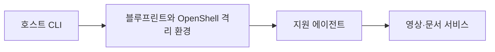

# NemoClaw

[← 전체 목록](../../README.ko.md) · [English](../en/nemoclaw.md)

지원 에이전트를 실행하는 OpenShell 기반 참조 스택.

## 아키텍처와 데이터 흐름

호스트 CLI가 에이전트 설정과 수명주기를 관리하고 블루프린트가 에이전트 통합 및 OpenShell 격리 환경을 구성합니다. 추론, 네트워크 정책, 지속 상태는 별도 구성 요소입니다. NVIDIA의 VSS·RAG 사례는 영상 근거와 조직 문서 문맥을 에이전트 작업에 결합합니다.

아래 공식 자료를 바탕으로 정리한 개념도입니다.

## 물리 AI 활용 예시

에이전트가 시각이 포함된 클립 요약과 정비 절차를 읽고 근거를 결합해 사고 보고서 초안을 작성하도록 구성합니다. 티켓 연동 전에 읽기 전용 예제로 네트워크 허용 범위를 시험합니다.

## 검증할 항목

에이전트 호환성, 격리 정책, 네트워크 목적지와 추론 제공자 접근을 확인합니다. 근거 인용과 애플리케이션 권한은 격리 환경 구성과 별도로 검증합니다.

## 공개 범위와 라이선스

저장소 코드는 Apache-2.0입니다. 모델 가중치, 외부 서비스와 의존성에는 별도 조건이 적용될 수 있습니다.

## 공식 자료

- [저장소](https://github.com/NVIDIA/NemoClaw)
- [NemoClaw 아키텍처](https://docs.nvidia.com/nemoclaw/latest/user-guide/openclaw/about/how-it-works)
- [VSS와 RAG 공식 사례](https://developer.nvidia.com/blog/?p=120054)
- [OpenShell 소스](https://github.com/NVIDIA/OpenShell)
- [저장소 라이선스](https://github.com/NVIDIA/NemoClaw/blob/HEAD/LICENSE)

## 관련 가이드

[Metropolis / VSS](metropolis-vss.md) · [NeMo Retriever Library](nemo-retriever.md)
