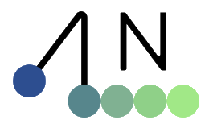
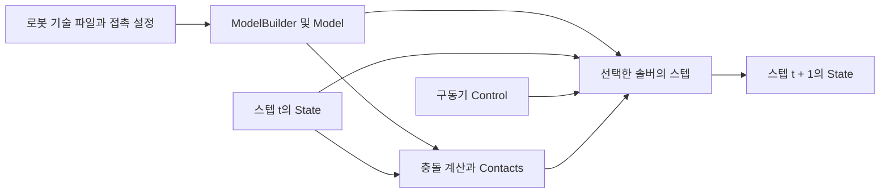

# Newton

[← 전체 목록](../../README.ko.md) · [English](../en/newton.md)

  <picture>
    <source media="(prefers-color-scheme: dark)" srcset="../../assets/project-marks/newton-dark.png">
    
  </picture> 
  <a href="https://github.com/newton-physics/newton/blob/0ced8f8420d4ee1eab9ecfaee59e1354ef670348/docs/conf.py#L301-L304">Newton 공식 문서 로고</a>

Newton은 Warp 위에서 동작하는 로봇용 물리 엔진이다. 선택한 솔버로 수치화된 세계 상태를 한 스텝씩 진행한다. 로봇 학습에서 관측·행동·보상·에피소드 리셋은 환경 쪽에서 정의한다.

## Newton 1.8

**Newton 1.8.0**은 접촉이 많은 강화학습 환경의 관절 강체를 위한 실험적 Steel 솔버, XPBD·VBD의 경로 지정 텐던, 변형체 접촉 및 렌더링 개선을 추가합니다. VBD 기본값과 불러온 관절의 감쇠 동작도 바뀌었으므로, 튜닝한 장면을 옮길 때 접촉과 궤적을 다시 비교합니다. [Newton 1.8.0 릴리스 및 마이그레이션 안내](https://github.com/newton-physics/newton/releases/tag/v1.8.0)

Isaac Lab 3.0과 Isaac Sim 6.2의 대상 버전은 Newton 1.6.1입니다. 시뮬레이터나 학습 환경에서 작업을 실행할 때는 해당 환경이 지정한 의존성 버전을 사용합니다. [Isaac Lab 3.0 릴리스](https://github.com/isaac-sim/IsaacLab/releases/tag/v3.0.0) · [Isaac Sim 6.2 릴리스 노트](https://docs.isaacsim.omniverse.nvidia.com/6.2.0/overview/release_notes.html)

## 아키텍처

| 구성 요소 | 역할과 데이터 경계 |
|---|---|
| `ModelBuilder` → `Model` | 빌더에서 강체·관절·충돌 형상·접촉 매개변수를 정의하고 토폴로지와 모델 배열을 대상 장치에 생성한다. |
| `State` / `Control` | State에는 위치·속도처럼 바뀌는 값이 들어가고 Control은 관절 목표나 구동력 같은 입력을 담는다. 이 구조로 동일 토폴로지를 여러 스텝에서 재사용한다. |
| `Contacts` / `SolverBase.step` | Newton이 생성한 접촉을 소비하는 솔버는 접촉 버퍼로 충돌 데이터를 받는다. SolverMuJoCo, Featherstone, XPBD의 지원 기능과 접촉 계산 방식은 각각 다르다. |
| Warp 실행 계층 | 장치 배열과 커널이 계산을 수행한다. 정책은 상위 시뮬레이션·학습 프레임워크가 전달하는 상태 일부를 관측으로 사용한다. |

아래 공식 자료를 바탕으로 이 가이드에서 재구성한 그림입니다.

### 공식 그림과 예시

NVIDIA 공식 아키텍처는 Warp와 OpenUSD 위에 Newton이 놓이고 솔버와 시뮬레이션 도구로 연결되는 구조를 보여 준다. [그림 출처와 원문 설명](https://developer.nvidia.com/blog/newton-adds-contact-rich-manipulation-and-locomotion-capabilities-for-industrial-robotics/)

Newton 공식 URDF 예제의 관절 모델. 작업 스크립트를 붙이기 전 불러온 모델의 방향과 관절 움직임을 살펴볼 수 있다. [그림 출처와 원문 설명](https://github.com/newton-physics/newton/blob/main/newton/examples/basic/example_basic_urdf.py)

## 워크플로 예시

1. 공식 URDF 예제로 로봇 자세와 충돌 형상을 확인한다. 솔버를 고르기 전에 관절 구동 방식, 바닥과 물체의 물성, 적분 시간 간격을 설정한다.
2. 파지 실험에서는 Control로 손가락 목표를 넣는다. Newton 접촉을 사용하는 솔버라면 접촉을 계산하고 결과 State에 반영한다. 하위 물리 스텝마다 반복하고 조건별 물체 움직임을 비교한다.
3. 관절 궤적, 접촉, 물체 자세를 기록해 정책 관측이나 분석에 쓴다. 독립 실행에서 물리가 예상대로 동작한 뒤 같은 모델을 Isaac Lab에 연결한다.

## 검증 포인트

- 솔버 기능표에서 관절체·변형체·접촉 방식 지원을 확인한다. 접촉 매개변수 해석은 솔버별로 다를 수 있다.
- 고정된 초기 조건에서 시간 간격을 줄여 관통 깊이, 정지 안정성, 구동력을 비교한 뒤 학습 궤적을 수집한다.

## 라이선스와 범위

Newton 저장소는 Apache-2.0을 사용합니다. 의존성과 로봇 에셋에는 별도 조건이 적용됩니다. [Newton 1.8 라이선스 원문](https://github.com/newton-physics/newton/blob/v1.8.0/LICENSE.md)

## 관련 가이드

[Warp](nvidia-warp.md) · [Isaac Lab](isaac-lab.md) · [MuJoCo Warp](mujoco-warp.md)

## 공식 자료

- [Newton 저장소와 예제](https://github.com/newton-physics/newton)
- [솔버 지원 범위와 스텝 인터페이스](https://newton-physics.github.io/newton/latest/solvers/index.html)
- [ModelBuilder API](https://newton-physics.github.io/newton/latest/api/_generated/newton.ModelBuilder.html)
- [Isaac Lab의 Newton 백엔드](https://docs.nvidia.com/isaaclab/concepts/newton)
