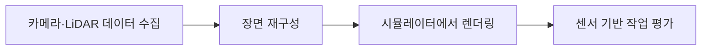

# NuRec

[← 전체 목록](../../README.ko.md) · [English](../en/nurec.md)

## 소개

실제 환경의 신경 재구성·렌더링 기술.

## 개념적 워크플로

## 활용 흐름과 사례

카메라·LiDAR 데이터 수집 → 장면 재구성 → 시뮬레이터에서 렌더링 → 센서 기반 작업 평가. 개념적인 흐름이며 버전별 사전 요구사항과 지원 구성은 공식 문서를 확인한다.

**활용 사례:** 재구성한 도로 장면 재현. 지원 입력과 모델 버전은 공식 출처에서 확인한다.

**연결 기술:** OpenUSD, Isaac Sim, AlpaSim.

## 구성과 구체적인 활용

NuRec은 카메라 또는 라이다 촬영을 메타데이터가 포함된 USD 장면으로 재구성하고 Gaussian splatting으로 렌더링한다. 시뮬레이터는 일반적으로 gRPC로 렌더링 서비스에 연결한다.

실제 도로 장면을 재구성하고 AlpaSim에서 센서 시점을 렌더링해 주행 정책을 시험한다.

[공식 기술 자료](https://developer.nvidia.com/omniverse/nurec)

## 공개 및 이용 조건

제품·기술; 전체 소스 및 라이선스 범위 미확인. 사용 전 해당 버전과 모델·데이터·바이너리·의존성의 조건을 각각 확인한다.

## 공식 출처

[공식 안내](https://developer.nvidia.com/omniverse/nurec)
