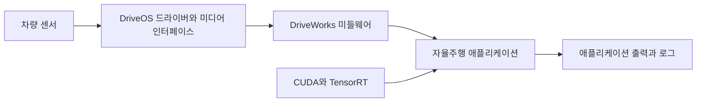

# NVIDIA DRIVE

[← 전체 목록](../../README.ko.md) · [English](../en/nvidia-drive.md)

DRIVE는 차량용 컴퓨팅과 소프트웨어를 아우릅니다. DRIVE AGX는 대상 컴퓨팅 플랫폼이고 DriveOS는 운영체제·런타임을, DriveWorks는 차량용 미들웨어와 개발 모듈을 제공합니다.

## 어떻게 동작하나

센서 데이터는 플랫폼 드라이버와 미디어 인터페이스로 들어옵니다. DriveWorks는 센서 스트림과 가속 애플리케이션 구성 요소를 연결하는 데 쓰입니다. CUDA와 TensorRT가 계산·추론을 담당하고 애플리케이션에서 인식·계획·제어를 수행합니다. 개발 키트에서 대상에 가까운 컴퓨팅 환경으로 소프트웨어를 통합하고 시험할 수 있습니다.

## 실전 워크플로

대상 DRIVE AGX 개발 키트에서 참조 앱으로 기록된 카메라 또는 센서 데이터를 재생합니다. 개발 로그와 시간 처리 및 추론 결과를 비교하고, 데이터가 끊길 때 마감 시간 초과와 복구 동작을 확인합니다.

## 검증할 항목

DRIVE 플랫폼과 SDK 버전, 접근 조건, 지원 센서를 확인합니다. 차량 시험 전에 시간 제약, 장애 처리와 대상 하드웨어를 검증합니다. DriveOS 개발 가이드에 버전별 소프트웨어 스택 그림이 있습니다.

## 공개 범위와 라이선스

제품·플랫폼; 구성 요소별 이용 조건 확인. 사용 전 해당 버전과 모델·데이터·바이너리·의존성의 조건을 각각 확인한다.

## 공식 자료

- [아키텍처와 워크플로 공식 문서](https://developer.nvidia.com/drive/faq)
- [DriveOS 6.0.7 Linux SDK 가이드와 스택 그림](https://developer.nvidia.com/docs/drive/drive-os/6.0.7/public/drive-os-linux-sdk/drive_os_v5l_sdk_dev_guide.pdf)
- [관련 공식 자료 · developer.nvidia.com](https://developer.nvidia.com/DRIVE)
- [관련 공식 자료 · developer.nvidia.com](https://developer.nvidia.com/drive)
