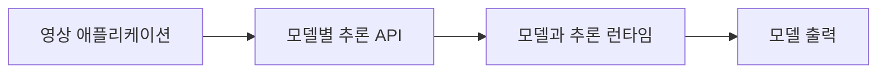

# NVIDIA NIM

[← 전체 목록](../../README.ko.md) · [English](../en/nvidia-nim.md)

에이전트와 파이프라인에서 호출하는 모델별 추론 서비스.

## 아키텍처와 데이터 흐름

NIM은 지원 모델과 추론 소프트웨어를 API와 함께 제공합니다. 입출력은 모델별로 다릅니다. 물리 장면 추론 모델은 지원 이미지나 영상을 받고, 임베딩·재정렬 엔드포인트는 검색용 벡터 또는 점수를 생성합니다. 오케스트레이션 계층이 엔드포인트를 호출하고 결과를 기록합니다.

아래 공식 자료를 바탕으로 정리한 개념도입니다.

## 물리 AI 활용 예시

지원 Cosmos Reasoner를 호출해 설비 검사 클립을 분석합니다. 보고 에이전트에 결과를 넘기기 전에 모델 ID, 영상 샘플링 설정과 추론 결과를 기록합니다. 로컬과 호스팅 엔드포인트 간 이동 시 입력 제한을 비교합니다.

## 검증할 항목

모델별 모달리티, 서빙 프로파일, 하드웨어와 엔드포인트 조건을 확인합니다. NIM 배포와 모델 권리는 클라이언트 라이브러리의 라이선스와 별도입니다.

## 공개 범위와 라이선스

NVIDIA 플랫폼 또는 서비스입니다. 제품, 배포와 모델별 조건을 확인합니다.

## 공식 자료

- [공식 문서](https://docs.nvidia.com/nim/)
- [Cosmos 3 Nano Reasoner 시스템 카드](https://build.nvidia.com/nvidia/cosmos3-nano-reasoner/systemcard)

## 관련 가이드

[Cosmos Framework](cosmos-framework.md) · [Metropolis / VSS](metropolis-vss.md) · [NVIDIA NeMo Platform](nemo-platform.md)
