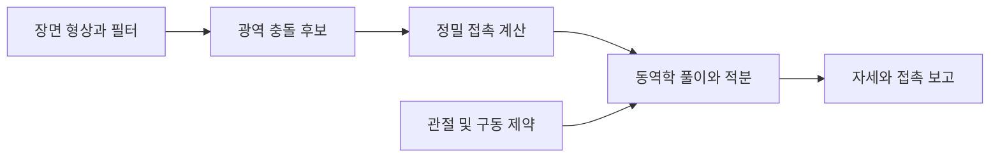

# NVIDIA PhysX

[← 전체 목록](../../README.ko.md) · [English](../en/nvidia-physx.md)

PhysX는 충돌 형상·강체·관절 기구의 물리 시뮬레이션과 장면 질의를 제공한다. Isaac Sim에서 USD에 작성한 물리 설정은 백엔드가 관리하는 물리 객체로 변환된다.

## 아키텍처

| 구성 요소 | 역할과 데이터 경계 |
|---|---|
| `PxScene`과 액터 | 장면은 정적·동적 액터, 형상, 재질, 필터, 솔버 설정을 묶는다. 넓은 단계의 충돌 탐지에서 후보 쌍을 찾고 좁은 단계에서 접촉을 계산한다. |
| 제약과 관절체 | 접촉과 관절이 강체 운동을 제한한다. 축소 좌표 관절체는 연결된 링크를 관절 좌표로 모델링하고 로봇 제어에 필요한 구동기를 제공한다. |
| GPU 동역학과 광역 충돌 탐지 | 장면에서 GPU 강체 동역학과 GPU 광역 충돌 탐지를 각각 켤 수 있다. 지원 형상과 동작은 버전에 따라 달라진다. |
| `simulate` / `fetchResults` | 시뮬레이션이 액터 상태를 진행하고 결과와 콜백을 애플리케이션에 전달한다. 레이캐스트 등의 기하 질의는 별도의 인터페이스로 장면을 읽는다. |

아래 공식 자료를 바탕으로 이 가이드에서 재구성한 그림입니다.

### 공식 그림과 예시

PhysX 관절체 가이드의 예시. 관절로 이어진 링크 트리로 표현할 수 있는 기구들을 보여 준다. [그림 출처와 원문 설명](https://nvidia-omniverse.github.io/PhysX/physx/5.4.0/docs/Articulations.html)

자유물체도는 관절체 링크에서 보고하는 유입 관절력의 방향과 의미를 해석하는 데 도움이 된다. [그림 출처와 원문 설명](https://nvidia-omniverse.github.io/PhysX/physx/5.4.0/docs/Articulations.html)

## 워크플로 예시

1. 두 손가락 그리퍼 관절체를 만들고 정적 테이블 위에 강체 작업물을 배치한다. 링크 질량·관성, 콜라이더, 구동기 제한과 마찰 재질을 정의한다.
2. 고정 시간 간격과 관절 위치 목표로 장면을 진행한다. 그리퍼를 닫고 들어 올리는 동안 작업물 자세와 접촉 보고를 기록한다.
3. 마찰과 콜라이더 근사 형상을 각각 바꿔 어떤 설정이 파지 실패에 더 큰 영향을 주는지 확인한다.

## 검증 포인트

- 단순한 콜라이더로 시작해 무게중심, 관절 축, 구동 단위를 확인한다. 시각 메시가 맞아도 물리 표현에는 오류가 있을 수 있다.
- 다수 환경이나 접촉이 많은 작업으로 확장하기 전에 SDK 버전의 GPU 버퍼 제한과 충돌 지원 표를 확인한다.

## 라이선스와 범위

PhysX SDK 코드는 BSD-3-Clause다. 상위 애플리케이션과 추가 구성 요소의 조건은 별도다.

## 관련 가이드

[Isaac Sim](isaac-sim.md) · [Isaac Lab](isaac-lab.md) · [Newton](newton.md)

## 공식 자료

- [PhysX 소스 저장소](https://github.com/NVIDIA-Omniverse/PhysX)
- [축소 좌표 관절체 및 구동기](https://nvidia-omniverse.github.io/PhysX/physx/5.4.0/docs/Articulations.html)
- [GPU 장면 설정](https://nvidia-omniverse.github.io/PhysX/physx/5.4.0/docs/GPURigidBodies.html)
- [시뮬레이션 제어와 결과](https://nvidia-omniverse.github.io/PhysX/physx/5.4.0/docs/Simulation.html)
