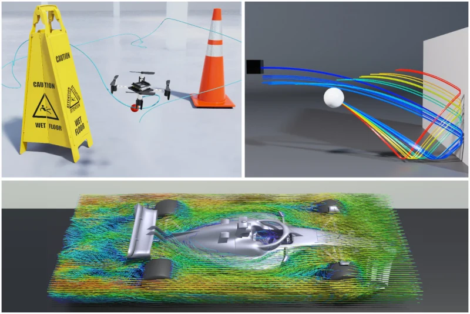
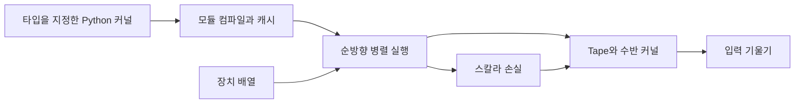

# NVIDIA Warp

[← 프로젝트 홈](../../README.ko.md) · [English](../en/nvidia-warp.md)

   
  <a href="https://github.com/NVIDIA/warp/blob/416577971d0c39e8ea2fbe6d0894229b749125cd/README.md">NVIDIA Warp 공식 저장소의 대표 시뮬레이션 이미지</a>

Warp는 Python으로 작성한 수치 계산 커널을 CPU 또는 CUDA GPU에서 병렬 실행할 코드로 컴파일합니다. 배열, 기하 연산과 자동 미분을 제공해 시뮬레이션 프로젝트가 필요한 계산을 직접 구현할 수 있게 합니다.

## Python 코드가 어떻게 GPU에서 입자를 한꺼번에 움직일까요?

### Python에서 커널을 실행하기

Python은 데이터 배열과 함수를 준비하고, Warp의 **커널**이 각 입자의 계산을 병렬로 실행합니다. 입자 DEM 예제는 공간 격자에서 이웃을 찾고 접촉 힘을 계산해 위치와 속도를 갱신합니다. 화면에 보낼 좌표와 검사용 통계를 계산하는 좌표는 목적이 다릅니다.

### 전체 배열과 표시용 표본 읽기

[저장된 GPU 실행](../../labs/warp-particles/recorded.json)은 입자 `65536`개를 계산하고 `16384`개를 화면에 표시했습니다. 전체 위치 배열을 읽으면 `[65536, 3]`이며, 뷰어는 `points[::4]`로 네 개 중 하나를 선택합니다. 따라서 표시 개수를 줄여도 계산한 입자 수는 65,536개입니다. [Warp DEM 공식 코드](https://github.com/NVIDIA/warp/blob/main/warp/examples/core/example_dem.py) · [입자 실습](labs/warp-particles.md)

## Warp 1.19

**Warp 1.19.0**은 희소 행렬 조립 구조 재사용, 새 희소 전처리기, Surface Nets 메시 추출과 실험적 텍스처 샘플링 미분을 추가합니다. 유한요소 해석에서 희소 구조는 그대로 두고 계수만 반복해 갱신할 때 조립 구조를 재사용할 수 있습니다. Isaac Lab 3.0과 Isaac Sim 6.2의 대상 버전은 Warp 1.17.0입니다. [Warp 1.19.0 릴리스](https://github.com/NVIDIA/warp/releases/tag/v1.19.0) · [Isaac Lab 3.0 릴리스](https://github.com/isaac-sim/IsaacLab/releases/tag/v3.0.0) · [Isaac Sim 6.2 릴리스 노트](https://docs.isaacsim.omniverse.nvidia.com/6.2.0/overview/release_notes.html)

## 아키텍처

| 구성 요소 | 역할과 주고받는 데이터 |
|---|---|
| `@wp.kernel` / `wp.launch` | 커널에 논리 스레드 한 개가 수행할 작업을 정의합니다. 실행 호출에서 반복 차원과 타입이 지정된 배열 및 매개변수를 전달합니다. |
| 컴파일 및 캐시 | Warp가 Python 모듈의 커널과 함수를 대상 장치의 네이티브 코드로 변환합니다. 모듈 캐시로 같은 컴파일을 반복하는 비용을 줄입니다. |
| `wp.array`와 상호 운용 | 호스트 코드에서 배열을 만들고 배치 장치를 선택합니다. Warp/PyTorch 연결은 호환 메모리를 공유할 수 있어 프레임워크 사이에 버퍼를 넘길 때 장치와 동기화가 중요합니다. |
| `wp.Tape` | Tape가 미분 가능한 커널 호출과 배열 참조를 기록합니다. 역방향 커널은 필요한 순방향 값을 읽어 기울기 버퍼에 누적합니다. |

아래 공식 자료를 바탕으로 이 가이드에서 재구성한 그림입니다.

### 공식 그림과 예시

Warp 공식 컴파일 흐름. 커널 선언을 장치 코드로 변환하며 Python 애플리케이션에서 배열 할당과 실행을 제어합니다. [그림 출처와 원문 설명](https://nvidia.github.io/warp/latest/user_guide/programming_model.html)

공식 Tape 그림은 순방향 커널 실행과 기울기를 전달하는 역방향 실행을 구분해 보여 줍니다. [그림 출처와 원문 설명](https://nvidia.github.io/warp/latest/user_guide/differentiability.html)

## 워크플로 예시

1. 스프링 상수 추정에 필요한 초기 위치, 속도, 강성 배열을 만듭니다. 상태를 진행하는 커널과 예측한 종점을 관측 종점과 비교하는 커널을 작성합니다.
2. wp.Tape 안에서 커널을 실행하고 역전파에 필요한 상태를 보존합니다. 손실에 대해 backward를 호출하고 강성 기울기를 최적화기에 전달합니다.
3. 첫 사용 컴파일을 포함하는 준비 실행 후 정상 실행 시간을 잽니다. 실행 순서가 반복된다면 데이터 흐름과 장치 배치를 확정한 뒤 그래프 캡처·재생을 검토합니다.

## 검증할 항목

- Tape는 배열 참조를 기록합니다. 반복 커널이 역전파에 필요한 값을 덮어쓰면 스텝별 상태를 분리하거나 체크포인팅으로 보존합니다.
- 작은 문제에서 미분 결과를 유한차분과 비교한 뒤 롤아웃 길이를 늘리거나 GPU 그래프를 적용합니다.

## 공개 범위와 라이선스

Warp는 Apache-2.0을 사용합니다. 런타임과 GPU 요구사항은 릴리스에 따라 달라집니다. [Warp 1.19 라이선스 원문](https://github.com/NVIDIA/warp/blob/v1.19.0/LICENSE.md)

## 관련 가이드

[Newton](newton.md) · [MuJoCo Warp](mujoco-warp.md)

## 공식 자료

- [Warp 소스와 예제](https://github.com/NVIDIA/warp)
- [프로그래밍 모델과 컴파일러](https://nvidia.github.io/warp/latest/user_guide/programming_model.html)
- [자동 미분과 배열 수명](https://nvidia.github.io/warp/latest/user_guide/differentiability.html)
