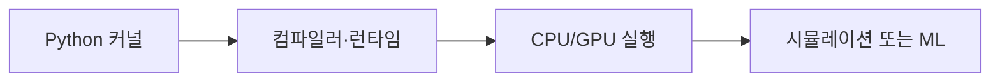

# NVIDIA Warp

[← 전체 목록](../../README.ko.md) · [English](../en/nvidia-warp.md) · [공식 소스](https://github.com/NVIDIA/warp) · [공식 문서](https://nvidia.github.io/warp/stable/user_guide/faq.html)

시뮬레이션·기하·로봇·머신러닝에 필요한 고성능 커널을 Python으로 작성해 CPU와 NVIDIA GPU에서 실행하는 프레임워크입니다.

**라이선스:** Apache-2.0. 사용 전에 해당 버전과 에셋·모델·의존성의 조건을 확인하세요.

*이미지 출처: [공식 프로젝트 저장소](https://github.com/NVIDIA/warp). 저작자 표시 및 재사용 조건은 원본을 확인하세요.*

## 구성과 아키텍처

지원되는 Python 커널 코드를 네이티브 CPU 또는 CUDA 코드로 컴파일합니다. 기하 연산과 지원되는 연산의 자동 미분 기능을 제공하며, 그 자체가 완성형 물리 엔진은 아닙니다.

*이 안내서에서 만든 개념적 흐름도입니다. 실제 구현은 공식 문서를 확인하세요.*

## 활용 흐름

Python으로 타입이 지정된 커널을 정의하고 대상 장치에서 컴파일·실행합니다. 배열이나 기하 데이터를 처리한 결과를 시뮬레이션 또는 학습 흐름에 연결합니다.

## 활용 사례

유체·기하 알고리즘 제작, 시뮬레이션 구성 요소 가속, 미분 가능한 계산 실험에 활용할 수 있습니다.

## 연계 기술

Newton과 MuJoCo Warp의 계산 기반으로 활용됩니다. PyTorch 등과 함께 더 큰 파이프라인을 구성할 수 있습니다.

## 공식 자료

- [프로젝트 저장소](https://github.com/NVIDIA/warp)
- [공식 문서](https://nvidia.github.io/warp/stable/user_guide/faq.html)
