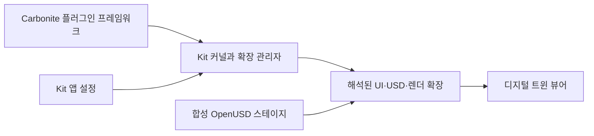

# NVIDIA Omniverse

[← 전체 목록](../../README.ko.md) · [English](../en/omniverse.md)

Omniverse는 OpenUSD 애플리케이션 제작 도구를 제공한다. Omniverse Kit는 확장 기능을 조합한 앱을 실행하며, 선언한 의존성에 따라 UI·장면 도구·렌더링 등의 기능을 제공한다.

## 아키텍처

| 구성 요소 | 역할과 데이터 경계 |
|---|---|
| Carbonite와 Kit 커널 | Carbonite 프레임워크는 기본 플러그인 인프라를 제공한다. Kit 커널이 앱을 시작하고 확장 관리와 기초 인터페이스를 제공한다. |
| 앱 설정과 확장 | Kit 앱은 설정에서 확장과 옵션을 선택한다. 확장이 다른 기능에 대한 의존성을 선언하고 Kit가 그래프를 해석해 시작한다. |
| USD 장면과 활용 기능 | 앱 확장이 USD 스테이지를 작성하거나 검사하고 합성 장면을 시각화나 도메인 기능에 전달한다. 스테이지와 확장 설정은 서로 다른 입력이다. |

아래 공식 자료를 바탕으로 이 가이드에서 재구성한 그림입니다.

### 공식 그림과 예시

NVIDIA Kit 기반 USD Viewer 예제. 앱에서 합성 스테이지를 연 화면이다. [그림 출처와 원문 설명](https://docs.omniverse.nvidia.com/xr/omniverse-spatial-docs/latest/server/02-build-and-launch.html)

## 워크플로 예시

1. USD를 표시하는 Kit 앱 템플릿에서 시작한다. 공장 레이아웃 뷰어에 필요한 기능을 켜고 장비 간격을 확인하거나 장면 메타데이터를 읽는 확장을 추가한다.
2. OpenUSD 스테이지에서 장비 에셋을 참조하고 앱으로 연다. 재사용 에셋 데이터와 앱 전용 UI·제어를 분리한다.
3. 깨끗한 환경에서 같은 설정으로 빌드하고 실행한다. 확장 해석 로그를 확인하고 에셋·재질이 로드되는지 검증한다.

## 검증 포인트

- 앱과 확장 버전을 함께 고정한다. USD 에셋이 열리는지와 확장 의존성이 해석되는지는 별도로 확인한다.
- 전체 UI를 실행하지 않고 합성을 검증할 수 있도록 디지털 트윈 데이터와 인터페이스 코드를 분리한다.

## 라이선스와 범위

Omniverse는 플랫폼과 SDK 계열이다. 선택한 Kit 런타임, 확장, 서비스 이용 조건을 각각 확인한다.

## 관련 가이드

[OpenUSD](openusd.md) · [Isaac Sim](isaac-sim.md) · [SimReady](simready.md)

## 공식 자료

- [Omniverse 플랫폼](https://developer.nvidia.com/omniverse)
- [Kit 커널과 확장 아키텍처](https://docs.omniverse.nvidia.com/kit/docs/kit-manual/latest/guide/kit_architecture.html)
- [OpenUSD 앱 빌드](https://docs.omniverse.nvidia.com/composer/latest/how-to-build.html)
