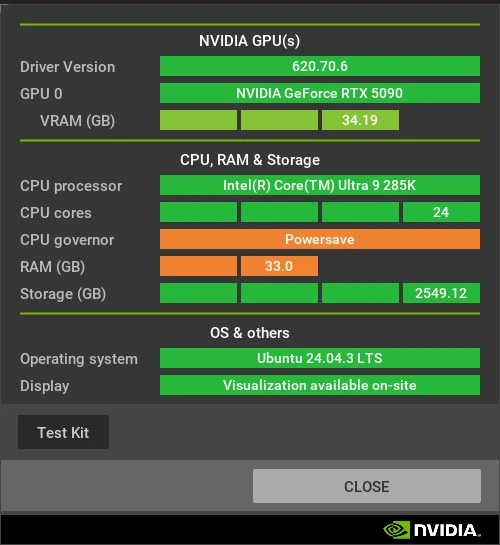
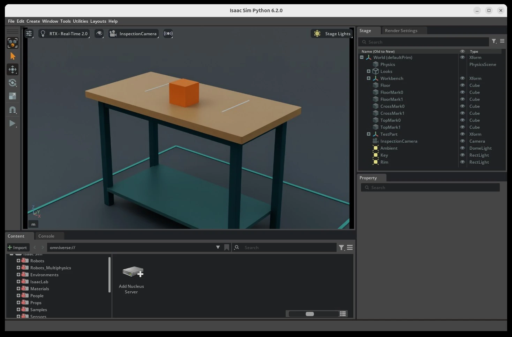
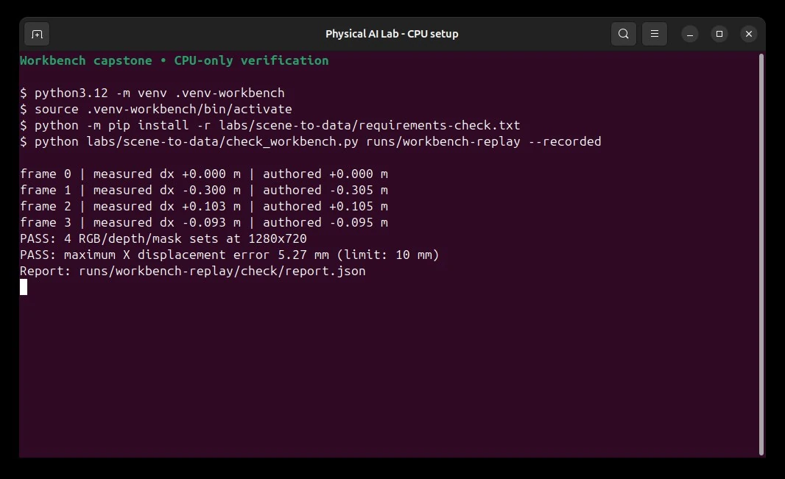

# Isaac Sim 입문 · GUI에서 CLI까지

먼저 화면에서 USD 장면을 열어 구조를 확인합니다. 이어 스크립트로 장면을 만들고, 출력 파일과 검사 결과를 남깁니다. 이 작업대 예제는 Isaac Sim 6.2를 사용합니다.

## 실습에 맞는 설치 방식 고르기

| 하고 싶은 작업 | 시작 도구 |
| --- | --- |
| 눈으로 장면을 확인하고 물리 속성을 편집하기 | 지원되는 RTX 데스크톱에 [Workstation 패키지](https://docs.isaacsim.omniverse.nvidia.com/6.2.0/installation/install_workstation.html) 설치 |
| 프로젝트 Python 환경에서 시뮬레이터 실행하기 | Python 3.12 가상환경에 [Isaac Sim 6.2 Python 패키지](https://docs.isaacsim.omniverse.nvidia.com/6.2.0/installation/install_python.html) 설치 |
| 원격 GPU에서 데이터를 반복 생성하기 | 지원 환경에서 헤드리스로 실행하거나 [Isaac Sim 컨테이너](https://docs.isaacsim.omniverse.nvidia.com/6.2.0/installation/install_container.html) 사용. 원격 화면이 필요하면 NVIDIA WebRTC 설정을 따릅니다. |
| 이미 생성한 데이터 검사하기 | Python과 OpenUSD만 쓰는 [작업대 CPU 실습](../labs/workbench-capstone.md) |

설치 전에 [Linux GPU와 드라이버](nvidia-linux.md)를 확인합니다. Linux x86-64라면 [공식 다운로드](https://docs.isaacsim.omniverse.nvidia.com/6.2.0/installation/download.html)에서 6.2 Workstation ZIP을 받아 `~/Downloads`에 두고, 데스크톱의 터미널에서 실행합니다.

```sh
mkdir -p "$HOME/isaacsim-6.2.0"
unzip "$HOME/Downloads/isaac-sim-standalone-6.2.0-linux-x86_64.zip" -d "$HOME/isaacsim-6.2.0"
cd "$HOME/isaacsim-6.2.0"
./post_install.sh
./isaac-sim.compatibility_check.sh
./isaac-sim.sh
```

실행 중에 나오는 라이선스 안내를 확인합니다. 처음에는 셰이더 캐시 준비에 시간이 걸릴 수 있습니다. Compatibility Checker에서 GPU, 드라이버 또는 디스플레이 검사에 실패하면 그 부분부터 해결하고 다시 실행하세요. `aarch64`는 설치 파일과 지원 조건을 따로 확인합니다.



이 화면은 디스플레이를 연결한 Isaac Sim 6.2 컨테이너에서 캡처했습니다. OS 항목에는 컨테이너 내부 배포판이, NVIDIA GPU와 드라이버 항목에는 컨테이너에서 접근한 장치와 드라이버가 표시됩니다.

pip로 설치할 때는 별도 가상환경을 사용합니다. Workstation 설치와 pip 설치는 실행 명령이 다르므로 실습에는 둘 중 한 환경을 골라 사용합니다.

```sh
python3.12 -m venv .venv-isaacsim
source .venv-isaacsim/bin/activate
python -m pip install 'isaacsim[all,extscache]==6.2.0.0' --extra-index-url https://pypi.nvidia.com
isaacsim
```

### GUI로 보던 장면을 스크립트에서 어떻게 재현하나요?

GUI의 **Stage**는 USD 프림의 계층을, **Property**는 선택한 프림의 속성을 보여줍니다. **Play**를 누르면 물리가 상태를 갱신합니다. 스크립트는 같은 장면을 열어 카메라나 충돌체를 지정하고, 반복 실행에서 이미지와 검사 로그를 남깁니다.

헤드리스 캡처는 창을 띄우지 않고 RTX로 카메라 데이터를 렌더링합니다. 이미 저장한 배열을 읽는 CPU 검사는 렌더링 없이 할 수 있습니다. 예를 들어 뷰포트에서 확인한 USD와 카메라 경로를 사용해 헤드리스로 캡처한 뒤, 데이터 폴더를 복사해 다른 컴퓨터에서 검사할 수 있습니다. [Isaac Sim Python 실행 환경](https://docs.isaacsim.omniverse.nvidia.com/6.2.0/installation/install_python.html)

## GUI에서 작업대 열고 조작하기

1. **File → Open**에서 레포에 있는 [`workbench_scene.usda`](../../../labs/scene-to-data/workbench_scene.usda)를 엽니다.
2. **Stage** 패널에서 `/World`를 펼치고 **Workbench → Tabletop**을 선택합니다. **Property**에서 메시와 충돌체를 확인합니다. **TestPart**가 강체이며, 그 아래 **Geometry**가 큐브 형상과 충돌체를 담고 있습니다.
3. **Viewport**의 카메라 선택에서 **InspectionCamera**를 고르면 데이터를 찍은 시점을 볼 수 있습니다. **Play**를 눌러 큐브를 떨어뜨리고 **Stop**으로 시작 상태를 복원합니다. 충돌체를 지우거나 바꿔 보려면 **File → Save As**로 실험용 사본을 먼저 저장합니다.
4. **Console**에서 경고를 확인하고, **Window → Script Editor**를 엽니다. 아래 코드를 붙여 넣고 **Run**을 누르면 현재 장면의 단위와 상판 충돌체를 확인할 수 있습니다.

```python
import omni.usd
from pxr import UsdGeom, UsdPhysics

stage = omni.usd.get_context().get_stage()
tabletop = stage.GetPrimAtPath("/World/Workbench/Tabletop")
print("Meters per unit:", UsdGeom.GetStageMetersPerUnit(stage))
print("Tabletop collider:", tabletop.HasAPI(UsdPhysics.CollisionAPI))
```

단위는 `1.0`, 상판 충돌체는 `True`가 출력됩니다. Script Editor는 현재 실행 중인 Kit와 그 안에 열린 USD 장면을 사용합니다. [GUI 공식 안내](https://docs.isaacsim.omniverse.nvidia.com/6.2.0/gui/index.html) · [Script Editor](https://docs.isaacsim.omniverse.nvidia.com/6.2.0/development_tools/omniverse_script_editor.html)



## 터미널에서 같은 실습 실행하기

[작업대 완주 과제](../labs/workbench-capstone.md)에서 CadQuery로 STEP 메시를 만든 뒤 `workbench_final_take.py`로 시뮬레이션 장면을 새로 만듭니다. Workstation의 `python.sh`는 Kit와 Isaac Sim의 Python 경로를 준비합니다. pip로 설치했다면 Isaac Sim을 설치한 가상환경의 `python`을 사용합니다.

```sh
# CAD 단계를 마치고 레포 최상위 폴더에서:
"$HOME/isaacsim-6.2.0/python.sh" labs/scene-to-data/workbench_final_take.py \
  runs/workbench-live/cad_meshes.json runs/workbench-live

# CPU 검사 환경에서:
.venv-workbench/bin/python labs/scene-to-data/check_workbench.py runs/workbench-live
```

화면 없이 파일만 필요하면 캡처 명령에 `--headless`를 붙입니다. 생성은 GPU 머신에서 하고, `check/report.json`은 어느 머신에서든 열 수 있습니다. 반복 실행은 폴더를 나누고, Bash에서 `2>&1 | tee capture.log`를 붙여 로그를 남깁니다. `set -o pipefail`을 켜면 시뮬레이터가 실패해도 파이프라인이 실패를 알립니다.



## 다음 작업에 필요한 도구 찾기

| 하고 싶은 작업 | 도구 |
| --- | --- |
| 카메라, 충돌체, 강체, 관절을 하나씩 확인 | Isaac Sim의 **Stage**, **Property**, **Viewport**, **Play** |
| 열려 있는 장면을 짧은 코드로 확인·수정 | Isaac Sim **Script Editor**. 같은 스크립트를 반복해서 실행하거나 앱을 새로 띄울 때는 standalone Python을 사용합니다. |
| Isaac Sim 없이 USD 파일 구조 확인 | OpenUSD Python API. OpenUSD 전체 도구 설치에는 [`usdview`, `usdcat`, `usdchecker`](https://openusd.org/release/toolset.html)도 들어 있습니다. CPU 실습은 `usd-core` Python 패키지만 사용합니다. |
| 카메라 영상과 정답 라벨을 함께 만들기 | Replicator에서 RGB·깊이·분할 annotator를 같은 카메라의 render product에 연결합니다. [Replicator 예제](https://docs.isaacsim.omniverse.nvidia.com/6.2.0/replicator_tutorials/tutorial_replicator_getting_started.html) |
| 같은 과제를 병렬로 실행해 정책 학습 | Isaac Lab. [호환표](https://docs.isaacsim.omniverse.nvidia.com/6.2.0/installation/compatibility.html)에서 Isaac Sim 버전과 물리 백엔드를 맞춥니다. [Microduck 실습](../labs/microduck.md) |

GUI는 열리는데 CLI가 실패하면 활성 Python과 `SimulationApp`을 초기화하는 순서를 확인하세요. 시뮬레이션은 되는데 캡처 파일이 없으면 드라이버를 바꾸기 전에 render product, 의미 라벨, 출력 폴더와 로그를 확인합니다. [공식 standalone 예제](https://docs.isaacsim.omniverse.nvidia.com/6.2.0/introduction/quickstart_isaacsim_robot.html)
