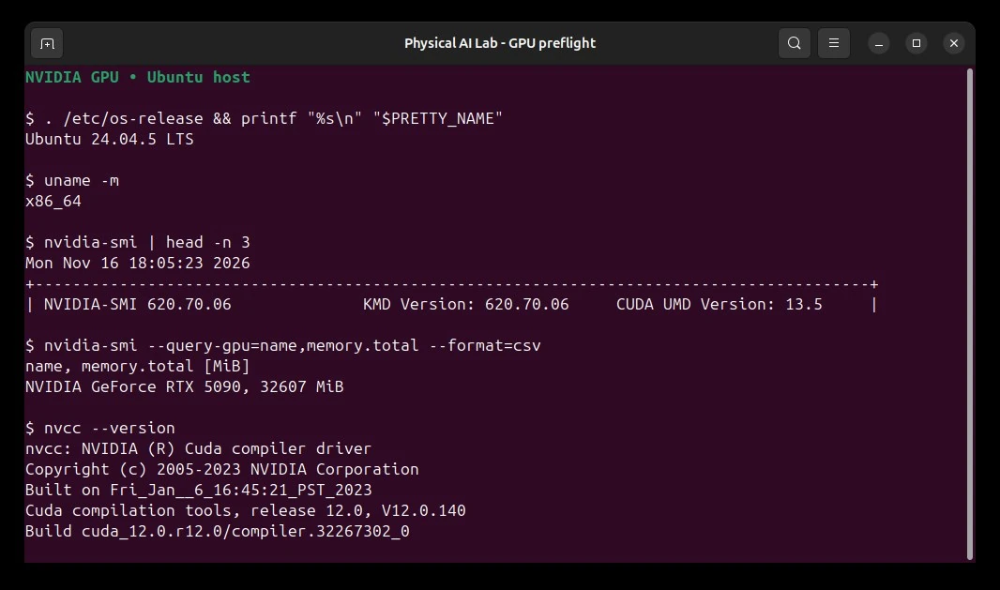

# 피지컬 AI 실습용 NVIDIA Linux 환경 준비하기

Isaac Sim을 설치하기 전에 Ubuntu 24.04 기반 RTX 워크스테이션이나 서버를 점검합니다. Mac을 쓰고 있다면 SSH로 Linux GPU 머신에 접속해서 GPU 명령을 실행하세요. [작업대 실습의 저장된 데이터](../labs/workbench-capstone.md)는 CPU에서도 검사할 수 있습니다.

## 머신과 드라이버 확인하기

```sh
. /etc/os-release && printf '%s\n' "$PRETTY_NAME"
uname -m
nvidia-smi
nvidia-smi --query-gpu=index,name,driver_version,memory.used,memory.total,utilization.gpu --format=csv
```

예상한 GPU 이름과 드라이버 버전이 보이는지 먼저 확인하고, 다른 작업이 VRAM을 얼마나 쓰고 있는지도 봅니다. `x86_64`와 `aarch64`는 설치 파일이 다릅니다. 사용하려는 [Isaac Sim 릴리스의 시스템 요구사항](https://docs.isaacsim.omniverse.nvidia.com/6.2.0/installation/requirements.html)에서 OS, GPU, 드라이버, DGX Spark 주의사항을 확인하세요.



## 드라이버·CUDA·컨테이너 도구 구분하기

| 구성 요소 | 무슨 일을 하나요? | 어떻게 확인하나요? |
| --- | --- | --- |
| NVIDIA 호스트 드라이버 | Linux가 GPU와 통신하게 합니다. Isaac Sim에는 지원되는 그래픽 드라이버와 RTX 기능도 필요합니다. | `nvidia-smi`와 Isaac Sim Compatibility Checker |
| 앱이나 Python 패키지의 CUDA 런타임 | 호스트 드라이버를 통해 각 앱의 CUDA 코드를 실행합니다. | 앱 자체의 GPU 검사 또는 프레임워크의 런타임 버전 |
| CUDA Toolkit | CUDA 코드 빌드에 쓰는 `nvcc`, 헤더, 개발 도구를 제공합니다. | `nvcc --version` |
| NVIDIA Container Toolkit | 컨테이너가 호스트의 GPU와 드라이버 라이브러리를 사용하게 합니다. | GPU를 넘긴 컨테이너 안에서 `nvidia-smi` 실행 |

화면의 **CUDA UMD Version**은 드라이버가 지원하는 최대 CUDA 버전입니다. 이전 버전에서는 **CUDA Version**으로 나옵니다. 위 머신은 드라이버가 13.5까지 지원하지만, 셸이 찾은 Toolkit은 `nvcc --version`에 나온 12.0입니다. 앱이 맞는 런타임을 포함하고 있다면 시스템에 Toolkit을 따로 설치하지 않아도 실행할 수 있습니다. [NVIDIA SMI 항목 설명](https://docs.nvidia.com/deploy/nvidia-smi/index.html#gpu-attributes) · [CUDA 호환표](https://docs.nvidia.com/datacenter/tesla/drivers/latest/cuda-toolkit-driver-and-architecture-matrix.html)

새 Ubuntu 워크스테이션에 정상 동작하는 드라이버가 없다면 배포판의 드라이버 선택 도구부터 사용합니다. GPU와 Isaac Sim을 모두 지원하는 버전을 고르세요. 운영 중인 공용 머신에서는 관리자와 드라이버 교체 및 재부팅 시점을 잡습니다.

```sh
sudo apt update
sudo apt install ubuntu-drivers-common
sudo ubuntu-drivers list
sudo ubuntu-drivers install
# 워크스테이션을 재부팅한 뒤:
nvidia-smi
```

Isaac Sim GUI를 실행할 워크스테이션에는 그래픽을 지원하는 드라이버가 필요합니다. 연산 전용 서버는 [Ubuntu 드라이버 설치 안내](https://ubuntu.com/server/docs/nvidia-drivers-installation/)와 [NVIDIA 설치 유형 안내](https://docs.nvidia.com/datacenter/tesla/driver-installation-guide/latest/compute-only-and-desktop-installation.html)에 나온 별도 절차를 따르세요.

CUDA 코드를 직접 빌드해야 한다면 [CUDA Linux 설치 문서](https://docs.nvidia.com/cuda/cuda-installation-guide-linux/)에서 배포판·아키텍처에 맞는 저장소를 추가하고, 프로젝트가 지정한 버전의 `cuda-toolkit-X-Y` 패키지를 설치합니다. 설치 후에는 셸이 어느 컴파일러를 읽는지 확인합니다.

```sh
command -v nvcc
nvcc --version
```

PyTorch를 쓴다면 프로젝트 가상환경에서 직접 확인합니다. 설치할 패키지는 [PyTorch 공식 설치 페이지](https://pytorch.org/get-started/locally/)에서 OS와 CUDA 환경에 맞게 고릅니다.

```sh
python -c 'import torch; print("Build CUDA:", torch.version.cuda); print("CUDA usable:", torch.cuda.is_available())'
```

## SSH로 GPU 머신 사용하기

`gpu-lab`은 계정이 있는 머신의 주소나 SSH 별칭으로 바꿉니다. 터미널 하나로 실습을 실행하고 다른 터미널에서 GPU와 디스크 상태를 봅니다.

```sh
ssh gpu-lab
tmux new -s isaac-lab
# 두 번째 SSH 터미널에서:
watch -n 2 nvidia-smi
df -h .
```

tmux에서 **Ctrl+B**, **D** 순으로 누르면 작업을 둔 채 연결에서 빠져나옵니다. SSH로 다시 접속해 `tmux attach -t isaac-lab`으로 돌아갑니다. CLI와 헤드리스 실습은 SSH로 실행할 수 있습니다. 시뮬레이터 화면이 필요하면 데스크톱 세션을 쓰거나, 관리하는 네트워크 안에서 [NVIDIA WebRTC 클라이언트](https://docs.isaacsim.omniverse.nvidia.com/6.2.0/installation/manual_livestream_clients.html)로 접속합니다.

검사 결과만 가져올 때는 노트북 터미널에서 아래처럼 복사합니다. 레포를 다른 폴더에 내려받았다면 원격 경로를 바꾸세요.

```sh
scp gpu-lab:awesome-nvidia-physical-ai/runs/workbench-live/check/report.json .
```

## 컨테이너에서 GPU 확인하기

Docker와 호스트 드라이버를 먼저 확인하고 [NVIDIA Container Toolkit](https://docs.nvidia.com/datacenter/cloud-native/container-toolkit/latest/install-guide.html)을 설치합니다. 아래는 직접 관리하는 rootful Docker의 설정입니다. 런타임 설정은 Docker 설정 파일을 수정하며, 데몬을 재시작하면 실행 중인 작업이 중단될 수 있습니다. rootless Docker는 공식 안내의 별도 절차를 사용하세요.

```sh
sudo nvidia-ctk runtime configure --runtime=docker
sudo systemctl restart docker
sudo docker run --rm --runtime=nvidia --gpus all ubuntu nvidia-smi
```

호스트에서는 GPU가 보이는데 [테스트 컨테이너](https://docs.nvidia.com/datacenter/cloud-native/container-toolkit/latest/sample-workload.html)에서는 보이지 않는다면, 이미지 안의 CUDA 버전을 바꾸기 전에 Docker 런타임과 Toolkit 설정을 확인합니다. 시뮬레이터 이미지와 라이선스는 [Isaac Sim 컨테이너 안내](https://docs.isaacsim.omniverse.nvidia.com/6.2.0/installation/install_container.html)를 따릅니다.

## 어디서 막혔는지 확인하기

| 증상 | 다음에 볼 것 |
| --- | --- |
| `nvidia-smi`가 드라이버에 연결하지 못함 | 실제 GPU가 있는 Linux 머신에 접속했는지, 드라이버·커널 모듈·Secure Boot·재부팅 상태를 확인합니다. |
| `nvidia-smi`는 되고 `nvcc`만 없음 | CUDA 코드를 직접 빌드하는 경우에만 Toolkit 설치나 PATH를 확인합니다. |
| PyTorch가 `CUDA usable: False`를 출력 | 활성 Python, 설치된 PyTorch 패키지, 호스트 드라이버, 컨테이너의 GPU 노출을 확인합니다. |
| Isaac Sim이 켜지지만 뷰포트가 비거나 종료됨 | Compatibility Checker로 RTX와 드라이버, 디스플레이, 여유 VRAM을 확인합니다. 원격이면 창 또는 스트리밍 실행 방식을 확인합니다. |
| 실습에서 NGC·Hugging Face 인증을 요구함 | 해당 서비스에서 인증하고 받을 파일의 접근 권한을 확인합니다. 토큰을 셸 히스토리나 공유 로그에 남기지 않습니다. [NGC Catalog 안내](https://docs.nvidia.com/ngc/latest/ngc-catalog-user-guide.html) |

[Isaac Sim GUI·CLI 시작하기](isaac-sim-tools.md) · [작업대 완주 과제](../labs/workbench-capstone.md)
