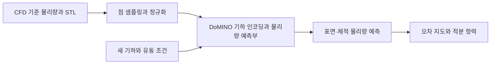

# NVIDIA PhysicsNeMo

[← 전체 목록](../../README.ko.md) · [English](../en/physicsnemo.md)

PhysicsNeMo는 물리 시스템을 학습으로 모델링하고 평가하는 프레임워크다. CFD 예제는 기존 시뮬레이션으로 학습한 대리 모델이 새 기하의 압력·속도 등을 예측하는 방법을 보여 준다.

## 아키텍처

| 구성 요소 | 역할과 데이터 경계 |
|---|---|
| 학습 데이터와 데이터 파이프 | DoMINO 외부 공력 예제는 기하, 표면 물리량, 체적 물리량을 입력으로 받는다. 점을 전처리하고 표본을 뽑으며 유입 속도 등의 조건을 추가할 수 있다. |
| 기하 표현과 국소 질의 | DoMINO는 기하에서 다중 스케일 표현을 만들고 국소 이웃 및 질의 좌표를 사용해 표면점이나 체적점의 물리량을 예측한다. |
| 학습, 체크포인트와 추론 | 시뮬레이션 물리량으로 모델을 학습한다. 추론에서는 체크포인트와 정규화 정보를 대상 STL 및 경계 조건에 적용해 표면 또는 체적 예측을 얻는다. |
| 분석과 솔버 비교 | 점별 물리량과 항력처럼 적분해 얻는 값은 서로 다른 평가 기준이다. 예제에는 대형 점 집합의 병렬 처리 설정도 들어 있다. |

아래 공식 자료를 바탕으로 이 가이드에서 재구성한 그림입니다.

### 공식 그림과 예시

공식 DoMINO 결과는 공력 예제의 예측 물리량을 시각화한다. 종합 점수와 함께 국소 물리량을 살펴볼 수 있다. [그림 출처와 원문 설명](https://archive.docs.nvidia.com/physicsnemo/26.03/physicsnemo/examples/cfd/external_aerodynamics/domino/README.html)

공식 예제의 항력 비교는 대리 모델 예측값과 CFD 결과를 짝지어 보여 준다. [그림 출처와 원문 설명](https://archive.docs.nvidia.com/physicsnemo/26.03/physicsnemo/examples/cfd/external_aerodynamics/domino/README.html)

## 워크플로 예시

1. 차량 기하 기준으로 학습·시험 데이터를 나눈다. CFD 샘플을 기하점과 표면·체적 타깃 배열로 가공한다. 추론에서도 같은 단위, 기준 속도와 정규화를 쓴다.
2. DoMINO 예제를 학습하고 별도로 남긴 STL과 유입 속도로 체크포인트를 실행한다. 차체 압력과 후류 단면 속도를 시각화한다.
3. 대리 모델로 설계안을 비교하기 전에 기준 CFD 계산과 추정 항력·고오차 유동 영역을 대조한다.

## 검증 포인트

- 항력이 비슷해도 국소 오차가 있을 수 있다. 표면 압력, 후류, 힘 추정값을 분리해 평가한다.
- 학습에 포함한 기하 계열과 유동 조건 범위를 기록한다. 메시 밀도나 입력 조건이 달라지면 정확도를 다시 확인한다.

## 라이선스와 범위

프레임워크 코드는 Apache-2.0이다. 체크포인트와 데이터셋의 조건은 배포별로 확인한다.

## 관련 가이드

[Warp](nvidia-warp.md) · [OSMO](osmo.md)

## 공식 자료

- [PhysicsNeMo 저장소](https://github.com/NVIDIA/physicsnemo)
- [프레임워크 소개](https://docs.nvidia.com/physicsnemo/latest/overview.html)
- [DoMINO 학습·평가 예제](https://archive.docs.nvidia.com/physicsnemo/26.03/physicsnemo/examples/cfd/external_aerodynamics/domino/README.html)
