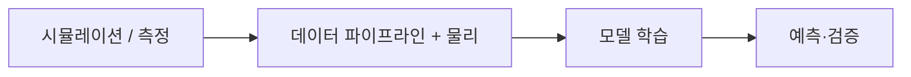

# NVIDIA PhysicsNeMo

[← 전체 목록](../../README.ko.md) · [English](../en/physicsnemo.md) · [공식 소스](https://github.com/NVIDIA/physicsnemo) · [공식 문서](https://docs.nvidia.com/physicsnemo/latest/overview.html)

물리 지식과 데이터를 활용하는 과학 머신러닝 모델을 구축하고 학습하는 딥러닝 프레임워크입니다.

**라이선스:** Apache-2.0; 사전 학습 모델과 데이터는 별도 조건 적용 가능. 사용 전에 해당 버전과 에셋·모델·의존성의 조건을 확인하세요.

*이미지 출처: [공식 프로젝트 저장소](https://github.com/NVIDIA/physicsnemo). 저작자 표시 및 재사용 조건은 원본을 확인하세요.*

## 구성과 아키텍처

모델 아키텍처, 과학 데이터 파이프라인, 분산 학습 도구와 선택적 물리 기반 잔차 도구를 제공합니다. 검증된 수치 솔버를 자동으로 대체하기보다는 보완합니다.

*이 안내서에서 만든 개념적 흐름도입니다. 실제 구현은 공식 문서를 확인하세요.*

## 활용 흐름

시뮬레이션 또는 측정 데이터를 준비하고 모델과 물리 제약을 선택합니다. 학습·검증을 거친 뒤 대상 공학 문제에 대해 추론합니다.

## 활용 사례

공력 유동 대리 모델, 구조 역학 연구, 공학 데이터 기반 물리장 예측에 활용할 수 있습니다.

## 연계 기술

PyTorch 기반이며 결과를 엔지니어링·디지털 트윈 흐름에 활용할 수 있습니다. 대상 분야에 대한 모델 적합성과 예측 정확도를 검증해야 합니다.

## 공식 자료

- [프로젝트 저장소](https://github.com/NVIDIA/physicsnemo)
- [공식 문서](https://docs.nvidia.com/physicsnemo/latest/overview.html)
