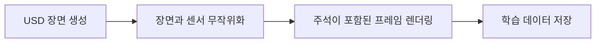

# Replicator

[← 전체 목록](../../README.ko.md) · [English](../en/replicator.md)

## 소개

Omniverse/Isaac Sim의 합성 데이터 생성 도구.

## 개념적 워크플로

## 활용 흐름과 사례

USD 장면 생성 → 장면과 센서 무작위화 → 주석이 포함된 프레임 렌더링 → 학습 데이터 저장. 개념적인 흐름이며 버전별 사전 요구사항과 지원 구성은 공식 문서를 확인한다.

**활용 사례:** 객체 탐지용 주석 이미지 생성. 지원 입력과 모델 버전은 공식 출처에서 확인한다.

**연결 기술:** Isaac Sim, OpenUSD, TAO Toolkit.

## 구성과 구체적인 활용

Replicator 스크립트는 일반적으로 USD 장면을 만들고 조건을 무작위화하며, 시뮬레이션을 진행한 뒤 주석 출력을 writer로 저장한다.

무작위 위치의 물체에 대한 주석 이미지를 생성하고 학습 전에 레이블과 조건의 다양성을 검사한다.

[공식 기술 자료](https://docs.isaacsim.omniverse.nvidia.com/latest/replicator_tutorials/tutorial_replicator_sdg_workflows.html)

## 공개 및 이용 조건

제품 구성 요소; 전체 코드 공개 및 독립 라이선스 미확인. 사용 전 해당 버전과 모델·데이터·바이너리·의존성의 조건을 각각 확인한다.

## 공식 출처

[Isaac Sim 문서](https://docs.isaacsim.omniverse.nvidia.com/latest/replicator_tutorials/index.html)
