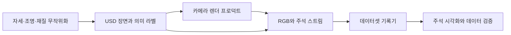

# Replicator

[← 전체 목록](../../README.ko.md) · [English](../en/replicator.md)

Replicator는 시뮬레이션 장면에서 라벨이 붙은 합성 데이터셋을 만든다. 캡처 사이에 바뀌는 요소, 장면을 렌더링할 카메라, 계산할 라벨과 저장 형식을 설정한다.

## 아키텍처

| 구성 요소 | 역할과 데이터 경계 |
|---|---|
| USD 스테이지와 의미 라벨 | 물체·재질·카메라는 스테이지에 있다. 의미 라벨은 물체를 주석 생성기에 쓰는 클래스로 연결한다. 물리를 진행해 흩뿌리거나 떨어뜨린 에셋을 안정시킨 뒤 캡처할 수 있다. |
| 무작위화와 오케스트레이터 | 튜토리얼은 자세·배치의 직접 수정과 이벤트로 실행하는 그래프 무작위화를 함께 사용한다. 오케스트레이터 스텝으로 변경된 장면을 캡처할 때를 정한다. |
| 렌더 프로덕트와 주석 생성기 | 렌더 프로덕트가 카메라를 캡처 파이프라인에 연결한다. 주석 생성기가 렌더 결과와 장면 메타데이터에서 RGB·박스·분할 같은 데이터를 얻는다. |
| 기록기 | 기록기가 렌더 프로덕트에 연결돼 선택한 스트림을 지정 형식으로 저장한다. 여러 카메라에서 같은 캡처 스텝의 시점을 얻을 수 있다. |

아래 공식 자료를 바탕으로 이 가이드에서 재구성한 그림입니다.

### 공식 그림과 예시

장면 기반 튜토리얼의 창고 캡처 워크플로와 렌더링 결과. [그림 출처와 원문 설명](https://docs.isaacsim.omniverse.nvidia.com/latest/replicator_tutorials/tutorial_replicator_scene_based_sdg.html)

무작위화한 UR10 팔레타이징 장면에서 캡처한 데이터 예시. [그림 출처와 원문 설명](https://docs.isaacsim.omniverse.nvidia.com/latest/replicator_tutorials/tutorial_replicator_ur10_palletizing.html)

## 워크플로 예시

1. 창고 장면 튜토리얼에서 지게차, 팔레트, 상자와 여러 카메라를 구성한다. 클래스 라벨을 붙이고 작업에 맞는 카메라 범위 안에 물체를 배치한다.
2. 무작위화 시드를 정하고 자세·조명·재질을 바꾼다. 배치한 물체가 안정될 때까지 물리를 진행한 뒤 캡처하고 RGB와 박스 라벨을 저장한다.
3. 대량 생성 전에 일부 영상에 라벨을 겹쳐 확인한다. 학습과 평가 데이터가 지나치게 비슷해지지 않도록 장면 또는 구성 기준으로 분리한다.

## 검증 포인트

- 라벨 누락, 완전 가림, 카메라 범위와 출력 형식을 확인한다. 창고 예제의 KITTI 주석은 선택한 학습기에 따라 변환이 필요할 수 있다.
- 무작위화 시드와 캡처 시점을 기록한다. 탐지기 배포 성능을 확인할 때 합성 검증 데이터와 실제 영상을 함께 평가한다.

## 라이선스와 범위

Replicator는 Omniverse/Isaac Sim 구성 요소로 배포된다. 확장, 렌더러, 에셋과 출력물의 조건은 배포판별로 확인한다.

## 관련 가이드

[Isaac Sim](isaac-sim.md) · [SimReady](simready.md) · [CDF Simulation](cdf-simulation.md) · [TAO Toolkit](tao-toolkit.md)

## 공식 자료

- [장면 기반 합성 데이터 생성](https://docs.isaacsim.omniverse.nvidia.com/latest/replicator_tutorials/tutorial_replicator_scene_based_sdg.html)
- [UR10 팔레타이징 무작위화](https://docs.isaacsim.omniverse.nvidia.com/latest/replicator_tutorials/tutorial_replicator_ur10_palletizing.html)
- [장면 재사용·재구성 방식](https://docs.isaacsim.omniverse.nvidia.com/latest/replicator_tutorials/tutorial_replicator_sdg_workflows.html)
