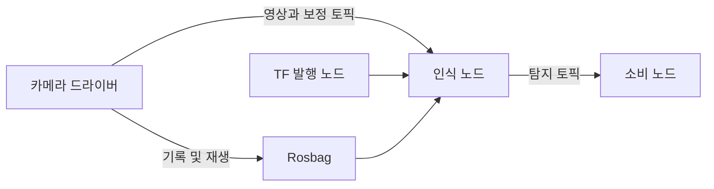

# ROS 2

[← 전체 목록](../../README.ko.md) · [English](../en/ros-2.md)

ROS 2는 Isaac ROS 패키지를 포함한 로봇 노드의 응용 통신 계층입니다. 노드는 미들웨어를 통해 타입이 지정된 메시지를 교환합니다.

## 어떻게 동작하나

발행자는 이름이 있는 토픽에 데이터를 보내고 호환 구독자가 받습니다. 서비스는 요청과 응답에, 액션은 피드백과 취소가 필요한 긴 작업에 사용합니다. QoS 정책은 호환성과 전달 동작을 결정합니다. TF가 좌표계를 연결하고 rosbag으로 메시지를 기록·재생합니다.

*아래 공식 자료에 근거해 재구성한 그림입니다.*

## 실전 워크플로

카메라 토픽과 카메라 정보, 변환을 함께 기록합니다. rosbag을 재생하고 Isaac ROS 인식 노드를 붙입니다. 토픽 그래프를 확인하고 부하가 있는 상태에서 시간 정렬된 메시지가 노드에 도착하는지 측정합니다.

## 검증할 항목

ROS 배포판, 메시지 정의, QoS 호환성, 클록과 TF를 확인합니다. QoS 때문에 메시지가 누락되는 경우와 시간·변환 문제로 노드가 거부하는 경우를 구분합니다.

## 공개 범위와 라이선스

ROS 2의 패키지와 배포판 라이선스는 서로 다릅니다. 각 의존성과 바이너리 런타임을 확인하세요.

## 공식 자료

- [공식 기술 자료](https://github.com/ros2/ros2_documentation/blob/rolling/source/ROS-Framework/interfaces/About-Topics.rst)
- [ROS 2 QoS 개념](https://github.com/ros2/ros2_documentation/blob/rolling/source/ROS-Framework/interfaces/topics/About-Quality-of-Service-Settings.rst)
- [관련 공식 자료 · docs.ros.org](https://docs.ros.org/en/rolling/)
