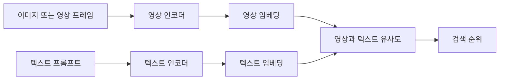

# SigLIP 2

[← 전체 목록](../../README.ko.md) · [English](../en/siglip-2.md)

SigLIP 2는 영상과 텍스트를 임베딩해 서로 비교하고 검색할 수 있는 인코더 모델입니다.

## 어떻게 동작하나

영상 인코더는 패치를, 텍스트 인코더는 토큰을 처리합니다. 학습에는 이미지·텍스트 쌍별 시그모이드 목적 함수와 논문에 설명된 캡션·자기지도 신호를 사용합니다. 고정 해상도와 NaFlex 체크포인트는 영상 준비 방식이 다릅니다. 영상 검색에는 프레임을 샘플링하고 점수를 통합하는 별도 로직이 필요합니다.

*아래 공식 자료에 근거해 재구성한 그림입니다.*

## 실전 워크플로

로봇 시연에서 프레임을 뽑아 색인합니다. 같은 동작을 한국어와 영어로 검색하고 오탐을 보면서 선택된 프레임에 요청한 이벤트가 실제로 있는지 확인합니다.

## 검증할 항목

체크포인트의 토크나이저와 영상 전처리를 사용합니다. 수동 라벨 예제로 검색 재현율을 평가합니다. 프레임 임베딩이 짧은 동작을 놓칠 수 있으므로 시간 범위도 따로 검증합니다.

## 공개 범위와 라이선스

모델 카드와 체크포인트별 라이선스를 확인하고 대상 데이터에 대한 한계와 편향을 평가하세요.

## 공식 자료

- [공식 기술 자료](https://arxiv.org/abs/2502.14786)
- [체크포인트 카드와 예제](https://huggingface.co/google/siglip2-base-patch16-224)
