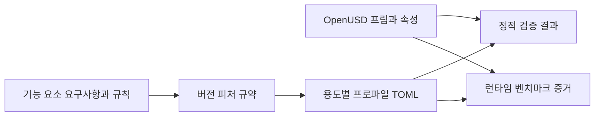

# SimReady Foundation

[← 프로젝트 홈](../../README.ko.md) · [English](../en/simready-foundation.md)

SimReady Foundation은 시뮬레이션 용도별로 OpenUSD 에셋에 필요한 속성을 정리한 규격입니다. 에셋 제작자와 도구 개발자는 같은 카탈로그와 검증 규칙을 사용하고, 작업에 맞는 규격 버전을 선택할 수 있습니다.

## 아키텍처

| 구성 요소 | 역할과 주고받는 데이터 |
|---|---|
| 기능 요소와 요구사항 | 기능 요소는 강체, 콜라이더, 의미 정보 같은 USD 속성을 설명합니다. 요구사항과 검증 규칙으로 속성이 지원 구조에 맞게 들어 있는지 검사합니다. |
| 피처 JSON과 프로파일 TOML | 피처는 관련 요구사항을 묶습니다. 프로파일은 Robotics-Prop이나 Robot-Body 같은 용도별로 버전이 지정된 필수·선택 피처를 조합합니다. 카탈로그 파일은 기계가 읽을 수 있는 규약입니다. |
| 티어, 검증기와 벤치마크 | Core 티어에 기본 규약과 정적 검증 규칙이 있습니다. 검증기는 작성한 USD를 검사합니다. 적합한 런타임에서는 선택 벤치마크로 실행 동작을 확인할 수 있습니다. |

아래 공식 자료를 바탕으로 이 가이드에서 재구성한 그림입니다.

### 공식 그림과 예시

NVIDIA 개요 그림은 SimReady Foundation 요구사항과 OpenUSD 에셋 제작·검증 도구의 역할을 구분합니다. [그림 출처와 원문 설명](https://huggingface.co/blog/nvidia/simready-central-assets-robotics-ai-factories)

## 워크플로 예시

1. 재사용 강체 소품에 맞는 Robotics-Prop 버전을 선택하고 고정된 피처 목록을 읽습니다. 지정한 USD 프림 계층에 강체와 충돌 형상을 작성합니다.
2. 호환 티어와 프로파일로 검증기를 실행합니다. 누락 API, 단위 불일치, 프림 관계 오류를 에셋 원본에서 수정합니다.
3. 패키징할 때 검증 증거를 보관하고 작은 시뮬레이션 시험을 실행합니다. 결과와 함께 프로파일 버전과 에셋 리비전을 저장합니다.

## 검증할 항목

- 프로파일과 피처 버전을 고정합니다. 릴리스에 따라 요구사항이 다른 프로파일로 옮겨가거나 새 검사가 추가될 수 있습니다.
- 에셋 비교에서 검증 범위를 확인합니다. 패키지·시각화 프로파일과 로봇·조작 프로파일의 요구사항은 다를 수 있습니다.

## 공개 범위와 라이선스

NVIDIA가 작성한 Foundation 자료는 Apache-2.0이며 제3자 에셋과 의존성의 조건은 별도입니다.

## 관련 가이드

[SimReady](simready.md) · [SimReady Central](simready-central.md) · [OpenUSD](openusd.md)

## 공식 자료

- [SimReady Foundation 소스와 명세](https://github.com/NVIDIA/simready-foundation)
- [Core 티어와 프로파일 버전](https://nvidia.github.io/simready-foundation/latest/tiers/core.html)
- [Isaac Sim 에셋 검증](https://docs.isaacsim.omniverse.nvidia.com/latest/robot_setup/asset_validation.html)
