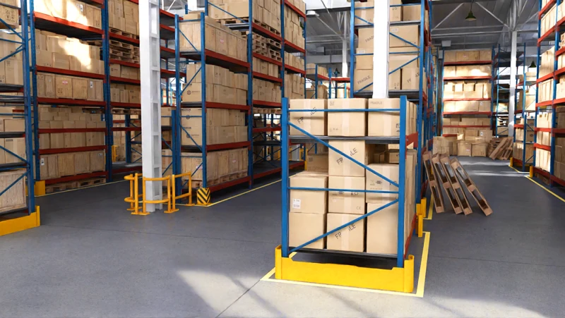
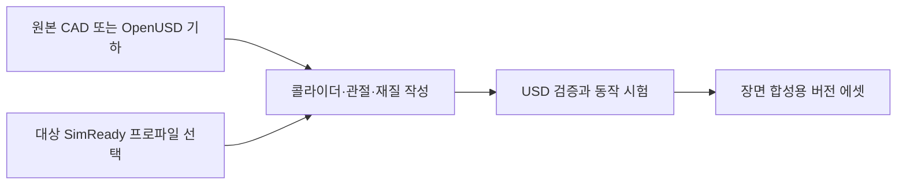

# SimReady

[← 전체 목록](../../README.ko.md) · [English](../en/simready.md)

   
  <a href="https://docs.omniverse.nvidia.com/simready/latest/index.html">NVIDIA SimReady 공식 개요의 대표 물류창고 이미지</a>

SimReady는 특정 시뮬레이션 용도에 필요한 OpenUSD 에셋 조건을 설명한다. 로봇팔에는 정확한 관절체와 가동 범위, 조작 소품에는 충돌·질량 정보, 인식용 에셋에는 의미 라벨이 필요할 수 있다.

## 아키텍처

| 구성 요소 | 역할과 데이터 경계 |
|---|---|
| 작성한 USD 콘텐츠 | 원본 CAD가 기하 정보를 제공한다. 에셋을 제작하며 계층, 단위, 재질과 물리 스키마나 의미 라벨 같은 도메인 정보를 추가한다. |
| 프로파일과 피처 | 이름이 붙은 프로파일이 런타임 용도에 필요한 기능 집합을 지정한다. 에셋 요구사항을 결정할 때 프로파일 버전을 고정한다. |
| 검증과 런타임 | 검증기는 작성한 USD 속성을 선택 프로파일과 비교한다. 런타임에서는 실제 장면에서 에셋이 예상대로 동작하는지 따로 시험한다. |

아래 공식 자료를 바탕으로 이 가이드에서 재구성한 그림입니다.

### 공식 그림과 예시

NVIDIA의 명세 그림은 OpenUSD 코어·도메인 데이터와 SimReady 콘텐츠 요구사항의 관계를 보여 준다. [그림 출처와 원문 설명](https://docs.omniverse.nvidia.com/simready/latest/simready-faq.html)

NVIDIA YuMi 물리 오버레이는 충돌 형상과 관절 축을 보여 준다. 시각 메시와 별도로 이 속성들을 검증할 수 있다. [그림 출처와 원문 설명](https://developer.nvidia.com/blog/5-steps-to-create-simready-assets-for-robotics-with-frontier-ai-models)

## 워크플로 예시

1. NVIDIA의 YuMi 예제를 따라 CAD 가져오기, 시각 재질, 관절 축, 콜라이더 근사, 질량과 관성을 설정한다. 제조사 자료가 필요한 속성을 구분한다.
2. 로봇용 프로파일에 맞춰 에셋을 검증하고 Isaac Sim에 불러온다. 관절 가동 범위를 시험하고 간단한 집기·놓기 작업으로 손가락 연동과 접촉을 확인한다.
3. 검증한 에셋을 작업 스테이지에서 참조한다. 에셋 리비전, 프로파일 버전, 검증에 사용한 시뮬레이터를 기록한다.

## 검증 포인트

- 실제 용도에 맞는 프로파일을 고른다. 시각적으로 정교해도 로봇 제어에 필요한 충돌·단위·관절 정보가 빠져 있을 수 있다.
- 정적 검증과 런타임 시험을 구분한다. 최종 장면에서 접촉 응답, 제어 축과 자세 규약을 확인한다.

## 라이선스와 범위

명세, 검증 도구, 개별 에셋의 조건은 서로 다르다. Foundation과 해당 에셋 카드를 확인한다.

## 관련 가이드

[SimReady Foundation](simready-foundation.md) · [SimReady Central Library](simready-central-library.md) · [Isaac Sim](isaac-sim.md) · [OpenUSD](openusd.md)

## 공식 자료

- [공식 SimReady FAQ와 프로파일 모델](https://docs.omniverse.nvidia.com/simready/latest/simready-faq.html)
- [YuMi CAD의 시뮬레이션 변환 예제](https://developer.nvidia.com/blog/5-steps-to-create-simready-assets-for-robotics-with-frontier-ai-models)
- [SimReady Foundation 명세](https://github.com/NVIDIA/simready-foundation)
