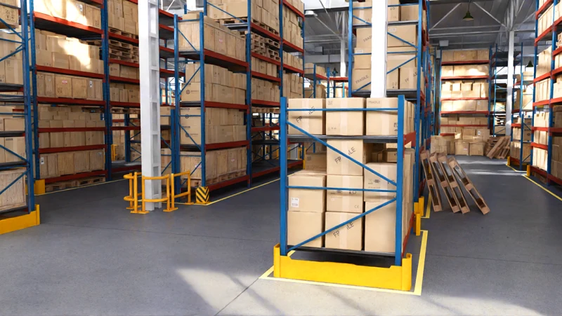
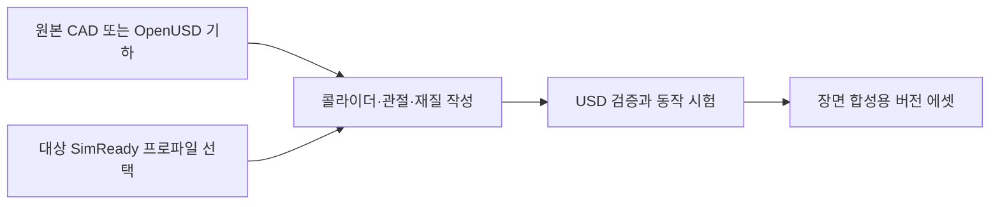

# SimReady

[← 프로젝트 홈](../../README.ko.md) · [English](../en/simready.md)

   
  <a href="https://docs.omniverse.nvidia.com/simready/latest/index.html">NVIDIA SimReady 공식 개요의 대표 물류창고 이미지</a>

SimReady는 특정 시뮬레이션 용도에 필요한 OpenUSD 에셋 조건을 설명합니다. 로봇 팔에는 정확한 관절체와 가동 범위, 조작 소품에는 충돌·질량 정보, 인식용 에셋에는 의미 라벨이 필요할 수 있습니다.

## 그림으로 잘 보이는 물체가 시뮬레이션에서도 잘 작동할까요?

### 렌더러·물리 엔진·카메라가 읽는 속성

| 속성 | 읽는 곳 | 작업대에서의 역할 |
| --- | --- | --- |
| 메시와 시각 재질 | 렌더러 | 상판의 모양과 색을 나타냅니다. |
| 충돌 형상 | 물리 엔진 | 떨어지는 물체가 상판 어디에 닿을지 정합니다. |
| 클래스 라벨 | 의미 분할 어노테이터 | 카메라 픽셀을 작업대 등 지정한 범주로 구분합니다. |

SimReady는 이런 속성을 용도에 맞춰 작성하고 검증하기 위한 콘텐츠 요구사항입니다. 맨눈으로 에셋을 볼 때는 그림과 물리 형상이 겹쳐 보일 수 있으니, 간단한 접촉 실험을 한 번 돌려 봅니다.

### 화면이 같아도 결과가 달라지는 예

[SimReady 비교 장면의 기록](../../labs/physics/recorded.json)에서 두 탐침의 최종 중심 높이는 약 0.844m와 0.984m입니다. 높이 차이 0.14m를 눈으로만 추정하기보다, 시뮬레이터 좌표를 읽고 충돌 형상을 겹쳐 봅니다. 학습 데이터까지 만들려면 동일 물체의 클래스 라벨이 기대한 픽셀에 붙는지도 별도로 확인합니다. [충돌체 실습](labs/physics.md) · [NVIDIA SimReady 명세](https://docs.omniverse.nvidia.com/simready/latest/)

## 아키텍처

| 구성 요소 | 역할과 주고받는 데이터 |
|---|---|
| 작성한 USD 콘텐츠 | 원본 CAD가 기하 정보를 제공합니다. 에셋을 제작하며 계층, 단위, 재질과 물리 스키마나 의미 라벨 같은 도메인 정보를 추가합니다. |
| 프로파일과 피처 | 이름이 붙은 프로파일이 런타임 용도에 필요한 기능 집합을 지정합니다. 에셋 요구사항을 결정할 때 프로파일 버전을 고정합니다. |
| 검증과 런타임 | 검증기는 작성한 USD 속성을 선택 프로파일과 비교합니다. 런타임에서는 실제 장면에서 에셋이 예상대로 동작하는지 따로 시험합니다. |

아래 공식 자료를 바탕으로 이 가이드에서 재구성한 그림입니다.

### 공식 그림과 예시

NVIDIA의 명세 그림은 OpenUSD 코어·도메인 데이터와 SimReady 콘텐츠 요구사항의 관계를 보여 줍니다. [그림 출처와 원문 설명](https://docs.omniverse.nvidia.com/simready/latest/simready-faq.html)

NVIDIA YuMi 물리 오버레이는 충돌 형상과 관절 축을 보여 줍니다. 시각 메시와 별도로 이 속성들을 검증할 수 있습니다. [그림 출처와 원문 설명](https://developer.nvidia.com/blog/5-steps-to-create-simready-assets-for-robotics-with-frontier-ai-models)

## 워크플로 예시

1. NVIDIA의 YuMi 예제를 따라 CAD 가져오기, 시각 재질, 관절 축, 콜라이더 근사, 질량과 관성을 설정합니다. 제조사 자료가 필요한 속성을 구분합니다.
2. 로봇용 프로파일에 맞춰 에셋을 검증하고 Isaac Sim에 불러옵니다. 관절 가동 범위를 시험하고 간단한 집어 옮기기 작업으로 손가락 연동과 접촉을 확인합니다.
3. 검증한 에셋을 작업 스테이지에서 참조합니다. 에셋 리비전, 프로파일 버전, 검증에 사용한 시뮬레이터를 기록합니다.

## 검증할 항목

- 실제 용도에 맞는 프로파일을 고릅니다. 시각적으로 정교해도 로봇 제어에 필요한 충돌·단위·관절 정보가 빠져 있을 수 있습니다.
- 정적 검증과 런타임 시험을 구분합니다. 최종 장면에서 접촉 응답, 제어 축과 자세 규약을 확인합니다.

## 공개 범위와 라이선스

명세, 검증 도구, 개별 에셋의 조건은 서로 다릅니다. Foundation과 해당 에셋 카드를 확인합니다.

## 관련 가이드

[SimReady Foundation](simready-foundation.md) · [SimReady Central Library](simready-central-library.md) · [Isaac Sim](isaac-sim.md) · [OpenUSD](openusd.md)

## 공식 자료

- [공식 SimReady FAQ와 프로파일 모델](https://docs.omniverse.nvidia.com/simready/latest/simready-faq.html)
- [YuMi CAD의 시뮬레이션 변환 예제](https://developer.nvidia.com/blog/5-steps-to-create-simready-assets-for-robotics-with-frontier-ai-models)
- [SimReady Foundation 명세](https://github.com/NVIDIA/simready-foundation)
