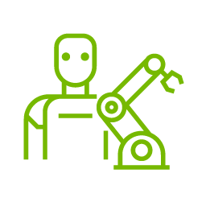

# Video-to-Data (V2D)

[← 목록으로](../../README.ko.md) · [English](../en/video-to-data.md)

   
  <a href="https://nvidia-isaac.github.io/video_to_data/">Video-to-Data 공식 프로젝트 사이트 아이콘(파비콘)</a>

Video to Data(V2D)는 사람의 시연 영상을 검토 가능한 3D 산출물과 로봇 학습 입력으로 바꿉니다. 단계마다 중간 결과를 저장하므로 해당 영상 구간을 다시 선택하거나 복원·리타기팅할 때 다른 단계를 모두 반복할 필요가 없습니다.

## 사람의 작업 영상에서 로봇 학습용 데이터까지

### 영상 구간 선택, 복원, 로봇 동작 변환

RGB 영상에서 원하는 작업 구간을 찾아냅니다. 복원 단계에서는 프레임의 픽셀을 바탕으로 사람이나 물체가 3D 공간에서 어디에 있었는지 추정합니다. 추정한 사람의 움직임을 대상 로봇이 실행할 수 있는 행동으로 바꾸고, 복원 장면을 이용하는 공식 경로에서는 시뮬레이터에서 그 동작을 따라가도록 정책을 학습시킵니다.

### 중간 결과를 기록하면 오류가 생긴 위치를 찾을 수 있습니다

예를 들어 30fps 영상의 프레임 180이 컵을 집는 장면이라면, 균일한 프레임 간격과 0번 프레임을 기준으로 약 6초 지점입니다. 이 시점을 기준으로 영상 구간, 물체의 3D 자세, 로봇 동작이 같은 이벤트를 나타내는지 확인합니다. 화면에서 가려진 손의 깊이는 추정값이므로, 해당 구간을 검토하고 물체 접촉을 시뮬레이션에서 확인할 수 있습니다. [Video-to-Data 공식 코드](https://github.com/nvidia-isaac/video_to_data)

## 아키텍처와 데이터 흐름

| 구성 요소 | 입력·처리·출력 |
|---|---|
| **영상 수집 에이전트** | LangGraph 워크플로가 영상을 동작 구간으로 나누고 물체와 관계를 추출하며 SigLIP 2로 프레임을 임베딩합니다. 그래프·벡터 데이터베이스에서 자연어 질의로 후보 구간을 검색할 수 있습니다. |
| **3D 복원** | 컨테이너화한 비전 모듈에 선택한 RGB 또는 스테레오 영상을 입력해 깊이, 마스크, 텍스처 메시, 물체 자세, 인체 파라미터를 추정합니다. 다중 시점 예제에서는 카메라 보정값과 기록된 센서 스트림도 사용합니다. |
| **로봇 동작 학습** | 동작을 목표 로봇 기종로 리타기팅하고 복원한 Isaac Lab 장면에서 추적 기준으로 사용합니다. PPO로 기준 정책을 학습한 뒤 실행해 전문가 시연 데이터를 만들 수 있습니다. |
| **후속 파인튜닝** | 공식 전체 과정을 다룬 예제는 전문가 롤아웃을 LeRobot 형식으로 변환하고 GR00T N1.7을 파인튜닝한 후 폐루프에서 평가합니다. |

공식 개요 그림에서 영상이 선별된 구간, 3D 복원, 로봇 학습으로 이어지는 경로를 따라가면 됩니다. 화살표는 학습이나 배포 전에 점검할 수 있는 실제 산출물의 이동을 나타냅니다. [공식 그림 출처](https://github.com/nvidia-isaac/video_to_data)

CHORD 연구 그림은 로봇 학습 단계를 확대해 보여줍니다. 복원한 동작과 접촉 정보가 학습 목표에 어떻게 들어가는지 확인할 수 있습니다. [공식 프로젝트 그림](https://nvidia-isaac.github.io/video_to_data/chord/)

## 적용 예시

1. iPhone 1인칭 시연으로 시작하는 공식 휴지 상자 예제를 활용합니다. 로봇 학습 단계 전에 장면과 동작의 복원 결과를 확인합니다.
2. 지원되는 Sharpa 로봇 기종에 동작을 리타기팅하고 기준 전문가 정책을 학습하거나 불러옵니다. 롤아웃을 기록해 GR00T 학습용으로 변환합니다.
3. 폐루프 평가를 실행한 후 최종 작업 완료율과 중간 복원·추적 품질을 비교합니다.

## 검증할 항목

- 리타기팅 전에 스케일과 카메라·월드 좌표계를 점검합니다. 눈으로 보기에 자연스러운 복원이라도 접촉면 위치가 어긋날 수 있습니다.
- 단계별 의존성과 하드웨어 요구사항을 확인합니다. 검색·복원·로봇 학습은 서로 다른 실행 환경을 쓰며 모델 조건도 별도로 적용될 수 있습니다.

## 공식 자료와 이용 조건

코드는 Apache-2.0이고 문서와 스킬은 CC BY 4.0입니다. 연동 모델과 데이터의 이용 조건은 별도입니다.

- [저장소와 전체 과정을 다룬 예제](https://github.com/nvidia-isaac/video_to_data)
- [파이프라인 공식 문서](https://nvidia-isaac.github.io/video_to_data/)
- [Robotic Grounding 프로젝트](https://nvidia-isaac.github.io/video_to_data/chord/)

## 관련 가이드

[EgoHand](egohand-egopost.md) · [Isaac Lab](isaac-lab.md) · [Isaac GR00T](isaac-gr00t.md)
