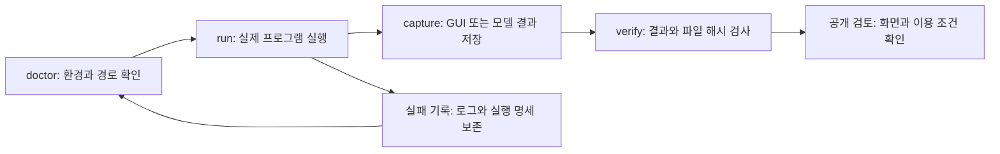

# 네 분야에서 살펴보는 Physical AI 실험 12가지

[English](EXPERIMENTS.md) · [한국어](EXPERIMENTS.ko.md) · [실습 실행과 결과 확인](cli/README.ko.md)

화면에서 확인할 질문을 정하고, 실제 도구를 실행한 뒤, 입력과 결과를 함께 남깁니다. 이번에 측정한 결과와 이전 실행, 앞으로 할 실험을 구분해 정리했습니다. **2026-11-19 기준**이며, 실행 대기 중인 항목은 완료한 결과가 아닙니다.

| 분야 | 실험 | 현재 확인한 내용 |
|---|---|---|
| 로보틱스 | 1. GR00T: 집기와 배치의 차이 | 새 추론 완료. 두 번 모두 집었지만 **그릇 배치 0/2회** |
| 로보틱스 | 2. cuRobo: 새 장애물 피하기 | 새 경로 계산 통과. 실제 GUI 재생 10.6초 녹화 완료 |
| 로보틱스 | 3. Microduck: 균형 잡으며 걷기 | 이전 학습 자료만 있음. 새 실행은 하지 않음 |
| 물리엔진 | 4. 마찰과 반발 비교 | 새 마찰 실험 GUI 녹화·검사 통과. 반발 실험은 후속 실행 준비 |
| 물리엔진 | 5. XPBD·VBD 천 시뮬레이션 | 두 공식 테스트 통과. 실제 GUI 녹화 완료 |
| 물리엔진 | 6. 케이블 비틀기 | 공식 기본 예제 통과·녹화 완료. 강성 비교는 계획 단계 |
| 월드 모델 | 7. 이미지에서 좌우 움직임 생성 | 좌우 모두 49프레임·24 FPS 생성 완료. 지시한 큐브 이동은 약함 |
| 월드 모델 | 8. 카메라 조건으로 시점 바꾸기 | 실제 CLI 검사 통과. 61프레임·30 FPS, 카메라 동작 입력 `[60,9]` |
| 월드 모델 | 9. 문장으로 영상 찾기 | 검색 실험 계획. 아직 실행하지 않음 |
| 자율주행 | 10. 합성 카메라 입력으로 Alpamayo 확인 | 실제 추론 검사 통과. 유효한 미래 자세 64개, 최대 할당 메모리 5.76 GiB |
| 자율주행 | 11. AlpaSim 폐루프 주행 | 이전 로컬 실제 실행 확인. 결과 공개는 이용 조건 검토 후 결정 |
| 자율주행 | 12. AlpaGym 보상 해석 | 계획 단계. 새 롤아웃·학습 실행은 없음 |

## 로보틱스

### 1. GR00T는 집은 물체를 제자리에 놓을 수 있을까?

- **화면에서 볼 것:** 큐브를 들어 올리는 장면과 그릇 안에 놓는 장면을 구분합니다.
- **입력 → 출력:** 카메라 영상·로봇 상태·작업 지시 → 정책의 동작 명령·시뮬레이션 속 움직임·에피소드 JSONL·GUI 영상. 집기는 중간 단계이며 배치 완료와 다릅니다.
- **이번 결과:** 새로 실행한 두 번의 시도는 **그릇 배치 0/2회**였습니다. 물체를 들어 올린 시점은 각각 시뮬레이션 시간 55.87초와 28.47초입니다. 이전 성공 기록은 [recorded-70s.jsonl](gr00t-placement/recorded-70s.jsonl)에 따로 있습니다. 배치 조건이 달라 새 시도의 성공 근거로 쓰지는 않습니다.
- **다음 실험과 통과 기준:** 시작 배치와 seed를 고정하고 놓는 시점·위치가 어긋나는 구간을 확인합니다. Arena의 최종 성공 판정, `object_on_destination` 이벤트, 화면 속 최종 위치가 일치해야 합니다. 실패 시도도 함께 보존합니다.
- **코드와 공식 자료:** [실행·검사 스크립트](gr00t-placement/), [Arena GR00T 공식 절차](https://isaac-sim.github.io/IsaacLab-Arena/release/0.3.1/pages/quickstart/running_a_real_policy/gr00t.html), [공식 모델](https://huggingface.co/nvidia/GR00T-N1.6-DROID).

### 2. 장애물이 생겨도 로봇팔이 같은 목표에 도달할까?

- **화면에서 볼 것:** 원래 경로와 새 빨간 상자를 돌아가는 경로를 나란히 비교합니다.
- **입력 → 출력:** Franka의 시작 관절 상태·툴 목표 자세·상자 형상 → 전후 관절 궤적·툴 좌표·로봇 충돌 구체가 담긴 `motion.npz`.
- **이번 결과:** GPU에서 새로 계산한 경로는 **24/26개 웨이포인트**, 최종 툴 위치 차이 0m, **저장된 충돌 구체 샘플의 최소 간격 2.17mm**였습니다. 이 간격은 저장된 시점의 구체 기준이며, 이동 중 충돌 검증은 cuRobo가 별도로 수행합니다. 새 결과는 **실제 GUI 재생 10.6초**로 녹화했습니다. [충돌 형상 비교 영상 보기](../site/public/showcase/curobo-replan.mp4).
- **통과 기준:** 시작 상태와 툴 목표가 같아야 합니다. 기존 툴 경로는 새 장애물과 겹치고, 재계획한 경로는 피해야 합니다. 툴 표식뿐 아니라 팔 전체도 살펴봅니다. 초기화 직후와 워밍업 후 실행 시간을 동등한 벤치마크처럼 비교하지 않습니다.
- **코드와 공식 자료:** [CLI](cli/README.ko.md)의 `curobo-replan`, [씬 생성기](robot-motion/make_scene.py), [공식 모션 플래닝 예제](https://nvlabs.github.io/curobo/latest/getting-started/motion_planning.html). USD에는 **저장된 충돌 형상**을 표시합니다. Franka 전체 외형 메시나 실시간 정책 실행 화면은 아닙니다.

### 3. 학습한 Microduck은 균형을 더 잘 잡을까?

- **화면에서 볼 것:** 같은 보행 명령에 초기·후기 체크포인트가 어떻게 반응하는지 비교합니다.
- **입력 → 출력:** 몸체·관절 관측값과 목표 속도 → 정책의 관절 명령과 Newton에서의 움직임. 학습 로그와 체크포인트로 과정을 남깁니다.
- **현재 자료:** 이전 학습 로그와 내보낸 ONNX 파일이 있습니다. 이번에 새 학습·평가를 실행한 것은 아닙니다. 기존 재생 스크립트에는 학습한 `.pt` 체크포인트가 필요하며, 화면은 Isaac Sim GUI가 아닌 **Newton OpenGL**입니다.
- **다음 실험과 통과 기준:** 원본 체크포인트를 찾고 같은 seed·명령으로 넘어짐, 에피소드 길이, 목표 속도와 실제 속도의 차이를 측정합니다. 학습 보상이 올랐다는 사실만으로 보행 개선을 판단하지 않으며, 실물 로봇 배포 결과로 설명하지 않습니다.
- **코드와 공식 자료:** [학습·재생 스크립트](microduck/), [Microduck 공식 학습 가이드](https://isaac-sim.github.io/IsaacLab/main/source/how-to/train_microduck.html).

## 물리엔진

### 4. 왜 어떤 물체는 멀리 미끄러지고 더 높이 튈까?

- **화면에서 볼 것:** 같은 형상·카메라에서 마찰계수 3개를 비교하고, 이어서 반발계수 3개를 비교합니다.
- **입력 → 출력:** USD 재질·초기 위치·물리 설정 → 실행 중 PhysX 위치 기록·실제 Isaac Sim 창 녹화·수치 요약.
- **이번 결과:** 새 `physics-friction` GUI 실행은 위치 기반 이동 거리 순서 검사를 통과했습니다. 반발 비교는 기존에 준비한 실험이며, 이번에 새 실행까지 통과했다고 표시하지 않습니다.
- **통과 기준:** 초기 조건을 맞추고 위치 기록에서 마찰이 낮을수록 멀리 움직였는지 확인합니다. 공은 떨어뜨린 높이가 아닌 충돌 후 다시 올라간 높이를 비교합니다. 수치 요약·원본 샘플·영상이 서로 일치해야 합니다.
- **코드와 공식 자료:** [CLI](cli/README.ko.md)의 `physics-friction`·`physics-bounce`, [녹화 코드](physics/capture_gui.py), [공식 시뮬레이션 기초](https://docs.isaacsim.omniverse.nvidia.com/latest/physics/simulation_fundamentals.html).

### 5. 같은 천을 XPBD와 VBD로 계산하면 어떻게 다를까?

- **화면에서 볼 것:** 매달린 천이 늘어나고 접히며 안정되는 모습을 비교합니다.
- **입력 → 출력:** 공식 천 예제·고정한 메시 크기·솔버 선택 → 시간별 점 좌표가 담긴 USD와 별도의 검토용 카메라 레이어.
- **이번 결과:** 두 공식 예제 모두 **240프레임**을 완료하고 upstream의 `--test`를 통과했습니다. 실제 Isaac Sim GUI 녹화도 남겼습니다. GUI에서는 Newton 계산 결과를 **재생**하며 PhysX로 다시 시뮬레이션하는 것이 아닙니다.
- **통과 기준:** 점 좌표가 유효하고 애니메이션과 공식 테스트가 정상인지 확인한 뒤 같은 구간을 비교합니다. timestep·메시·재질·반복 횟수를 함께 기록합니다. 계산법과 설정이 다른 결과를 동일한 재료 특성으로 단정하지 않습니다.
- **코드와 공식 자료:** [Newton 실행기](newton-materials/run.py), [공식 천 예제 소스](https://github.com/newton-physics/newton/blob/main/newton/examples/cloth/example_cloth_hanging.py).

### 6. 케이블을 비틀거나 강성을 바꾸면 어떤 모양이 될까?

- **화면에서 볼 것:** 비틀린 케이블의 형태를 살펴보고, 공식 예제가 지원하는 강성 변수를 바꿔 비교합니다.
- **입력 → 출력:** 케이블 형상·제약·솔버 설정 → 시간별 점 좌표·USD·GUI 재생 영상.
- **이번 결과:** 공식 **기본 cable-twist** 예제는 240프레임과 공식 테스트를 완료했고 GUI 재생도 녹화했습니다. 강성을 여러 값으로 바꾸는 비교 실험은 **아직 하지 않았습니다**.
- **다음 실험과 통과 기준:** 고정한 소스 버전에서 조절할 수 있는 변수를 확인하고 한 번에 하나만 바꿉니다. 초기 조건을 맞추고 유효한 상태·공식 테스트 통과를 확인합니다. 설정별 변위·모양을 함께 살펴본 뒤 재료 특성을 비교합니다.
- **코드와 공식 자료:** [Newton 실행기](newton-materials/run.py), [공식 케이블 소스](https://github.com/newton-physics/newton/blob/main/newton/examples/cable/example_cable_twist.py).

## 월드 모델과 데이터 활용

### 7. 같은 이미지에 왼쪽·오른쪽 이동을 지시하면 잘 따를까?

- **화면에서 볼 것:** 원본 작업대 이미지와 생성 영상 두 개를 나란히 놓고 실제로 무엇이 움직였는지 확인합니다.
- **입력 → 출력:** 직접 만든 시뮬레이터 PNG·방향 프롬프트·seed → **49프레임 Cosmos3-Edge 생성 영상**과 공식 추론 성공 기록.
- **이번 결과:** 좌우 프롬프트 모두 **49프레임·24 FPS** 영상 생성을 완료했지만, 지시한 큐브 이동은 눈에 잘 드러나지 않았습니다. 생성 완료와 지시 이행·물리적 타당성은 별개입니다. 공식 추론 기록과 함께 [왼쪽 결과](world-driving/evidence/cosmos-left/)와 [오른쪽 결과](world-driving/evidence/cosmos-right/)를 확인할 수 있습니다.
- **통과 기준:** 영상 디코딩·프레임 수를 확인한 뒤 큐브 변위, 움직이면 안 되는 물체, 카메라 흔들림을 살펴봅니다. 잘 안된 결과도 남깁니다. 프롬프트를 비교할 때 이미지·seed·샘플링 설정을 맞춥니다.
- **코드와 공식 자료:** [월드 모델·자율주행 실습](../docs/ko/labs/world-driving.md), [입력 준비](world-driving/make_cosmos_input.py), [CLI](cli/README.ko.md)의 `cosmos-i2v`, [공식 프레임워크](https://github.com/NVIDIA/cosmos-framework), [모델](https://huggingface.co/nvidia/Cosmos3-Edge).

### 8. 카메라 조건으로 생성 영상의 시점을 바꿀 수 있을까?

- **화면에서 볼 것:** 고정 시점 영상과 명시적인 카메라 이동 조건을 준 영상을 비교합니다.
- **입력 → 출력:** 원본 이미지·프롬프트·해당 모델이 지원하는 카메라 조건 → 생성 프레임과 추론 기록. 이미 아는 3D 공간을 카메라로 렌더링하는 것이 아니라 영상 생성의 조건을 조절하는 실험입니다.
- **이번 결과:** 실제 카메라 동작 조건 CLI 실행이 완료 검사를 통과했습니다. **`[60,9]` 카메라 동작 입력 배열**로 **61프레임·30 FPS** 영상을 만들었습니다. 조건을 준 영상 생성이 끝났다는 뜻이며, 시점 제어 정확도까지 측정한 것은 아닙니다.
- **통과 기준:** 고정한 체크포인트·CLI가 해당 조건 필드를 지원하는지 먼저 확인하고 값을 그대로 기록합니다. 시점 변화, 장면 일관성, 의도하지 않은 물체 움직임을 따로 검사합니다. 인자를 받았다는 사실만으로 제어가 됐다고 판단하지 않습니다.
- **자료:** [월드 모델·자율주행 실습](../docs/ko/labs/world-driving.md), [공식 Cosmos 프레임워크](https://github.com/NVIDIA/cosmos-framework). 재현할 때는 일반 이미지→영상 설정뿐 아니라 추가한 카메라 동작 인자도 함께 기록합니다.

### 9. 문장으로 원하는 실습 영상을 찾을 수 있을까?

- **화면에서 볼 것:** “로봇이 큐브를 그릇에 넣는 장면”을 검색해 후보 영상과 해당 구간을 확인합니다.
- **입력 → 출력:** 사용할 권한이 있는 실습 영상·검색 문장 → 영상·텍스트 임베딩, 벡터 인덱스, 관련도 순으로 정렬한 영상 참조. 유사도는 후보를 찾는 기준이며 배치 성공 판정이 아닙니다.
- **현재 상태:** Cosmos Dataset Search를 활용할 **계획 단계**이며 아직 실행하지 않았습니다. 기존 설명 가이드가 실행 근거를 대신하지는 않습니다.
- **통과 기준:** 성공·실패를 사람이 표시한 작은 영상 묶음을 만들고 원본 시간 정보와 인덱스·모델 버전을 보존합니다. 올바른 장면이 상위 결과에 있는지 측정하고 원본을 다시 열어 확인합니다.
- **자료:** [기존 가이드](../docs/ko/cosmos-embed-search.md), [공식 CDS 소스](https://github.com/NVIDIA-Omniverse-blueprints/cosmos-dataset-search), [공식 구조 설명](https://docs.nvidia.com/cosmos/cds/latest/introduction.html). 서비스·모델 접근과 이용 조건은 별도 확인이 필요합니다.

## 자율주행

### 10. 합성 카메라 관측을 받으면 Alpamayo는 무엇을 출력할까?

- **화면에서 볼 것:** 카메라 입력, 예측한 미래 위치, 모델이 실제로 반환한 reasoning 필드를 합성 장면과 함께 보여줍니다.
- **입력 → 출력:** 6개 카메라로 렌더링한 **22프레임 입력 시퀀스**·자차 이동 이력·길 안내 텍스트 → 미래 자세 64개를 포함한 모델 결과·저장 텐서·실행 기록. 텐서 축과 카메라·시간 순서는 실제 입력 명세를 기준으로 읽습니다.
- **이번 결과:** **seed 19**로 실행한 실제 CLI가 합성 입력 인터페이스 검사를 통과해 **유효한 미래 자세 64개**를 저장했습니다. **최대 GPU 할당 메모리는 5.76 GiB**였습니다. reasoning 출력은 상세한 인과 설명이 아닌 **`<NOMINAL>` 토큰**이었습니다. 주행 성능을 검증한 결과는 아닙니다. [6개 카메라 입력 자료](world-driving/evidence/synthetic-intersection/)에 직접 만든 씬과 GUI 영상이 있습니다.
- **통과 기준:** `pred_xyz` `[1,1,1,64,3]`, `pred_rot` `[1,1,1,64,3,3]` 형태와 유효한 수치를 확인하고 저장 텐서와 대조합니다. 좌표를 자차 기준 좌표계에 맞춰 살펴봅니다. **합성 입력 인터페이스 검사**로 표시하며 폐루프 주행·안전성 평가로 설명하지 않습니다.
- **코드와 공식 자료:** [월드 모델·자율주행 실습](../docs/ko/labs/world-driving.md), [합성 입력 실행기](world-driving/run_alpamayo_synthetic.py), [CLI](cli/README.ko.md)의 `alpamayo-synthetic`, [공식 코드](https://github.com/NVlabs/alpamayo2-edge), [모델](https://huggingface.co/nvidia/Alpamayo2-Edge).

### 11. 정책의 판단이 다음 관측으로 이어지는 폐루프가 실제로 돌까?

- **화면에서 볼 것:** 정책의 동작이 다음 영상과 이후 조향 판단을 바꾸는 과정을 확인합니다.
- **입력 → 출력:** 사용할 권한이 있는 재구성 장면·정책·에피소드 설정 → 관측과 동작의 반복, 자차 궤적, 지표와 영상.
- **현재 근거:** 이전 AlpaSim 로컬 실행에서 실제 폐루프가 돌았음을 확인했습니다. 이번 세션의 새 실행은 아닙니다. 재구성 장면 결과물의 공개는 데이터·모델·출력물 이용 조건을 검토할 때까지 보류합니다.
- **통과 기준:** 서비스 호출과 실제 진행 스텝을 확인하고, 초기화·기록된 자차 움직임 구간과 정책 제어 구간을 구분합니다. 충돌과 경로 진행도도 함께 확인합니다. 저장 궤적을 Isaac Sim에서 재생한 화면만으로 폐루프 실행을 입증할 수는 없습니다.
- **자료:** [기존 실습 흐름](../docs/ko/workflows/alpasim-closed-loop.md), [공식 AlpaSim 코드](https://github.com/NVlabs/alpasim). 공개 여부가 정해지기 전에도 로컬 실행 근거는 보존합니다.

### 12. AlpaGym의 보상은 어떤 주행을 높게 평가할까?

- **화면에서 볼 것:** 두 주행의 충돌·진행도·기준 경로 오차를 각각 살펴본 뒤 합산 점수를 비교합니다.
- **입력 → 출력:** 에피소드 지표·확정된 보상 가중치 → 항목별 기여도·총보상. 이후 학습을 실행하면 최적화에 사용할 롤아웃 데이터로 이어집니다.
- **현재 상태:** 계획 단계입니다. 새 AlpaGym 롤아웃, 강화학습 업데이트, 개선된 정책을 만들었다고 표시하지 않습니다. 기존 가이드의 계산 예시는 공식 **단위 테스트**에서 가져온 값이며 실제 주행 점수가 아닙니다.
- **통과 기준:** 고정 버전의 보상 테스트를 먼저 재현합니다. 실제 주행 점수를 보고할 때는 롤아웃 근거가 있어야 합니다. 별도 평가 경로를 두고 충돌·진행도를 나눠 봐서 총보상이 올랐다는 이유로 나빠진 행동을 놓치지 않도록 합니다.
- **자료:** [보상 설명](../docs/ko/alpagym.md), [공식 AlpaGym](https://github.com/NVlabs/alpagym), [고정 버전 보상 테스트](https://github.com/NVlabs/alpagym/blob/972d160eed0e23d388497851504a3a233fec5879/packages/runtime/src/alpagym_runtime/rewards/tests/test_compute.py).

## 실행부터 공개 검토까지

[작은 CLI 실행기](cli/README.ko.md)는 CLI-Anything의 명령어·실행 근거 관리 방식을 참고했습니다. **CLI-Anything 공식 통합 기능은 아닙니다.** `run.json`에 명령어·소스와 입력 해시·실행 방식·검사 결과를 기록합니다. 실시간 물리 예제는 녹화까지 포함하고, 저장된 경로·USD는 재생 녹화를 별도로 진행합니다. 모델 생성·추론 결과에는 무엇을 검증한 실험인지 표시합니다. 파일·수치 검사를 통과한 뒤에도 화면을 검토하고 공개 여부를 판단하며, 자동으로 작업 성공을 주장하지 않습니다.
