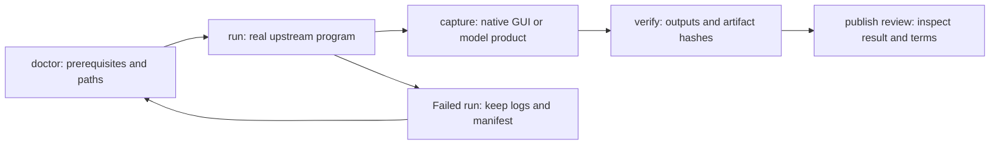

# Twelve experiments across Physical AI

[English](EXPERIMENTS.md) · [한국어](EXPERIMENTS.ko.md) · [Run and verify a lab](cli/README.md)

Start with an observable question, run the real tool, then keep the inputs and the evidence needed to check the answer. This casebook separates newly measured results, older runs and proposed follow-up experiments. Status snapshot: **2026-11-19**; queued experiments are not completed results.

| Area | Experiment | Current evidence |
|---|---|---|
| Robotics | 1. GR00T: lifting versus placing | New inference completed; **0/2 placements**, both trials lifted |
| Robotics | 2. cuRobo: avoid a new obstacle | New planning passed; 10.6-second native GUI replay recorded |
| Robotics | 3. Microduck: learning to balance | Earlier training artifacts only; no new run |
| Physics | 4. Friction and bounce | New friction GUI capture passed; bounce follow-up prepared |
| Physics | 5. XPBD versus VBD cloth | Both official tests passed; native GUI recordings made |
| Physics | 6. A twisting cable | Official default example passed and was recorded; stiffness sweep planned |
| World models | 7. Left/right image-to-video | Both 49-frame, 24 FPS generations completed; requested cube motion weak |
| World models | 8. Camera-conditioned generation | Actual CLI run passed: 61 frames at 30 FPS, camera-action input `[60,9]` |
| World models | 9. Find a clip by its meaning | Proposed retrieval experiment; not run |
| Driving | 10. Alpamayo on synthetic cameras | Actual seeded inference passed; 64 finite future poses, 5.76 GiB peak allocation |
| Driving | 11. AlpaSim closed-loop driving | Earlier local live run confirmed; public media held for terms review |
| Driving | 12. AlpaGym reward inspection | Proposed experiment; no rollout or training run claimed |

## Robotics

### 1. Can GR00T put the object down in the right place?

- **Observable outcome:** distinguish picking up a cube from placing it inside the bowl.
- **Input → output:** camera observations, robot state and task instruction → policy actions, simulated robot motion, episode JSONL and GUI footage. A successful lift is an intermediate event, not task completion.
- **Current result:** the new two-trial run completed with **0/2 placements**. Both trials lifted the object, at 55.87 and 28.47 simulated seconds. Earlier successful runs are kept separately in [recorded-70s.jsonl](gr00t-placement/recorded-70s.jsonl); their different layouts do not establish success on the new trials.
- **Next experiment and acceptance:** hold the initial layout and seed fixed, inspect where release/placement diverges, and repeat. Require Arena's final success to agree with `object_on_destination` and the visible final position. Keep failed attempts beside successes.
- **Implementation:** [runner and checker](gr00t-placement/), [official Arena GR00T workflow](https://isaac-sim.github.io/IsaacLab-Arena/release/0.3.1/pages/quickstart/running_a_real_policy/gr00t.html), [official model](https://huggingface.co/nvidia/GR00T-N1.6-DROID).

### 2. Can a robot arm reach the same target after an obstacle appears?

- **Observable outcome:** compare the original path with a path that bends around a newly added red box.
- **Input → output:** Franka start joints, target tool pose and cuboid geometry → baseline/replanned joint trajectories, tool coordinates and robot collision spheres in `motion.npz`.
- **Current result:** the new GPU run produced **24/26 waypoints**, zero difference between final tool positions, and **2.17 mm minimum sampled sphere clearance**. This clearance covers stored collision-sphere samples; cuRobo performs its own trajectory collision validation. The new result was recorded as a **10.6-second native GUI replay**: [watch the collision-geometry comparison](../site/public/showcase/curobo-replan.mp4).
- **Acceptance:** identical start state and tool goal, the old tool path crosses the new obstacle, and the replanned path avoids it. Review the complete arm, not only its tool marker. Do not compare cold and warmed-up timings as equivalent benchmarks.
- **Implementation:** `curobo-replan` in the [CLI](cli/README.md), [scene generator](robot-motion/make_scene.py), [official motion-planning tutorial](https://nvlabs.github.io/curobo/latest/getting-started/motion_planning.html). The generated USD shows **saved collision geometry**, not a full Franka visual mesh or live policy.

### 3. Does the learned Microduck policy balance better?

- **Observable outcome:** compare early and late checkpoints responding to the same walking command.
- **Input → output:** body/joint observations and velocity commands → policy joint actions and Newton motion; training logs and checkpoint files preserve the learning history.
- **Current evidence:** earlier training logs and an exported ONNX file exist. No new training or evaluation run is claimed. The existing replay script requires a trained `.pt` checkpoint and uses **Newton OpenGL**, not Isaac Sim GUI.
- **Next experiment and acceptance:** find the original checkpoints, use identical seeds/commands, and record falls, completed episode length and commanded-versus-measured velocity. A higher training reward alone is insufficient; no real-robot deployment is implied.
- **Implementation:** [training and replay scripts](microduck/), [official Microduck training guide](https://isaac-sim.github.io/IsaacLab/main/source/how-to/train_microduck.html).

## Physics engines

### 4. Why does one object slide farther or bounce higher?

- **Observable outcome:** compare three friction settings, then three restitution settings with a fixed camera and matched geometry.
- **Input → output:** authored USD materials, initial poses and physics settings → live PhysX body positions, an actual Isaac Sim window recording and a numeric summary.
- **Current result:** the new `physics-friction` native GUI run passed its position-based ordering checks. Bounce is an existing prepared experiment; a fresh bounce pass is not claimed here.
- **Acceptance:** use the same initial conditions, inspect the position samples and require low friction to travel farther. For bounce, compare post-contact peaks rather than release height. Keep the saved physics summary consistent with the samples and video.
- **Implementation:** `physics-friction` / `physics-bounce` in the [CLI](cli/README.md), [capture source](physics/capture_gui.py), [official simulation fundamentals](https://docs.isaacsim.omniverse.nvidia.com/latest/physics/simulation_fundamentals.html).

### 5. How do XPBD and VBD cloth behave in the same setup?

- **Observable outcome:** watch the hanging cloth stretch, fold and settle under each solver.
- **Input → output:** official cloth example, fixed mesh size and solver selection → simulated point arrays saved as animated USD, then a separate review-camera layer.
- **Current result:** both official examples completed **240 frames** with their upstream `--test` checks passing; native Isaac Sim GUI recordings were made. In that GUI, the Newton solver states are **replayed**, not simulated by PhysX.
- **Acceptance:** verify finite animated arrays and upstream tests, then compare matched frame ranges. Keep timestep, mesh, material and iteration settings with each run; different numerical methods/settings do not automatically produce interchangeable material behavior.
- **Implementation:** [Newton runner](newton-materials/run.py), [official cloth source](https://github.com/newton-physics/newton/blob/main/newton/examples/cloth/example_cloth_hanging.py).

### 6. How does a cable respond to twisting and stiffness changes?

- **Observable outcome:** inspect the shape of a twisted cable, then test how a documented stiffness parameter changes that shape.
- **Input → output:** official cable geometry, constraints and solver settings → animated point arrays, USD and GUI replay.
- **Current result:** the official **default cable-twist** example completed 240 frames and passed upstream tests; its native GUI replay was recorded. A stiffness sweep has **not** been run.
- **Next experiment and acceptance:** first check which parameters the pinned example exposes, vary one at a time, and retain identical initial conditions. Require finite states and passing upstream tests; plot or inspect displacement/shape alongside each setting before claiming a material comparison.
- **Implementation:** [Newton runner](newton-materials/run.py), [official cable source](https://github.com/newton-physics/newton/blob/main/newton/examples/cable/example_cable_twist.py).

## World models and their data workflows

### 7. Will the same image produce the requested left/right movement?

- **Observable outcome:** put two generated clips beside the same original workbench frame and check which objects actually move.
- **Input → output:** self-authored simulator PNG, directional prompt and seed → **49-frame Cosmos3-Edge generated video** and an upstream success receipt.
- **Current result:** both left/right generations completed at **49 frames, 24 FPS**, but the requested cube movement was visually weak. Completion is not evidence of prompt adherence or physically correct motion. Inspect the saved [left result](world-driving/evidence/cosmos-left/) and [right result](world-driving/evidence/cosmos-right/) with their upstream receipts.
- **Acceptance:** verify decoding/frame count and inspect cube displacement, stationary reference objects and camera stability. Retain imperfect generations as evidence. Match image, seed and sampling settings when comparing prompts.
- **Implementation:** [world-model/driving lab](../docs/en/labs/world-driving.md), [input preparation](world-driving/make_cosmos_input.py), `cosmos-i2v` in the [CLI](cli/README.md), [official framework](https://github.com/NVIDIA/cosmos-framework), [model](https://huggingface.co/nvidia/Cosmos3-Edge).

### 8. Does camera conditioning control the generated viewpoint?

- **Observable outcome:** compare a fixed-view clip with a clip conditioned on an explicit supported camera movement.
- **Input → output:** original image, prompt and the pinned model's supported camera conditioning → generated frames and inference receipts. This is a generation control, not a simulator camera rendering a known 3D world.
- **Current result:** the actual camera-action CLI run passed its completion checks and produced **61 frames at 30 FPS** from a **`[60,9]` camera-action input array**. This establishes a completed conditioned generation, not measured viewpoint-control accuracy.
- **Acceptance:** first confirm the checkpoint/CLI supports the selected conditioning fields. Record the exact values. Check viewpoint change, scene consistency and unwanted object motion separately; an accepted argument is not proof that conditioning worked.
- **Implementation reference:** [world-model/driving lab](../docs/en/labs/world-driving.md), [official Cosmos framework](https://github.com/NVIDIA/cosmos-framework). Record the additional camera-action arguments alongside the generic image-to-video settings when reproducing this case.

### 9. Can text find the right simulator clip?

- **Observable outcome:** search for “robot places a cube in a bowl” and inspect timestamped candidate clips.
- **Input → output:** authorized simulator clips and a text query → video/text embeddings, vector index and ranked clip references. Similarity retrieves candidates; it does not certify that placement succeeded.
- **Current status:** a proposed Cosmos Dataset Search experiment, **not run**. Existing explanatory guides are not execution evidence.
- **Acceptance:** create a small hand-labeled success/failure set, preserve source timestamps and index/model versions, then measure whether the correct clips appear in the top results. Reopen each source clip to check the evidence.
- **Implementation reference:** [local guide](../docs/en/cosmos-embed-search.md), [official CDS source](https://github.com/NVIDIA-Omniverse-blueprints/cosmos-dataset-search), [official architecture](https://docs.nvidia.com/cosmos/cds/latest/introduction.html). Service/model access and terms remain prerequisites.

## Autonomous driving

### 10. What does Alpamayo return from synthetic camera observations?

- **Observable outcome:** show the camera inputs, predicted future positions and the reasoning field actually returned by the model beside the synthetic scene.
- **Input → output:** six cameras across a rendered **22-frame input sequence**, ego history and navigation text → model output including 64 future poses, saved tensors and a receipt. Tensor axes and camera/timestamp ordering must be read from the actual input manifest.
- **Current result:** the actual CLI run with **seed 19** passed the synthetic interface checks and saved **64 finite future poses**, using **5.76 GiB peak allocated GPU memory**. Its reasoning output was the token **`<NOMINAL>`**, not a detailed causal explanation. The run does not establish driving quality. The [six-camera input evidence](world-driving/evidence/synthetic-intersection/) includes its authored scene and GUI footage.
- **Acceptance:** require finite `pred_xyz` shape `[1,1,1,64,3]` and `pred_rot` shape `[1,1,1,64,3,3]`, matching saved tensor contents, and inspect coordinates against the declared ego frame. Label the run **synthetic interface testing**, not closed-loop driving or a safety benchmark.
- **Implementation:** [world-model/driving lab](../docs/en/labs/world-driving.md), [synthetic runner](world-driving/run_alpamayo_synthetic.py), `alpamayo-synthetic` in the [CLI](cli/README.md), [official code](https://github.com/NVlabs/alpamayo2-edge), [model](https://huggingface.co/nvidia/Alpamayo2-Edge).

### 11. Does the policy actually close the driving loop?

- **Observable outcome:** watch policy actions change the next rendered observation and subsequent steering decisions.
- **Input → output:** an authorized reconstructed scene, a policy and an episode configuration → repeated observation/action exchanges, ego trajectory, metrics and recorded views.
- **Current evidence:** an earlier local AlpaSim live closed-loop run was confirmed. It is not a new run in this session. Public sharing of its reconstructed-scene output is held pending the applicable dataset/model/output terms review.
- **Acceptance:** verify service calls and episode steps, distinguish initialization/ground-truth motion from policy-controlled steps, and inspect collisions and route progress. A saved trajectory played in Isaac Sim is not, by itself, proof of closed-loop execution.
- **Implementation reference:** [existing workflow](../docs/en/workflows/alpasim-closed-loop.md), [official AlpaSim code](https://github.com/NVlabs/alpasim). Preserve locally accessible evidence while publication eligibility is unresolved.

### 12. What does an AlpaGym reward actually reward?

- **Observable outcome:** compare two drives with their separate collision, progress and tracking terms before looking at the total score.
- **Input → output:** episode metrics and resolved reward weights → per-term contributions, total reward and, in a later training run, rollout data for optimization.
- **Current status:** planned; no new AlpaGym rollout, reinforcement-learning update or improved policy is claimed. The worked values in our guide come from an upstream **unit test**, not a measured driving episode.
- **Acceptance:** reproduce the pinned reward test first. Then require live rollout provenance before reporting driving scores, keep held-out routes and compare collision/progress separately so a larger reward cannot hide worse behavior.
- **Implementation reference:** [reward explanation](../docs/en/alpagym.md), [official AlpaGym](https://github.com/NVlabs/alpagym), [pinned reward test](https://github.com/NVlabs/alpagym/blob/972d160eed0e23d388497851504a3a233fec5879/packages/runtime/src/alpagym_runtime/rewards/tests/test_compute.py).

## One execution and evidence workflow

This repository's [small CLI harness](cli/README.md) follows a CLI-Anything-inspired command-and-evidence pattern; it is **not an official CLI-Anything integration**. `run.json` records the command, source/input hashes, execution mode and checks. Capture is included in the live physics recipes and is a separate step for saved planner/USD results. Model generation and inference products retain their own scope labels. Passing a file or numeric check is followed by visual review and a publication decision, not automatic claims of task success.
