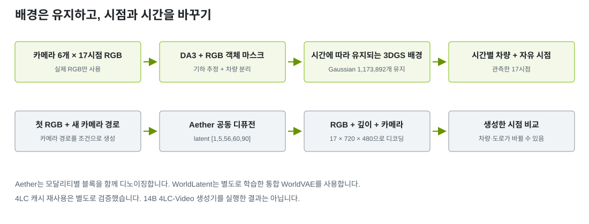

# 배경을 유지하는 Reality View와 공동 디퓨전 실험

[English](README.md) · [상위 실습](../README.ko.md) · [모델 설치](../unified/README.ko.md)

학습한 배경은 유지하면서 차량·시간·시점을 바꾸고, 카메라 경로를 조건으로 생성한 디퓨전 결과도 비교합니다. 이전 비교 모드도 그대로 열 수 있습니다.



## 실제로 실행한 세 가지 실험

| 실험 | 사용한 구성 | 결과 |
|---|---|---|
| 배경·차량 분리 | 이전 NuRec RGB 학습 모델 + 실제 RGB 객체 마스크 + DA3 깊이 | 배경 Gaussian 1,173,892개와 선택한 시간의 차량 메시 |
| 공동 디퓨전 | 공개 AetherV1 + 첫 RGB + 좌·우 카메라 경로 | 실제 공동 디노이징 상태 `[1,5,56,60,90]`와 경로별 RGB·깊이·카메라 17장 |
| 캐시 재사용 | 공식 4LC의 독립 `latent-cache` 라이브러리 | RGB 관측 이력의 재투영, 별도로 Aether의 RGB·disparity 특징 재사용 |

4LC 실험은 14B 4LC-Video 생성기나 WorldMirror를 실행하지 않습니다. 공개 뷰어는 저장된 3DGS·차량 자료를 표시하며, 브라우저에서 Python 캐시나 디퓨전을 실행하지 않습니다. 생성 영상의 차량은 실제 객체 인식이나 주행 정책의 관측 근거로 사용하지 않습니다.

## 시간축 latent만으로 장면이 채워지지는 않는 이유

[WorldLatent](https://worldlatent.github.io/)는 RGB·깊이·카메라 ray의 방향과 moment를 **학습된 하나의 bottleneck**으로 합치는 WorldVAE를 사용합니다. 논문에서는 입력 17×512×512를 `5×64×64×32` latent로 압축하고, 이 공간에서 14B 디퓨전 모델을 학습합니다. 2026-11-25 확인 기준으로 프로젝트 페이지에서 실행 가능한 추론 코드·가중치 공개본은 찾지 못했습니다. 기본 Wan 가중치로 이 학습 결과를 대신할 수는 없습니다.

Aether는 RGB 16개·disparity 16개·카메라 24개 채널을 함께 디노이징합니다. 카메라 채널은 방향과 signed-log **origin**이며, Plücker moment가 아닙니다. 이 실제 상태를 저장했다고 WorldLatent의 통합 WorldVAE를 구현한 것은 아닙니다. 4LC 특징 투영의 `(4,4)` 정수 앵커도 캐시에서 정한 표본 위치이며, VAE 수용 영역의 정확한 경계라는 뜻은 아닙니다.

디코딩한 RGB·깊이·카메라는 영상 시퀀스입니다. 자유 시점으로 돌아볼 장면에는 기하 구성, 가림 처리, 시간별 객체 분리가 더 필요합니다. 이전 뷰어는 현재 시간의 표면만 표시해 빈 영역이 남았습니다. 새 기본 모드는 이전의 조밀한 NuRec 모델을 활용해 배경을 유지합니다. **더 많은 학습 영상과 연산을 쓴 모델을 재사용한 결과**이므로, 같은 조건에서 복원 정확도가 높아졌다는 비교와는 구분해야 합니다.

## RTX 5090 한 장에서 측정한 결과

| GPU 작업 | 입력·설정 | 시간 | 최대 할당 메모리 |
|---|---|---:|---:|
| Aether 복원 + latent 저장 | 17×720×480, 4단계 | 21.27초 | 14.58GiB |
| Aether 오른쪽 시점 생성 | 17×720×480, 50단계 | 80.34초 | 14.57GiB |
| Aether 왼쪽 시점 생성 | 17×720×480, 50단계 | 79.87초 | 14.58GiB |
| 4LC RGB 캐시 구성 | 카메라 6개×17시점, 140×252 격자 | 1.27초 | RGB 캐시 실험에서 0.38GiB |
| 4LC 카메라 6개 이력 결합 | 옆으로 이동하는 가상 시점 17개 | 0.31초 | 같은 실험 |
| Aether 실제 특징 읽기 | 5×60×90×32 특징 | 0.0166초 | 별도로 측정하지 않음 |

RGB 캐시에서 표본이 채워진 픽셀의 비율은 전방 카메라 이력의 평균 **83.76%**에서, 카메라 6개 이력을 결합한 **91.58%**로 늘었습니다. 같은 시점 경로 17개에서 측정한 **재투영 점유율**이며 영상·깊이 정확도나 별도 검사 데이터의 성능이 아닙니다. 현재 시간의 카메라 6개 메시와 비교한 수치도 아닙니다. 이 점유율 실험에서는 RGB 값이 특징이며, Aether 학습 특징을 사용하는 검사는 별도로 실행했습니다.

모두 단일 실행의 GPU 동기화 측정입니다. 생성 시간에는 모델 로딩 5~8초, 설치, 파일 저장, 전송, 브라우저 표시가 포함되지 않습니다. 캐시 읽기 속도를 RGB 생성 속도나 실시간 FPS로 해석하면 안 됩니다. Aether는 생성 중 차량을 바꾸거나 없애기도 해 관측 장면에 바로 합치지 않았습니다. RGB-D 표면 누적도 시험했지만 고화질 3DGS보다 덜 선명해 기본 화면으로 선택하지 않았습니다.

RTX 5090의 실제 하드웨어 렌더링도 별도로 확인했습니다. 1920×1080 캔버스의 Chrome에서 이전 메시와 새 배경·차량 분리 모드 모두 약 **60FPS**를 유지했습니다. 프레임 간격 p95는 각각 **16.70 / 16.80ms**입니다. 약 60Hz로 제한된 브라우저 검사이며, 최대 처리량이나 모바일 성능, AI 추론 FPS를 뜻하지 않습니다. 측정 중 다른 GPU 서비스도 메모리에 남아 있었습니다. [측정 자료](evidence.json)를 함께 확인할 수 있습니다.

## 직접 실행하기

먼저 [RGB-only NuRec 실습](../README.ko.md)과 [DA3·Aether 설치](../unified/README.ko.md)를 완료합니다. 그 과정에서 만든 `calibrated` 기하, 실제 RGB 객체 인식 파일, 표시용 Gaussian PLY를 사용합니다. 큰 원본과 체크포인트는 Git 밖의 작업 폴더에 보관합니다.

```bash
export RV_DENSE_ROOT="$HOME/physical-ai-labs/reality-dense"
mkdir -p "$RV_DENSE_ROOT"
python3 labs/nurec-rgb-reality/dense/fuse.py \
  --geometry /path/to/da3-surround-priors/geometry.npz \
  --scene site/public/showcase/reality-joint-geometry/scene.json \
  --perception site/public/showcase/nurec-rgb-reality/perception.json \
  --out "$RV_DENSE_ROOT/fusion"
python3 labs/nurec-rgb-reality/dense/mask_gaussians.py \
  --ply /path/to/production/gaussians/background/model.ply \
  --cache-input "$RV_DENSE_ROOT/fusion/cache-input.npz" \
  --out "$RV_DENSE_ROOT/static"
npm exec --yes --package=@playcanvas/splat-transform@3.12.0 -- splat-transform \
  "$RV_DENSE_ROOT/static/static-background.ply" --filter-harmonics 1 \
  "$RV_DENSE_ROOT/static/static-background.spz" --spz-version 3
```

`fuse.py`는 RGB-D 표면 누적 실험과 공통 캐시 입력을 만듭니다. 최종 기본 화면은 이 표면 대신 필터링한 학습 Gaussian을 사용합니다. `mask_gaussians.py`는 두 개 이상의 실제 RGB 시점에서 객체 마스크와 예측 깊이가 `max(0.3,0.04×Z)` 이내로 일치할 때만 Gaussian을 제외합니다. 검출 실패와 깊이 오차는 남을 수 있습니다. 마스크에는 주차된 차도 포함되므로, 전경을 모두 움직이는 물체로 판단하는 것은 아닙니다.

앞선 실습의 고정된 Aether 컨테이너·모델·읽기 전용 어댑터 마운트를 그대로 사용하고, 실행 인자를 다음처럼 지정합니다.

```bash
# 앞선 실습과 같은 컨테이너 경로에서 실행합니다.
python /adapters/run_aether.py \
  --upstream /workspace/Aether --models /workspace/models \
  --images /workspace/crop --out /workspace/aether-right \
  --camera-from /workspace/aether-17-480/geometry.npz \
  --camera-truck 0.12 --steps 50 --save-joint-latent
```

왼쪽은 `--camera-truck -0.12`와 새 출력 폴더를 사용합니다. 이동량은 0부터 첫 프레임의 예측 깊이 중앙값의 12%까지 증가하며, 실측 미터가 아닙니다. `joint-latent.npy`는 공식 디코더 직전에 저장한 실제 최종 디노이징 텐서입니다. `latent.json`에는 모양·채널 의미·해시를 남깁니다. 고정한 공식 저장소는 수정하지 않고 계측용 복사본만 만듭니다.

4LC는 별도 PyTorch 환경에서 다음 버전의 라이브러리를 사용합니다.

```bash
git clone https://github.com/ZGCA-HMI-Lab/4LC.git "$RV_DENSE_ROOT/4LC"
git -C "$RV_DENSE_ROOT/4LC" checkout c44132ab231aaa3e31d4ac45d742d6fb76bb9b21
python3 labs/nurec-rgb-reality/dense/cache_benchmark.py \
  --upstream "$RV_DENSE_ROOT/4LC" \
  --input "$RV_DENSE_ROOT/fusion/cache-input.npz" \
  --aether /path/to/aether-recon-latent-17 \
  --out "$RV_DENSE_ROOT/cache-readout"
python3 labs/nurec-rgb-reality/dense/check.py
```

호출자가 제공한 DA3 기하를 사용하므로 WorldMirror나 동영상 생성 모델을 초기화하지 않습니다. `export_dense.py`는 완료된 실험에서 GPU 없이 볼 뷰어 자료를 만듭니다. 체크포인트, latent 원본, 대형 PLY와 실행 로그는 Git에 넣지 않습니다.

## 공식 자료와 이용 조건

- [WorldLatent 논문](https://arxiv.org/abs/2611.31209): 구조를 참고했으며 모델은 실행하지 않았습니다.
- [Aether](https://github.com/Sage-PhysicalAI/Aether): 앞선 실습의 버전 사용. 코드 MIT, 모델·기반 모델 조건은 [설치 문서](../unified/README.ko.md)에 정리했습니다.
- [4LC](https://github.com/ZGCA-HMI-Lab/4LC): 독립 라이브러리 MIT. 가중치·동영상 생성 모듈은 사용하지 않았습니다.
- DA3-BASE Apache-2.0, NuRec 실행 조건, RGB 데이터 출처는 [SOURCES](../SOURCES.md)를 따릅니다. 새 도로 파생 자료에도 PandaSet 출처와 CC BY-SA4.0 + 원본 Dataset Terms를 보수적으로 유지합니다.
