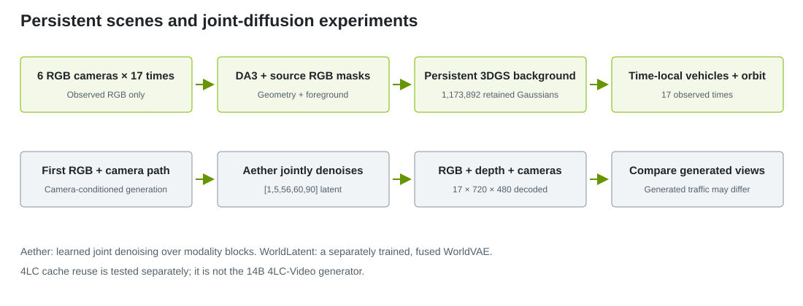

# Persistent Reality View and joint-diffusion experiments

[한국어](README.ko.md) · [Parent lab](../README.md) · [Public models/setup](../unified/README.md)

Keep a learned background while changing scene time, and compare genuine camera-conditioned diffusion outputs. The viewer preserves every earlier mode.



## Three separate experiments

| Experiment | What actually runs | Output |
|---|---|---|
| Persistent display | Earlier NuRec RGB-trained 3DGS, source-RGB masks and DA3 depth | 1,173,892 retained background Gaussians + selected-time textured foreground meshes |
| Joint diffusion | Public AetherV1, first RGB + a left/right camera path | Actual jointly denoised `[1,5,56,60,90]` state and 17 decoded RGB/depth/camera frames per path |
| Cache reuse | Official 4LC standalone `latent-cache` library | Reprojected RGB history and, separately, actual Aether RGB/disparity feature blocks |

The 4LC experiment does **not** run the 14B 4LC-Video generator or WorldMirror. The public interactive viewer uses the packaged 3DGS/foreground assets; it does not execute the Python cache or diffusion online. Aether-generated traffic is never used as observed detector/policy evidence.

## Why a temporal latent does not automatically fill a scene

[WorldLatent](https://worldlatent.github.io/) trains a WorldVAE to fuse RGB, depth and camera-ray direction/moment into one learned bottleneck. Its paper describes 17×512×512 inputs and a `5×64×64×32` latent. The 14B diffusion model operates in that learned space. As checked on 2026-11-25, no executable inference/weight release was located through the project page. Base Wan weights cannot replace its trained WorldVAE and diffusion checkpoint.

Aether instead jointly denoises modality blocks: RGB16 + disparity16 + packed camera24. Its camera representation is direction plus signed-log **origin**, not Plücker moment. Capturing its real denoising state does not reproduce WorldLatent’s learned fused codec. The 4LC latent projection uses integer `(4,4)` grid anchors as a cache convention, not a calibrated VAE receptive-field boundary.

Decoded RGB/depth/cameras describe a sequence. A persistent free-view scene still needs geometry, visibility handling and foreground separation. The earlier viewer showed only current-time surfaces, so holes remained even though a generative model had run. The new default reuses the earlier dense NuRec fit and separates foreground. This improves screen coverage over the frame-local mesh; it is **not** proof that the same-budget reconstruction model became more accurate. NuRec used a larger training/data budget.

## Actual single-RTX-5090 measurements

| GPU operation | Resolution/count | Time | Peak allocated memory |
|---|---|---:|---:|
| Aether reconstruction + latent capture | 17×720×480, 4 steps | 21.27 s | 14.58 GiB |
| Aether right camera generation | 17×720×480, 50 steps | 80.34 s | 14.57 GiB |
| Aether left camera generation | 17×720×480, 50 steps | 79.87 s | 14.58 GiB |
| 4LC RGB cache construction | 6 cameras×17 times, 140×252 grid | 1.27 s | 0.38 GiB for RGB-cache experiment |
| 4LC six-camera composition | 17 lateral query views | 0.31 s | same experiment |
| Actual Aether feature readout | 5×60×90×32 features | 0.0166 s | not measured separately |

The RGB cache’s mean occupied-pixel fraction increased from **83.76%** for the front-camera history to **91.58%** after composing six camera histories. This is reprojection occupancy, not image/depth accuracy, a held-out benchmark, or a comparison to the current-time six-camera mesh. RGB values are the features in this occupancy experiment; a separate readout caches the actual Aether learned state. Both compare the same 17 lateral query cameras at fixed scene time.

Timings are single-run synchronized GPU operations. Generation excludes model load (5–8 s), setup, serialization and browser/network work. Cache timing is not RGB synthesis time or live display FPS. Generated traffic can disappear or change; Aether is kept as an experimental comparison, rather than fused into observed geometry. Sparse surface fusion was also tried, but it was less sharp than the retained learned 3DGS and was not selected as the default.

Full HD hardware rendering was checked separately on the RTX 5090: the earlier mesh and new background/foreground mode both maintained approximately **60 FPS** in headless Chrome at a 1920×1080 canvas. Frame-interval p95 was **16.70 / 16.80 ms**, respectively. The browser is capped near60 Hz; these are not uncapped throughput, mobile performance or AI-inference FPS. Other GPU service(s) remained resident during rendering. See [machine-readable measurements](evidence.json).

## Reproduce

First finish the parent [RGB-only NuRec lab](../README.md) and [DA3/Aether setup](../unified/README.md). Use their saved `calibrated` geometry, source-RGB perception file and production Gaussian PLY. These are your own local outputs, outside Git.

```bash
export RV_DENSE_ROOT="$HOME/physical-ai-labs/reality-dense"
mkdir -p "$RV_DENSE_ROOT"
python3 labs/nurec-rgb-reality/dense/fuse.py \
  --geometry /path/to/da3-surround-priors/geometry.npz \
  --scene site/public/showcase/reality-joint-geometry/scene.json \
  --perception site/public/showcase/nurec-rgb-reality/perception.json \
  --out "$RV_DENSE_ROOT/fusion"
python3 labs/nurec-rgb-reality/dense/mask_gaussians.py \
  --ply /path/to/production/gaussians/background/model.ply \
  --cache-input "$RV_DENSE_ROOT/fusion/cache-input.npz" \
  --out "$RV_DENSE_ROOT/static"
npm exec --yes --package=@playcanvas/splat-transform@3.12.0 -- splat-transform \
  "$RV_DENSE_ROOT/static/static-background.ply" --filter-harmonics 1 \
  "$RV_DENSE_ROOT/static/static-background.spz" --spz-version 3
```

`fuse.py` creates a conservative RGB-D surfel experiment and the shared cache input. The shipped default uses the filtered learned Gaussian model, not those surfels. `mask_gaussians.py` removes a Gaussian only when source-RGB foreground masks and estimated depth agree in at least two views, within `max(0.3,0.04×Z)` relative units. Detector misses and depth errors still affect the result. Source masks include parked vehicles; “foreground” does not mean every detected vehicle is moving.

Using the pinned Aether image, models and read-only adapter mount from the previous setup, add these arguments to `run_aether.py`:

```bash
# Inside the same container layout as the preceding lab:
python /adapters/run_aether.py \
  --upstream /workspace/Aether --models /workspace/models \
  --images /workspace/crop --out /workspace/aether-right \
  --camera-from /workspace/aether-17-480/geometry.npz \
  --camera-truck 0.12 --steps 50 --save-joint-latent
```

Use `--camera-truck -0.12` for the left path and a fresh output directory. Offset ramps from zero to 12% of first-frame median predicted depth; it is not measured meters. `joint-latent.npy` contains the actual final denoising tensor captured just before upstream modality decoding. `latent.json` records shape, semantics and hashes. The pinned upstream checkout is not modified. Reconstruction with `--save-joint-latent` and no camera condition was checked against the earlier saved run.

For 4LC, install PyTorch in an isolated environment and use its pinned library:

```bash
git clone https://github.com/ZGCA-HMI-Lab/4LC.git "$RV_DENSE_ROOT/4LC"
git -C "$RV_DENSE_ROOT/4LC" checkout c44132ab231aaa3e31d4ac45d742d6fb76bb9b21
```

The cache program reads caller-supplied DA3 geometry, so it does not initialize WorldMirror or the video-generation stack.

```bash
python3 labs/nurec-rgb-reality/dense/cache_benchmark.py \
  --upstream "$RV_DENSE_ROOT/4LC" \
  --input "$RV_DENSE_ROOT/fusion/cache-input.npz" \
  --aether /path/to/aether-recon-latent-17 \
  --out "$RV_DENSE_ROOT/cache-readout"
python3 labs/nurec-rgb-reality/dense/check.py
```

The `export_dense.py` packager creates the GPU-free viewer assets from completed runs. Keep checkpoints, denoising tensors, original PLY files and full runtime logs outside Git.

## Sources and terms

- [WorldLatent paper](https://arxiv.org/abs/2611.31209): architecture reference; not executed.
- [Aether](https://github.com/Sage-PhysicalAI/Aether): pinned in the preceding lab; code MIT; model/base-model terms in [the setup](../unified/README.md).
- [4LC](https://github.com/ZGCA-HMI-Lab/4LC): standalone library MIT; weights/video stack not used.
- DA3-BASE Apache-2.0, NuRec runtime terms and RGB data credits remain in [SOURCES](../SOURCES.md). New road derivatives retain the PandaSet attribution and conservative CC BY-SA4.0 + original Dataset Terms notice.
